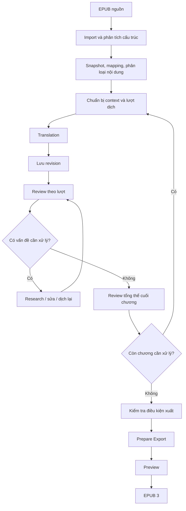
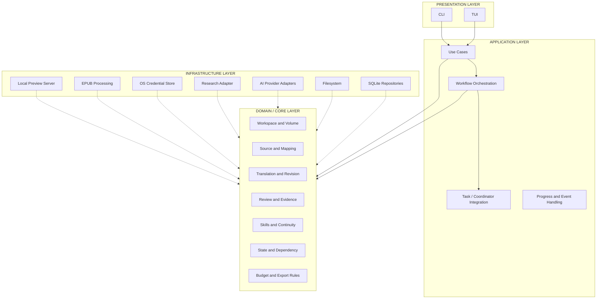
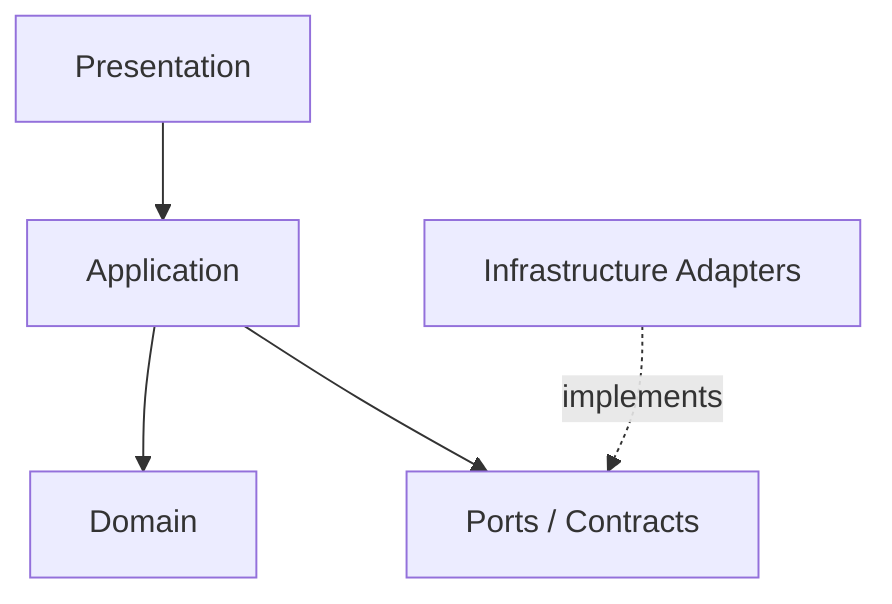
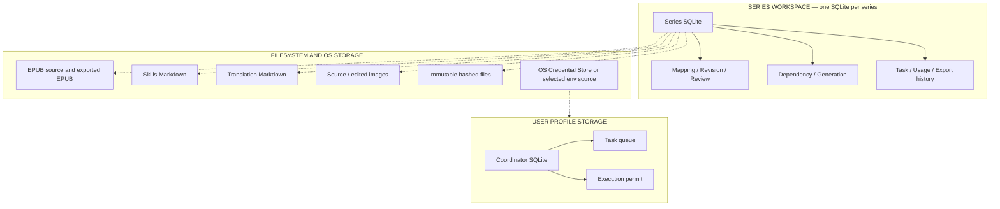
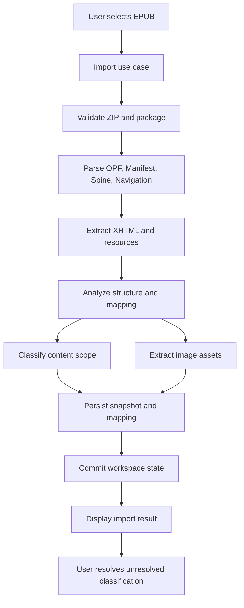
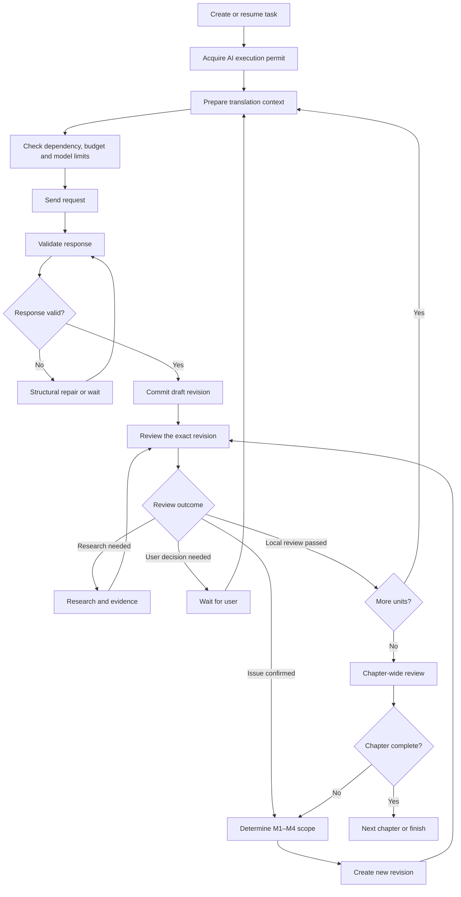
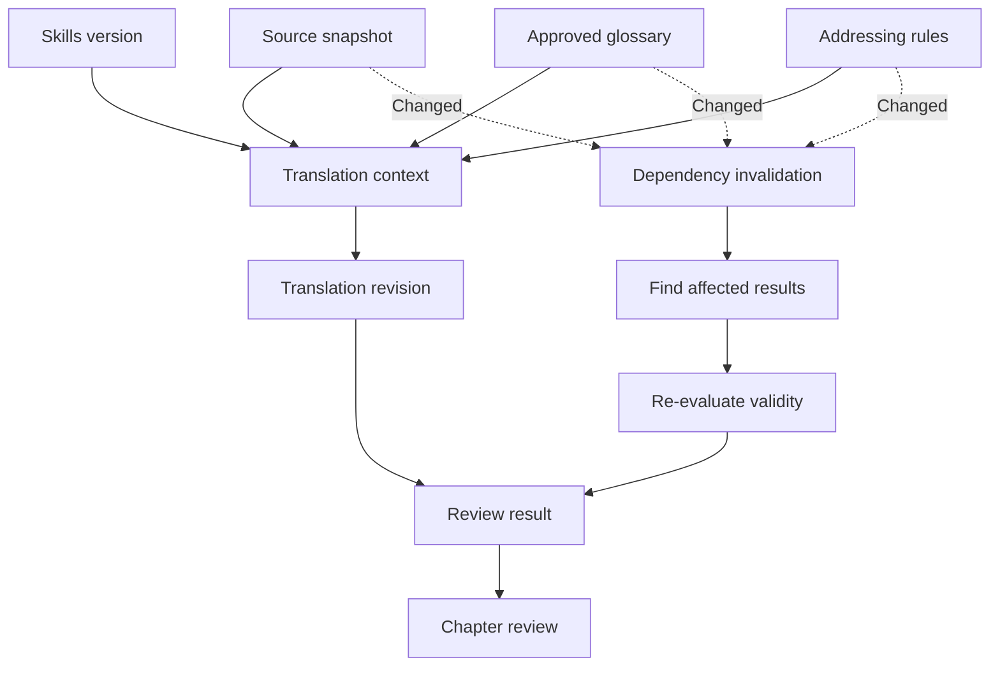
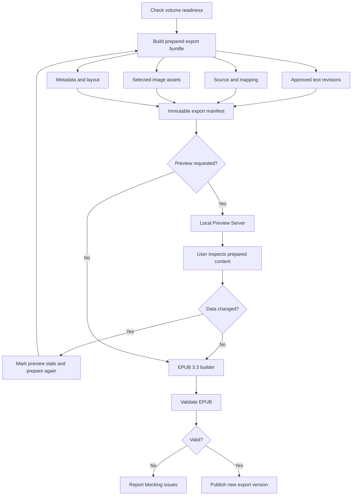
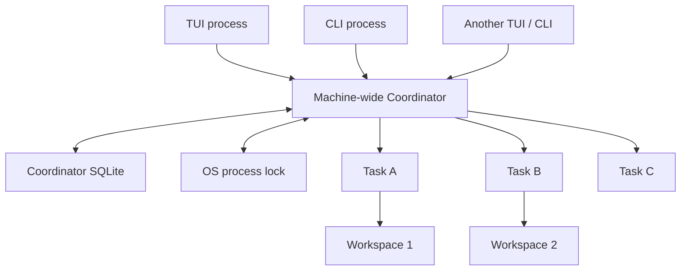
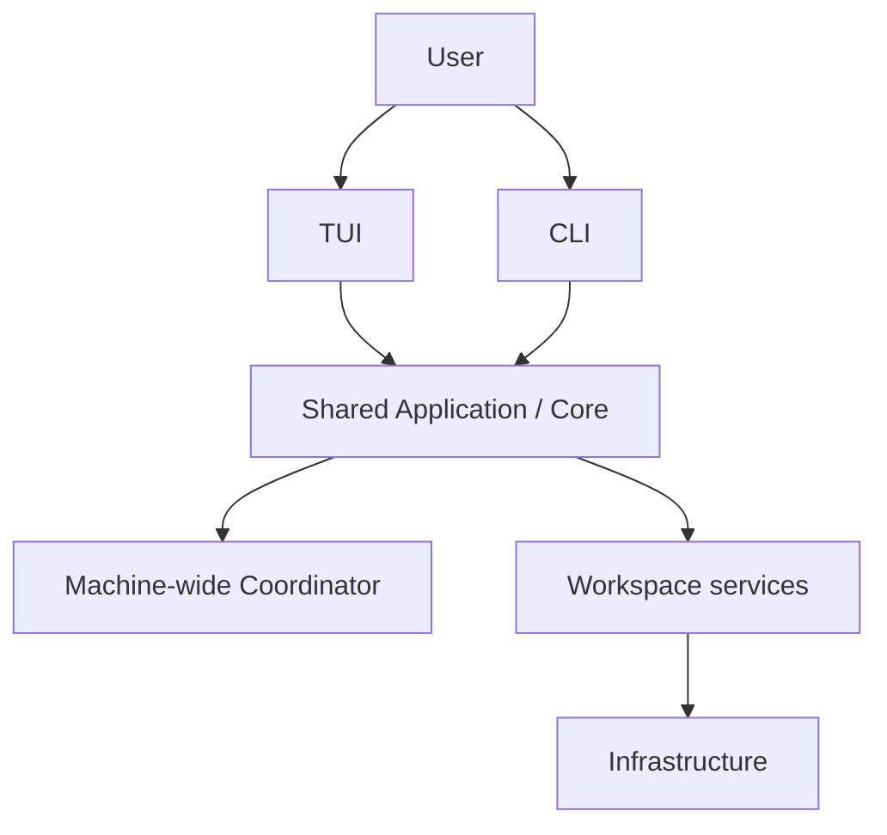

# ARCHITECTURE OVERVIEW
## novel-translate-cli

| Thuộc tính | Giá trị |
|---|---|
| Tài liệu | Architecture Overview |
| Giai đoạn | Step 1 – Architecture Overview |
| Phiên bản tài liệu | 0.1 |
| Ngày cập nhật | 04/11/2026 |
| Trạng thái | Bản tổng quan để rà soát và xác nhận |
| Phạm vi | Kiến trúc cấp hệ thống; chưa đi vào thiết kế subsystem, crate/module hoặc cây thư mục Rust |

---

## Mục lục

1. [Giới thiệu](#1-giới-thiệu)
2. [Phạm vi và mục tiêu kiến trúc](#2-phạm-vi-và-mục-tiêu-kiến-trúc)
3. [Các nguyên tắc và quyết định kiến trúc](#3-các-nguyên-tắc-và-quyết-định-kiến-trúc)
4. [Mô hình kiến trúc tổng thể](#4-mô-hình-kiến-trúc-tổng-thể)
5. [Các nhóm năng lực và subsystem ở mức tổng quan](#5-các-nhóm-năng-lực-và-subsystem-ở-mức-tổng-quan)
6. [Mô hình dữ liệu và ranh giới lưu trữ](#6-mô-hình-dữ-liệu-và-ranh-giới-lưu-trữ)
7. [Các luồng hoạt động cấp hệ thống](#7-các-luồng-hoạt-động-cấp-hệ-thống)
8. [Điều phối tác vụ AI và tích hợp model](#8-điều-phối-tác-vụ-ai-và-tích-hợp-model)
9. [Trạng thái, dependency và tính nhất quán](#9-trạng-thái-dependency-và-tính-nhất-quán)
10. [Bảo mật và các mối quan tâm xuyên suốt](#10-bảo-mật-và-các-mối-quan-tâm-xuyên-suốt)
11. [Presentation: TUI, CLI và Preview](#11-presentation-tui-cli-và-preview)
12. [Kiểm thử và nghiệm thu kiến trúc](#12-kiểm-thử-và-nghiệm-thu-kiến-trúc)
13. [Trade-offs và lý do lựa chọn](#13-trade-offs-và-lý-do-lựa-chọn)
14. [Phân biệt điều đã chốt, đề xuất và vấn đề còn mở](#14-phân-biệt-điều-đã-chốt-đề-xuất-và-vấn-đề-còn-mở)
15. [Ranh giới với Bước 2](#15-ranh-giới-với-bước-2)
16. [Tài liệu nguồn và tham chiếu](#16-tài-liệu-nguồn-và-tham-chiếu)

---

# 1. Giới thiệu

## 1.1. Tổng quan dự án

`novel-translate-cli` là công cụ hỗ trợ dịch Light Novel từ tiếng Nhật sang tiếng Việt, hoạt động trong môi trường Terminal. TUI là giao diện tương tác chính; CLI cung cấp các lệnh để thao tác trực tiếp hoặc tích hợp vào script.

Đầu vào và đầu ra chính của hệ thống đều là EPUB. Hệ thống quản lý quá trình dịch một bộ truyện nhiều tập, không chỉ gửi văn bản đến AI rồi nhận kết quả. Các năng lực chính gồm:

- Import và phân tích cấu trúc EPUB.
- Nhận diện nội dung, chương, part, block và tài nguyên.
- Quản lý nguyên tác, snapshot, mapping và phạm vi nội dung.
- Quản lý bản dịch, revision và lịch sử chỉnh sửa.
- Quản lý Skills, glossary, nhân vật và quy tắc xưng hô.
- Dịch bằng các AI model do người dùng cấu hình.
- Review bản dịch dựa trên nguyên tác và bằng chứng.
- Xác định phạm vi sửa, dịch lại và Review lại.
- Research khi cần tra cứu thêm căn cứ.
- Quản lý ảnh gốc và ảnh thay thế do người dùng chuẩn bị.
- Chuẩn bị dữ liệu, Preview và xuất EPUB 3.

## 1.2. Luồng nghiệp vụ khái quát



Sơ đồ thể hiện luồng nghiệp vụ tổng quát, không hàm ý mọi trường hợp đều chạy tuyến tính. Workflow có thể tạm dừng để chờ người dùng, gặp lỗi, cần Research hoặc phải tiếp tục từ checkpoint.

## 1.3. Phạm vi đầu vào và đầu ra

| Hạng mục | Phạm vi giai đoạn đầu |
|---|---|
| Đầu vào | EPUB 2 và EPUB 3 trong phạm vi hỗ trợ |
| Nội dung chính | XHTML có văn bản trích xuất được |
| Bố cục | Reflowable; có thể xen kẽ bìa, ảnh và trang fixed-layout thuộc phạm vi hỗ trợ |
| Ngôn ngữ | Tiếng Nhật sang tiếng Việt |
| Đầu ra | EPUB 3.3 |
| Giao diện | TUI và CLI |
| Preview | Trình duyệt cục bộ, chỉ phục vụ bản chuẩn bị |
| Lưu trữ | SQLite kết hợp filesystem |
| AI | Provider/model do người dùng cấu hình |

Không được suy diễn rằng giai đoạn đầu hỗ trợ OCR cho trang scan, manga cần nhận diện thứ tự đọc từ ảnh, hoặc mọi dạng EPUB tương tác/fixed-layout phức tạp.

## 1.4. Hai chế độ phạm vi nội dung

Người dùng có hai lựa chọn:

1. **Dịch toàn bộ phần chữ:** dịch phần văn bản đọc được theo phạm vi đã xác định, kể cả nội dung không phải truyện chính.
2. **Chỉ dịch nội dung truyện và phần liên quan:** phần ngoài phạm vi được giữ nguyên trong EPUB, không bị xóa và không bị gán nhãn đã dịch/đạt Review.

Mặc định của bộ mới là **Dịch toàn bộ phần chữ**. Lựa chọn có thể được thay đổi riêng cho từng tập; người dùng có thể lưu lựa chọn làm mặc định của bộ cho các tập tạo sau. Chữ nằm trong bitmap ảnh đi theo luồng ảnh riêng; không mặc định coi đó là văn bản đã OCR.

---

# 2. Phạm vi và mục tiêu kiến trúc

## 2.1. Mục tiêu

| ID | Mục tiêu | Ý nghĩa |
|---|---|---|
| AR-01 | Separation of Concerns | Tách giao diện, điều phối, quy tắc nghiệp vụ và hạ tầng |
| AR-02 | Modularity | Chia hệ thống thành các nhóm chức năng có ranh giới trách nhiệm rõ |
| AR-03 | Reusability | TUI và CLI dùng chung Application/Core |
| AR-04 | Extensibility | Có thể bổ sung provider, model và năng lực mới |
| AR-05 | Data Integrity | Bảo toàn nguồn, revision, quyết định, bằng chứng và lịch sử |
| AR-06 | Recoverability | Tiếp tục công việc sau khi ứng dụng đóng hoặc gặp lỗi |
| AR-07 | Consistency | Giữ nhất quán giữa nguồn, bản dịch, Review, dependency và EPUB xuất |
| AR-08 | Testability | Kiểm thử cục bộ, deterministic và offline khi có thể |
| AR-09 | Security | Bảo vệ API key, workspace và phiên Preview |
| AR-10 | Maintainability | Thay đổi một phần mà không gây ảnh hưởng dây chuyền không cần thiết |

## 2.2. Phạm vi kiến trúc

Tài liệu này mô tả:

- Mô hình kiến trúc cấp hệ thống.
- Các tầng trách nhiệm và quy tắc phụ thuộc.
- Nhóm năng lực/subsystem ở mức tổng quan.
- Ranh giới dữ liệu và lưu trữ.
- Các luồng nghiệp vụ và luồng kỹ thuật quan trọng.
- Điều phối AI, trạng thái, dependency, recovery.
- Bảo mật, giao diện, kiểm thử và trade-offs.

Tài liệu này **không** quyết định:

- Cây thư mục hoặc workspace layout của mã nguồn Rust.
- Danh sách crate/module cụ thể.
- Chi tiết struct, enum, trait hoặc chữ ký hàm.
- Schema SQLite chi tiết và câu lệnh migration.
- Chi tiết thuật toán nội bộ của từng subsystem.
- Thiết kế từng màn hình TUI ở cấp wireframe.

Các nội dung trên thuộc bước thiết kế chi tiết tiếp theo.

---

# 3. Các nguyên tắc và quyết định kiến trúc

## 3.1. Phân biệt nguồn yêu cầu và đề xuất kiến trúc

Trong tài liệu này, thông tin được phân thành ba loại:

- **[ĐÃ CHỐT]**: yêu cầu hoặc quyết định đã được người dùng xác nhận trong bộ đặc tả và [DESIGN_DECISIONS_36.md](../spec/DESIGN_DECISIONS_36.md).
- **[ĐỀ XUẤT KIẾN TRÚC]**: cách tổ chức kỹ thuật được đề xuất để hiện thực các yêu cầu đã chốt. Đây không tự động trở thành quyết định sản phẩm.
- **[CÒN MỞ]**: nội dung cần được quyết định hoặc làm rõ ở bước thiết kế chi tiết.

Không được biến một đề xuất kiến trúc thành yêu cầu đã chốt nếu chưa có xác nhận.

## 3.2. Nguyên tắc thiết kế

| Nguyên tắc | Nội dung |
|---|---|
| Separation of Concerns | Mỗi tầng và subsystem có trách nhiệm riêng |
| Dependency Inversion | Nghiệp vụ không phụ thuộc trực tiếp vào thư viện hoặc dịch vụ ngoài |
| Explicit State | Trạng thái phải được lưu và biểu diễn rõ, không suy đoán từ giao diện |
| Immutable Source | Nguyên tác và dữ liệu đã dùng làm căn cứ phải có thể truy vết |
| Incremental Processing | Chỉ đánh giá lại phần chịu ảnh hưởng khi dependency thay đổi |
| Fail Safely | Giữ kết quả hợp lệ, ghi nhận lỗi và phục hồi có kiểm soát |
| Explicit Approval | Đề xuất AI không tự trở thành quyết định chính thức |
| Deterministic Local Testing | Có thể kiểm thử các luồng cốt lõi bằng fixture và adapter giả lập |
| Versioned Decisions | Quyết định và quy tắc có phiên bản, phạm vi và lịch sử |
| No Silent Fallback | Không âm thầm đổi model, key, ngân sách, nguồn dữ liệu hoặc cách xử lý |

## 3.3. Các quyết định nền tảng đã chốt

| Chủ đề | Quyết định |
|---|---|
| Workspace | Một SQLite cho mỗi bộ truyện; các tập trong bộ dùng chung dữ liệu cấp bộ |
| Coordinator | Một SQLite riêng theo hồ sơ người dùng để quản lý hàng đợi AI toàn máy |
| File storage | EPUB nguồn, ảnh, Skills, Markdown và EPUB xuất nằm trên filesystem |
| Credential | API key thuộc OS Credential Store hoặc nguồn biến môi trường được người dùng chọn |
| Workspace Rust | Bắt đầu workspace mới, schema khởi đầu 1 |
| Workspace thử nghiệm Go | Không xây cơ chế chuyển workspace test cũ; tiếp tục giữ Go hoạt động cho đến khi bản thay thế đạt yêu cầu |
| Commit | Generation và Atomic Commit cho trạng thái nghiệp vụ |
| Revision | Bản dịch sửa tay/AI tạo revision mới; Review gắn với đúng revision |
| Dependency | Thay đổi căn cứ làm mất hiệu lực đúng phạm vi phụ thuộc, không mặc định toàn bộ |
| Task execution | Một tác vụ AI hoạt động tại một thời điểm theo hồ sơ người dùng trên máy |
| Retry | Có giới hạn; không retry vô hạn |
| Budget | Phải chọn rõ đặt hạn mức hoặc chạy không giới hạn |
| Translation | Response JSON có schema version và được kiểm tra cấu trúc trước khi lưu nháp |
| Review | Đọc nguyên tác trước, sau đó mới đối chiếu bản Việt |
| Quality | Mức lỗi S0–S3; phạm vi sửa M1–M4 |
| Repair | Tối đa năm vòng sửa–Review thất bại trước khi bàn giao cho người dùng |
| Research | Có giới hạn truy vấn, trang đọc và thời gian; bằng chứng phải có nguồn và mốc tiết lộ |
| Preview | Chỉ chạy cục bộ, có phiên truy cập riêng và giới hạn tài nguyên |
| Export | EPUB 3.3; mỗi lần xuất thành công tạo file phiên bản mới |

Chi tiết chính thức nằm trong 36 quyết định và các đặc tả chuyên ngành được liệt kê ở cuối tài liệu.

---

# 4. Mô hình kiến trúc tổng thể

## 4.1. Mô hình được đề xuất

**[ĐỀ XUẤT KIẾN TRÚC]** Sử dụng kết hợp:

- **Modular Monolith** để tổ chức ứng dụng thành các module logic có ranh giới rõ.
- **Layered Architecture** để chia trách nhiệm theo tầng.
- **Hexagonal Architecture (Ports & Adapters)** để kiểm soát sự phụ thuộc vào hạ tầng và dịch vụ bên ngoài.

Ba khái niệm này bổ trợ nhau, không phải ba phương án loại trừ lẫn nhau.

Các đặc tả nghiệp vụ hiện tại xác định hành vi và hợp đồng hệ thống, nhưng không bắt buộc một mô hình kiến trúc cụ thể. Việc chọn mô hình trên là đề xuất tổ chức implementation.

## 4.2. Vì sao Modular Monolith phù hợp

Các đặc điểm của sản phẩm:

- Ứng dụng chạy cục bộ trên máy người dùng.
- TUI và CLI cần dùng chung nghiệp vụ.
- Dữ liệu được tổ chức theo workspace và SQLite.
- Các bước Dịch, Review, Research, sửa và xuất có liên hệ chặt chẽ.
- Tác vụ AI được điều phối tập trung.
- Chưa có yêu cầu triển khai nhiều dịch vụ mạng độc lập.

Do đó, chưa có cơ sở nghiệp vụ rõ ràng để tách toàn hệ thống thành Microservices.

Điều này không có nghĩa mọi thành phần phải chạy trong cùng một tiến trình. Machine-wide Coordinator cần quản lý quyền chạy giữa nhiều tiến trình TUI/CLI; nó có thể cần cơ chế giao tiếp liên tiến trình. Đây vẫn có thể là một ứng dụng Modular Monolith ở cấp sản phẩm.

## 4.3. Sơ đồ bốn tầng



Sơ đồ mô tả trách nhiệm logic. Các mũi tên nét đứt biểu diễn việc adapter/hạ tầng hiện thực hoặc phục vụ hợp đồng được xác định ở phía trong; không có nghĩa Domain gọi trực tiếp mọi adapter.

## 4.4. Trách nhiệm từng tầng

| Tầng | Trách nhiệm | Không đảm nhận |
|---|---|---|
| Presentation | Nhận input, điều hướng, hiển thị dữ liệu và trạng thái, chuyển thao tác thành yêu cầu | Tự thực hiện nghiệp vụ, tự gọi provider hoặc tự ghi database |
| Application | Điều phối use case, workflow, quyền thực thi, tiến độ và phối hợp các dịch vụ | Tự thay đổi quy tắc Domain hoặc chứa chi tiết giao diện |
| Domain/Core | Thực thể, quy tắc nghiệp vụ, trạng thái, điều kiện hợp lệ, quyết định và dependency | Phụ thuộc framework TUI, HTTP client, SQLite hoặc OS API |
| Infrastructure | Hiện thực lưu trữ, provider, filesystem, parser, credential và preview | Tự quyết định trình tự nghiệp vụ hoặc tự duyệt kết quả |

## 4.5. Quy tắc phụ thuộc



Quy tắc:

1. Presentation giao tiếp với Application, không truy cập trực tiếp repository hay provider.
2. Application điều phối Domain và gọi các port cần thiết.
3. Domain không phụ thuộc Infrastructure.
4. Infrastructure hiện thực port/hợp đồng được khai báo ở phía trong.
5. Không tạo circular dependency.
6. Không để một use case bị bỏ qua bằng cách gọi thẳng database hoặc provider từ giao diện.
7. Các nhóm chức năng trao đổi qua hợp đồng rõ ràng, không đọc/ghi tùy tiện dữ liệu nội bộ của nhau.

## 4.6. Layer và Subsystem không phải một khái niệm

- **Layer** là tầng trách nhiệm kỹ thuật.
- **Subsystem** là nhóm năng lực/chức năng của sản phẩm.

Ví dụ, Translation là một subsystem nhưng có thể có phần ở nhiều layer:

| Layer | Ví dụ trách nhiệm thuộc Translation |
|---|---|
| Presentation | Màn hình Dịch, trạng thái, tiến độ và thao tác |
| Application | Use case Dịch, điều phối lượt và kiểm tra điều kiện |
| Domain | Revision, đơn vị dịch, quy tắc và tính hợp lệ |
| Infrastructure | Model adapter, tokenizer và repository |

Vì vậy, không nên mặc định một subsystem tương ứng đúng một crate, module hoặc thư mục.

---

# 5. Các nhóm năng lực và subsystem ở mức tổng quan

Đây là cách phân nhóm logic phục vụ Architecture Overview, chưa phải quyết định ranh giới crate/module.

| STT | Nhóm năng lực | Trách nhiệm chính |
|---:|---|---|
| 1 | Workspace Management | Quản lý bộ truyện, tập và cấu hình |
| 2 | EPUB Processing | Import, phân tích, phân loại và mapping nội dung |
| 3 | Translation | Tạo bản dịch, quản lý lượt dịch và revision |
| 4 | Review | Đọc nguồn, đối chiếu, bằng chứng, lỗi và sửa |
| 5 | Context & Skills | Văn phong, nhân vật, glossary, xưng hô và quy ước |
| 6 | Research | Tra cứu và quản lý bằng chứng bổ sung |
| 7 | Workflow & Task Management | Hàng đợi, điều phối, checkpoint và recovery |
| 8 | Model Integration | Provider, model, usage, giá và ngân sách |
| 9 | Image & EPUB Export | Ảnh, bộ dữ liệu chuẩn bị, Preview và EPUB |
| 10 | Persistence & Synchronization | SQLite, filesystem, revision, generation và đồng bộ |

Presentation là bề mặt tương tác xuyên suốt các nhóm. Persistence & Synchronization là năng lực kỹ thuật dùng chung, không phải một bước nghiệp vụ tuyến tính.

## 5.1. Workspace Management

Quản lý cấu trúc bộ truyện và các tập.

```text
Series
├── Series configuration
├── Common / Series Skills references
├── Characters and aliases
├── Glossary
├── Addressing rules
│
├── Volume 01
│   ├── EPUB source and snapshot
│   ├── Chapters and mapping
│   ├── Translation revisions
│   ├── Review results
│   └── Export history
│
└── Volume 02
    ├── EPUB source and snapshot
    ├── Chapters and mapping
    ├── Translation revisions
    ├── Review results
    └── Export history
```

Các tập trong cùng một bộ có thể dùng chung nhân vật, glossary, quy tắc xưng hô và dữ liệu cấp bộ. Dữ liệu theo tập vẫn cần giữ phạm vi và phiên bản riêng.

## 5.2. EPUB Processing

Tiếp nhận EPUB và chuyển đổi thành dữ liệu có cấu trúc để các năng lực khác sử dụng.

Trách nhiệm tổng quát:

- Đọc cấu trúc ZIP và package.
- Phân tích OPF, Manifest, Spine và Navigation/NCX.
- Trích xuất XHTML và tài nguyên.
- Nhận diện chương, part, trang phụ và nội dung liên quan.
- Giữ thứ tự đọc và mapping về nguồn.
- Nhận diện ruby, ảnh, chú thích, anchor và liên kết.
- Cho phép người dùng gộp/tách/dời ranh giới chương.
- Phân loại nội dung theo chế độ phạm vi.
- Chia nội dung thành các lượt phù hợp giới hạn model.
- Tách ảnh nguồn vào vùng quản lý riêng.

Import là hoạt động cục bộ; không tự gọi AI.

## 5.3. Translation

Tạo bản dịch theo phạm vi nguồn và context đã xác định.

Luồng trách nhiệm:

1. Nhận phạm vi cần dịch.
2. Kiểm tra dữ liệu, dependency và trạng thái.
3. Chuẩn bị context, Skills và quy tắc đã duyệt.
4. Lập lượt theo giới hạn model.
5. Gửi request qua adapter.
6. Kiểm tra response và cấu trúc.
7. Lưu revision hợp lệ.
8. Chuyển đúng revision sang Review.

Response của model không được công nhận là bản nháp hợp lệ chỉ vì parse được JSON. Core phải kiểm tra ID, thứ tự, số lần xuất hiện, marker và các tham chiếu cấu trúc cần bảo toàn.

## 5.4. Review

Đánh giá bản dịch so với nguyên tác.

Các trách nhiệm:

- Đọc nguyên tác và ngữ cảnh nguồn đã kiểm chứng trước.
- Chỉ đưa bản Việt vào request đối chiếu sau đó.
- Kiểm tra độ phủ nguồn → dịch và dịch → nguồn.
- Phát hiện thiếu ý, thêm ý, sai chủ thể, sai thời gian, phủ định và quan hệ.
- Lưu bằng chứng, trích dẫn và phạm vi.
- Phân loại mức độ S0–S3.
- Đề xuất phạm vi sửa M1–M4.
- Kiểm tra lại revision mới.
- Review tổng thể cuối chương.

Không dùng tổng điểm hoặc số lượng lỗi đơn thuần để quyết định dịch lại cả chương. Mức xử lý phải dựa trên phạm vi sai lệch và bằng chứng.

## 5.5. Context & Skills

Quản lý kiến thức dịch thuật có tính xuyên suốt.

Hai phạm vi chính:

- **Common Skills:** thư viện Markdown dùng chung.
- **Series Skills:** quy ước riêng của từng bộ truyện.

Mẫu Skill riêng của bộ có sáu mục:

1. Văn phong.
2. Nhân vật và bí danh.
3. Thuật ngữ và danh hiệu.
4. Địa danh.
5. Xưng hô.
6. Ngoại lệ.

Quy tắc cần có ID ổn định, phạm vi, phiên bản và lịch sử. Quy tắc xưng hô cần xác định chiều người nói → người nghe, cách tự xưng, cách gọi, hoàn cảnh và khoảng hiệu lực.

Đề xuất mới của AI phải qua duyệt. Thay đổi rõ ràng do người dùng lưu ngoài file Skill đã đăng ký được đồng bộ theo cơ chế đã chốt; phải phát hiện thay đổi bằng watcher và hash, bảo vệ xung đột, không ghi đè âm thầm.

## 5.6. Research

Tra cứu khi Dịch, Review hoặc người dùng cần thêm căn cứ.

Thứ tự ưu tiên:

1. Nguyên tác và ngữ cảnh nội bộ.
2. Skills, glossary và quyết định đã xác nhận.
3. Nguồn tham khảo và Internet.

Research phải lưu nguồn, trích đoạn, URL, thời điểm lấy, hash đoạn đọc, thực thể, mốc sự kiện và mốc sớm nhất độc giả được biết. Thông tin chưa rõ mốc tiết lộ không được đưa vào context dùng cho cảnh hiện tại.

Research không tự duyệt thuật ngữ hoặc quyết định cách dịch.

## 5.7. Workflow & Task Management

Điều phối tác vụ của hệ thống.

Có hai phạm vi:

- **Task workflow:** vòng đời một tác vụ Dịch/Review/Research, từ chuẩn bị đến hoàn tất, tạm dừng hoặc chờ người dùng.
- **Machine-wide Coordinator:** hàng đợi và quyền chạy AI dùng chung giữa nhiều workspace, cửa sổ và tiến trình.

Một tác vụ chờ người dùng hoặc đã tạm dừng không tiếp tục được lên lịch như tác vụ đang chạy. Khi bàn giao quyền, coordinator kiểm tra dependency và trạng thái lần gọi đang hoạt động.

## 5.8. Model Integration

Cung cấp hợp đồng giao tiếp thống nhất với provider/model.

Ba vai trò chính:

| Vai trò | Công việc |
|---|---|
| Translation | Tạo bản dịch |
| Review | Đọc nguồn và đánh giá bản dịch |
| Research | Tra cứu, bổ sung bằng chứng |

Ba vai trò có cấu hình riêng nhưng có thể dùng cùng model nếu người dùng lựa chọn. Adapter chuẩn hóa request, streaming, response, usage, lỗi và định danh model thực tế.

Không tự động đổi model hoặc credential khi request thất bại.

## 5.9. Image & EPUB Export

Quản lý ảnh gốc, ảnh thay thế và hoàn thiện sách.

- Ảnh gốc được tách vào `images/source/`.
- Ảnh do người dùng chuẩn bị nằm trong `images/edit/`.
- Đối chiếu chính xác đường dẫn tương đối, chữ hoa/thường và phần mở rộng.
- Ảnh thay hợp lệ được dùng trong bộ dữ liệu chuẩn bị.
- Ảnh thay khớp nhưng lỗi phải chặn xuất và chỉ rõ file cần sửa; không âm thầm dùng ảnh gốc thay thế.
- Preview và EPUB xuất sử dụng cùng bộ dữ liệu chuẩn bị.
- Đầu ra là EPUB 3.3.
- Mỗi lần xuất mới tạo phiên bản file mới, không ghi đè bản đã xuất trước.

## 5.10. Persistence & Synchronization

Năng lực nền tảng phục vụ hầu hết subsystem:

- Repository và lưu trữ trạng thái.
- Snapshot, mapping, revision và generation.
- Dependency tracking và invalidation.
- Event/history.
- Đồng bộ Markdown.
- Đồng bộ Skills.
- Khóa workspace và kiểm tra version trước commit.
- Checkpoint, recovery và migration.

---

# 6. Mô hình dữ liệu và ranh giới lưu trữ

## 6.1. Ba phạm vi lưu trữ



### A. Series Workspace

**[ĐÃ CHỐT]** Một SQLite cho mỗi bộ truyện. Các tập của cùng bộ tham chiếu dữ liệu cấp bộ.

SQLite lưu dữ liệu có cấu trúc:

- Mapping và snapshot metadata.
- Revision bản dịch.
- Quyết định và quy tắc.
- Dependency.
- Review và evidence.
- Tiến độ và trạng thái tác vụ.
- Sổ lần gọi, usage và chi phí.
- Hồ sơ chuẩn bị và lịch sử xuất.

### B. User Profile Storage

**[ĐÃ CHỐT]** Một SQLite riêng cho Machine-wide Coordinator theo hồ sơ người dùng.

Lưu:

- Thứ tự yêu cầu trong hàng đợi.
- Task ID và workspace ID.
- Chủ thể đang giữ quyền chạy.
- Số hiệu lần cấp quyền.
- Trạng thái bàn giao và thông tin phục hồi cần thiết.

### C. Filesystem và OS storage

Filesystem lưu:

- EPUB nguồn.
- Ảnh gốc và ảnh edit.
- Skills Markdown.
- Bản thảo Markdown.
- File bất biến có hash.
- EPUB đầu ra.

API key được lưu trong OS Credential Store hoặc lấy từ nguồn biến môi trường do người dùng chọn. Workspace và hồ sơ tác vụ chỉ tham chiếu kết nối, không sao chép key.

## 6.2. Các khái niệm dữ liệu cần phân biệt

| Khái niệm | Ý nghĩa | Không đồng nhất với |
|---|---|---|
| Snapshot | Bản nguồn EPUB cố định làm căn cứ | Revision bản dịch |
| Mapping | Quan hệ nội dung trích xuất với cấu trúc nguồn | Tên chương hiển thị |
| Block | Đơn vị nội dung được định danh ổn định | Một lượt request |
| Revision | Phiên bản nội dung hoặc quyết định | Generation |
| Generation | Mốc trạng thái dữ liệu đã commit nhất quán | Revision hoặc file EPUB |
| Dependency | Căn cứ và dữ liệu mà kết quả đã sử dụng | Trạng thái chất lượng |
| Review Result | Kết luận gắn với đúng revision và phạm vi | Trạng thái của tác vụ |
| Export Manifest | Hồ sơ bất biến xác định dữ liệu dùng cho lần chuẩn bị xuất | EPUB file |
| Export Version | Phiên bản file EPUB đã xuất | Generation |

Ví dụ minh họa:

- `r3`: revision thứ ba của một phạm vi dịch.
- `g12`: generation thứ mười hai của workspace.
- `export-004`: lần xuất EPUB thứ tư của tập.

Ba khái niệm có mục đích và vòng đời khác nhau.

## 6.3. Generation và Atomic Commit

**[ĐÃ CHỐT]** Các thay đổi nghiệp vụ liên quan phải được công bố nhất quán trong một giao dịch SQLite.

Các nhóm dữ liệu có thể cùng tham gia một generation:

- Revision.
- Tham chiếu Review.
- Quyết định.
- Dependency.
- Tiến độ.
- Metadata.
- Con trỏ trạng thái hiện hành.

Với file bất biến mới:

1. Ghi file tạm.
2. Hoàn tất ghi và kiểm tra hash.
3. Đặt file vào kho.
4. Commit tham chiếu trong SQLite transaction.
5. File chưa được tham chiếu có thể được thu gom sau theo chính sách phù hợp.

Markdown hiển thị được dựng sau commit. Nếu dựng file thất bại, hệ thống giữ generation đã commit và ghi nhận việc cần hoàn thành, ví dụ `Đã lưu bản dịch, chờ dựng Markdown`.

## 6.4. Workspace mới và schema

- Workspace Rust mới bắt đầu ở schema 1.
- Không xây bộ chuyển đổi để tiếp nhận lịch sử workspace test Go cũ.
- Khi mở workspace cũ/định dạng không hỗ trợ, báo cần tạo workspace mới; không tự diễn giải hoặc ghi đè.
- Workspace Rust mới vẫn phải hỗ trợ migration có phiên bản trong tương lai.
- Nâng cấp cần khóa ghi, tạo bản sao dữ liệu và file sẽ bị sửa, chuyển từng phiên bản, kiểm tra toàn vẹn rồi mở lại.
- Nếu migration thất bại, phục hồi mốc trước.
- Quyết định bỏ tương thích workspace test cũ không áp dụng cho EPUB nguồn, Skills hoặc dữ liệu người dùng tạo trong workspace Rust mới.

---

# 7. Các luồng hoạt động cấp hệ thống

## 7.1. Import EPUB



Kết quả Import là snapshot, mapping, tài nguyên và phạm vi nội dung có thể sử dụng. Import không tự gọi model.

## 7.2. Translation – Review



Các nguyên tắc:

1. Review ngay sau từng lượt dịch.
2. Review đúng revision đã tạo, không gán kết quả cũ sang revision mới.
3. Chỉ chuyển sang lượt tiếp theo khi điều kiện lượt hiện tại đã được giải quyết.
4. Sau các lượt cục bộ, phải Review tổng thể cuối chương.
5. Chỉ bắt đầu chương tiếp theo khi chương hiện tại đáp ứng điều kiện hoàn tất.
6. Tác vụ tự động đến hết EPUB vẫn tuân thủ các điểm chờ người dùng và giới hạn model/ngân sách.

## 7.3. Dependency và invalidation



Khi căn cứ thay đổi:

- Tìm kết quả đã phụ thuộc vào căn cứ đó.
- Xác định đúng phạm vi bị ảnh hưởng.
- Đánh dấu cần kiểm tra lại khi chưa đủ căn cứ kết luận.
- Giữ lịch sử và các kết quả ngoài phạm vi ảnh hưởng.
- Không tự động dịch lại toàn bộ bộ truyện.

Ví dụ: đổi cách dịch một thuật ngữ chỉ làm các vị trí cùng nghĩa/định danh trong phạm vi hiệu lực chịu ảnh hưởng; không thay chuỗi theo mặt chữ trên toàn bộ nội dung.

## 7.4. Prepare – Preview – Export



Preview và Export dùng cùng bộ dữ liệu chuẩn bị. Không tạo hai bản ghép độc lập có thể khác nội dung hoặc ảnh.

Đầu ra giai đoạn đầu là EPUB hoàn chỉnh của tập. Một lần xuất mới tạo phiên bản file mới; không sửa file EPUB đã xuất trước đó.

## 7.5. Thay đổi bản thảo Markdown bên ngoài

Khi người dùng sửa file Markdown bên ngoài ứng dụng:

1. Theo dõi thay đổi file và kiểm tra hash.
2. Đối chiếu marker, revision nền và đơn vị nội dung.
3. Nếu mapping hợp lệ, nhận phần thay đổi thành revision sửa tay.
4. Chuyển đúng phần sang chờ Review.
5. Nếu marker mất/trùng, giữ nguyên file và yêu cầu người dùng gắn lại phạm vi.
6. Nếu sửa tay và ứng viên AI chồng lấn, hiển thị bản nền / bản người dùng / ứng viên AI để người dùng chọn hoặc kết hợp.
7. Giữ lịch sử cả hai phía.

Không ghi đè sửa tay bằng kết quả AI cũ.

---

# 8. Điều phối tác vụ AI và tích hợp model

## 8.1. Machine-wide Coordinator

**[ĐÃ CHỐT]** Coordinator hoạt động theo hồ sơ người dùng trên máy, dùng chung cho TUI, CLI và các workspace.



Coordinator chịu trách nhiệm:

- Ghi nhận yêu cầu vào hàng đợi.
- Giữ thứ tự yêu cầu.
- Cấp quyền chạy cho tác vụ đến lượt.
- Đảm bảo một tiến trình coordinator hoạt động cho hồ sơ người dùng.
- Đối chiếu task ID và workspace ID.
- Thu hồi/bàn giao quyền khi tác vụ tạm dừng, chờ người dùng hoặc hoàn tất.
- Phục hồi trạng thái sau crash bằng cách đối chiếu khóa hệ điều hành, số hiệu quyền, hàng đợi và attempt trong workspace.

Workspace có khóa ghi riêng và kiểm tra phiên bản trước commit.

### 8.1.1. Chính sách một tác vụ AI hoạt động

- Một tác vụ đã được cấp quyền chạy thực hiện theo thứ tự hàng đợi.
- Tác vụ A hoàn tất thì kiểm tra điều kiện của B trước khi chạy.
- A tạm dừng hoặc chờ người dùng thì lưu bước, ngừng lên lịch; xử lý xong lần gọi đang hoạt động theo quy tắc, rồi mới cho tác vụ độc lập B được chọn.
- Trước khi bàn giao, kiểm tra dependency.
- Phản hồi đến muộn thuộc tác vụ A vẫn được ghi nhận vào lịch sử attempt của A; không được tự công bố nếu không còn quyền/nền hợp lệ.

## 8.2. Hợp đồng Provider/Model

Adapter thống nhất cho ba vai trò Translation, Review và Research.

Hợp đồng cần biểu diễn:

- Khả năng của model.
- Request và sự kiện streaming.
- Sự kiện bắt đầu, nội dung, hoàn tất hoặc lỗi.
- ID lần gọi.
- Alias model đã yêu cầu.
- ID model thực tế nếu provider trả.
- Lý do kết thúc.
- Nội dung phản hồi.
- Usage từng loại.
- Thời gian chờ dịch vụ.
- Lỗi đã phân loại.
- Phản hồi dở để chẩn đoán riêng.

Giới hạn context/output và tokenizer phải có nguồn/phiên bản. Nếu thiếu giới hạn cần thiết để gửi an toàn, yêu cầu bổ sung thay vì đoán.

## 8.3. Timeout, retry và phản hồi đến muộn

Một công việc logic có `request_id`; mỗi lần gửi thực tế có `attempt_id`, thời hạn và bộ phiên bản đầu vào riêng.

Các nguyên tắc:

- Mặc định timeout mỗi lần gọi là 10 phút.
- Lỗi tạm thời được retry tối đa hai lần, mặc định sau 10 giây và 30 giây; tôn trọng thời gian chờ dài hơn do dịch vụ yêu cầu.
- Không tự retry khi nguyên nhân chưa rõ hoặc đã hết lượt.
- Trước khi retry, nếu kết quả cũ đã nhận đủ và còn hợp lệ thì sử dụng kết quả đó.
- Nếu lần retry mới đã được gửi, kết quả cũ đến muộn chỉ được lưu trong lịch sử attempt cũ.
- Mỗi attempt có sổ usage riêng, kể cả attempt timeout.
- Khoản chi phí chưa rõ vẫn được dự phòng cho đến khi đối chiếu được.
- Không cam kết một request chỉ phát sinh chi phí một lần khi mất kết nối.

## 8.4. Budget và cost control

Có hai chế độ rõ ràng:

1. **Đặt hạn mức chi phí.**
2. **Chạy không giới hạn chi phí.**

Lần thiết lập đầu tiên phải có lựa chọn rõ ràng. Không được suy ra cấu hình thiếu hoặc lỗi là không giới hạn.

Thứ tự kế thừa cấu hình tác vụ mới:

1. Cấu hình riêng của tác vụ.
2. Cấu hình riêng của bộ.
3. Cấu hình mặc định của tool.

Chi phí cần phân biệt:

- Usage provider trả về.
- Chi phí ước tính theo usage và bảng giá.
- Khoản dự phòng cho request đã gửi/chưa rõ.
- Khoản chưa xác định.
- Phí công cụ Research nếu có.

Trong chế độ đặt hạn mức, chỉ gửi request mới khi khoản đã ghi nhận + dự phòng + dự trù lần tới còn trong hạn mức và đủ dữ liệu ước tính. Thiếu usage/giá không được hiển thị thành 0. Trong chế độ không giới hạn, vẫn theo dõi usage và chi phí nhưng không chặn theo tổng tiền.

Cả hai chế độ vẫn giữ giới hạn:

- Tối đa hai lần retry dịch vụ.
- Tối đa hai lượt sửa cấu trúc response.
- Tối đa năm vòng sửa–Review thất bại.

Không tự đổi model, bỏ bước duyệt thuật ngữ hoặc vượt giới hạn provider/model.

## 8.5. Translation request/response

Request dùng hợp đồng JSON có `schema_version`, gồm:

- Danh sách đơn vị được giao theo thứ tự.
- ID và phạm vi.
- Nguyên văn từng đơn vị.
- Marker được bảo vệ.
- Context chỉ đọc.
- Skills/glossary/xưng hô đã duyệt.
- Hướng dẫn văn phong.
- Hợp đồng đầu ra.

Response gồm các nhóm:

- `units[{id, target}]`
- `uncertainties[]`
- `continuity_candidates[]`
- `rule_candidates[]`

Core kiểm tra:

- Đủ ID.
- Đúng thứ tự.
- Mỗi ID xuất hiện đúng một lần.
- Bản dịch có nội dung.
- Marker, ruby, liên kết, ảnh và chú thích còn đối chiếu được.
- Các đề xuất có vị trí và căn cứ.

Lỗi cấu trúc tạo chẩn đoán theo ID và tối đa hai yêu cầu sửa. Chỉ response đã qua điều kiện mới thành nháp hiện hành.

## 8.6. Chia lượt theo token

- Ưu tiên tokenizer đúng phiên bản từ provider hoặc tokenizer cục bộ đúng model.
- Khi chỉ có ước lượng, phải thể hiện rõ trạng thái ước tính và dùng biên an toàn lớn hơn.
- Đếm toàn bộ request: hướng dẫn, Skills/glossary, context, nguồn, JSON schema và phần bao của adapter.
- Mặc định thử nghiệm: khoảng 3.000 token nguồn/lượt.
- Dự trù đầu ra Dịch khoảng hai lần token nguồn cộng phần bao JSON.
- Chừa 5% cửa sổ khi có tokenizer phù hợp, 10% khi phải ước lượng.
- Kiểm tra riêng input, output và tổng context.
- Ưu tiên cắt context tùy chọn trước; giữ quy ước bắt buộc.

---

# 9. Trạng thái, dependency và tính nhất quán

## 9.1. Ba trục trạng thái độc lập

Core quản lý ba trục độc lập:

| Trục | Ví dụ trạng thái |
|---|---|
| Chất lượng | Chưa dịch, Chờ Review, Cần sửa, Cần xác minh, Đạt, Người dùng giữ ngoại lệ |
| Hiệu lực | Còn phù hợp, Cần kiểm tra lại |
| Thực thi | Chờ chạy, Đang chạy, Đã tạm dừng, Chờ người dùng, Gặp lỗi, Hoàn tất, Đã hủy |

Ví dụ:

```text
Quality:   Đạt ở revision r2
Validity:  Cần kiểm tra lại do glossary thay đổi
Execution: Tác vụ đã tạm dừng
```

Đổi căn cứ không có nghĩa kết quả chắc chắn sai; nó có nghĩa cần kiểm tra lại đúng phạm vi phụ thuộc.

Mọi chuyển trạng thái phải đi qua cơ chế sự kiện của core. Chuyển trạng thái không hợp lệ phải trả lý do và giữ lịch sử trước đó.

## 9.2. Revision và bảo vệ sửa tay

- Mỗi lần sửa tạo revision mới.
- Review gắn với đúng revision đã kiểm tra.
- Nếu Review cũ trả về sau khi revision mới đã tạo, kết quả cũ vẫn gắn với revision nền cũ.
- Không tự áp kết luận hoặc bản sửa của revision cũ lên revision mới.
- Trước khi ghi trạng thái hiện hành, kiểm tra revision nền và dependency.
- Nếu nền đã đổi, giữ kết quả để đối chiếu/xử lý xung đột.
- Sửa tay của người dùng phải được bảo vệ khỏi kết quả AI cũ.

## 9.3. Dependency và phạm vi invalidation

| Thay đổi | Phạm vi cần đánh giá lại |
|---|---|
| Sửa một đoạn dịch | Revision đoạn đó, Review chương và phần sau thực sự dùng nó làm context |
| Đổi thuật ngữ | Các vị trí cùng nghĩa/định danh và phạm vi áp dụng |
| Đổi xưng hô | Đúng chiều người nói/người nghe, mốc và ngoại lệ |
| Thêm đề xuất chưa duyệt | Chỉ trạng thái đề xuất; chưa thay quy tắc chính thức |
| Sửa Skill đang dùng | Phiên bản Skill và kết quả thực sự phụ thuộc |
| Thay ảnh trong `images/edit/` | Bộ dữ liệu Preview/Export và vị trí ảnh |
| Đổi thể hiện ruby | Revision, Review và bộ dữ liệu xuất chịu ảnh hưởng |
| Đổi bố cục thuần túy | Chuẩn bị và kiểm tra hiển thị/cấu trúc; không tự dịch lại |
| Thay EPUB nguồn | Snapshot, mapping và kết quả liên quan |
| Đổi phạm vi toàn bộ chữ/chỉ truyện | Phân loại, hàng đợi, độ phủ và điều kiện xuất |

Nếu chưa xác định được ranh giới ảnh hưởng, giữ phần nghi liên quan ở trạng thái cần kiểm tra lại và ghi lý do. Không mặc định mọi tập đều sai hoặc mọi kết quả vẫn hợp lệ.

## 9.4. Checkpoint và recovery

Checkpoint cần được ghi:

- Sau khi chuẩn bị công việc.
- Trước khi gửi request.
- Khi ghi ý định gửi và khoản dự phòng.
- Khi nhận đủ response.
- Sau kiểm tra và commit.
- Khi chuyển sang Review.
- Khi chờ duyệt.
- Khi retry.
- Khi hoàn tất.

Các trường hợp phục hồi:

| Tình trạng lúc gián đoạn | Hành vi tiếp tục |
|---|---|
| Đã lưu response nhưng chưa kiểm tra | Tiếp tục kiểm tra response đã lưu |
| Đã commit nháp | Review đúng revision đã commit |
| Review cục bộ hợp lệ | Tiếp tục lượt hoặc Review cuối chương |
| Generation đã commit, Markdown chưa dựng | Dựng lại từ dữ liệu đã commit, bảo vệ sửa tay |
| Đã gửi request nhưng chưa biết provider xử lý chưa | Ghi `Chưa rõ đã xử lý`, đối chiếu nếu provider hỗ trợ |
| Đang chờ người dùng | Giữ trạng thái chờ, không tự chấp nhận |
| Nguồn/Skill đổi | Dựng lại request chưa gửi; đánh giá dependency của kết quả đã có |

Tiến độ, usage, khoản dự phòng, số lần thử và vòng sửa không được reset khi đóng/mở hoặc tiếp tục tác vụ.

---

# 10. Bảo mật và các mối quan tâm xuyên suốt

## 10.1. Credential và API key

- API key lưu trong OS Credential Store hoặc nguồn môi trường do người dùng chủ động chọn.
- Workspace và hồ sơ tác vụ chỉ lưu tham chiếu kết nối.
- Không tự lưu key vào `.env` hoặc workspace.
- Không tự quét và tiếp nhận `.env` chỉ vì file tồn tại.
- Không ghi key vào log, lịch sử, prompt, preview hoặc EPUB.
- Khi thiếu key hoặc không đọc được credential store, chặn request phụ thuộc và báo rõ.
- Không tự chuyển sang key/model/kết nối khác khi xác thực thất bại.

## 10.2. Preview cục bộ

**[ĐÃ CHỐT]** Preview:

- Chỉ lắng nghe trên loopback của máy chạy.
- Dùng cổng tạm.
- Có bí mật ngẫu nhiên 256 bit dùng một lần.
- Truyền bí mật ban đầu qua fragment của URL mở trình duyệt.
- Trang điều khiển tin cậy đổi mã qua POST cùng origin, xóa fragment khỏi thanh địa chỉ và giữ quyền trong bộ nhớ trang.
- Tài nguyên sách được truy cập theo ID nội bộ qua yêu cầu có quyền.
- Kiểm tra Host/origin.
- Không ghi mã phiên vào log/referrer.
- Phiên kết thúc khi người dùng đóng, tiến trình phục vụ đóng hoặc sau 30 phút không hoạt động theo mặc định thử nghiệm.

Preview không phải web UI quản lý ứng dụng. TUI/CLI vẫn là nơi thao tác chính.

## 10.3. Cô lập nội dung EPUB

Nội dung EPUB là dữ liệu không đáng tin cậy:

- Không thực thi script hoặc event handler.
- Chặn form/iframe chủ động và nội dung có khả năng thực thi.
- Chặn tham chiếu mạng, kể cả tham chiếu gián tiếp qua CSS.
- Không cho truy cập đường dẫn file tùy ý.
- Chỉ phục vụ tài nguyên thuộc danh sách bản chuẩn bị.
- Kiểm tra Host/origin và quyền phiên.
- Không để nội dung sách truy cập file cấu hình, `.env`, lịch sử nội bộ hoặc tài nguyên ngoài danh sách.

## 10.4. Kiểm tra ảnh

Ảnh thay thế thuộc định dạng JPEG, PNG, GIF, WebP và SVG tĩnh an toàn.

Các giới hạn mặc định thử nghiệm đã chốt, có thể điều chỉnh theo cấu hình:

| Giới hạn | Mặc định |
|---|---:|
| Dung lượng mỗi ảnh | 64 MiB |
| Mỗi chiều bitmap | 16.384 pixel |
| Pixel mỗi khung | 40 triệu |
| Pixel cộng dồn ảnh động | 100 triệu |

SVG phải thuộc tập nội dung tĩnh cho phép; chặn script và tài nguyên ngoài. Trước Preview/Export, đọc phiên file ổn định vào kho theo hash, kiểm tra lại và ghim tài nguyên được chọn cùng ảnh gốc cần so sánh.

## 10.5. Error handling và observability

Kiến trúc cần phân biệt ít nhất:

- Lỗi cấu hình.
- Lỗi xác thực.
- Lỗi provider tạm thời.
- Timeout.
- Response bị cắt.
- Response sai cấu trúc.
- Lỗi dữ liệu/mapping.
- Lỗi dependency hoặc conflict.
- Lỗi filesystem/SQLite.
- Lỗi Preview/EPUB export.
- Chờ người dùng hoặc chạm ngân sách.

Lỗi cần có mã/phân loại, phạm vi ảnh hưởng, attempt liên quan và hành động tiếp theo. Log/diagnostic phải che bí mật và không được biến trạng thái chưa rõ thành thành công hoặc chi phí bằng 0.

---

# 11. Presentation: TUI, CLI và Preview

## 11.1. TUI và CLI dùng chung Application

TUI và CLI là hai cách tương tác với cùng hệ thống nghiệp vụ.



Không nhân đôi logic Dịch/Review giữa TUI và CLI. CLI không phải một implementation nghiệp vụ độc lập.

## 11.2. Các màn TUI đã chốt

| Màn | Trách nhiệm |
|---|---|
| Tổng quan | Bộ/tập, tiến độ, việc đang chờ và lối mở đúng vị trí |
| Tập và chương | Cây sách, phân loại, điều chỉnh ranh giới, chọn phạm vi |
| Tác vụ | Hàng đợi, model/bước thực tế, chi phí, thời gian, tạm dừng/tiếp tục |
| Editor Nhật–Việt | Nguyên tác, bản Việt, revision nền, sửa/lưu và lịch sử |
| Reviewer | Issue, evidence, mức S/M, giải thích, mở editor và Review lại |
| Skills và ngữ cảnh | Mục chờ, phương án, phạm vi, chọn nhiều và xác nhận |
| Ảnh và xuất | Ảnh đã chọn, lỗi, bản chuẩn bị, Preview và file xuất |
| Cấu hình, báo cáo và trợ giúp | Kết nối, model, ngân sách, cấu hình và hướng dẫn |

Hành vi layout đã chốt:

- 80×24: danh sách mở sang chi tiết theo chiều dọc.
- 120 cột: có thể dùng hai vùng cho các màn phù hợp.
- Khi quay lại hoặc resize, giữ lựa chọn, bộ lọc, vị trí cuộn và nội dung đang soạn trong đúng ngữ cảnh.
- Các thao tác phải dùng được bằng bàn phím.
- Editor lưu revision sửa tay và bảo vệ revision nền.

## 11.3. CLI

Tên thực thi là `novel-translate-cli`. Chạy không có tham số sẽ mở TUI. Bảng dưới tóm tắt các nhóm lệnh. Cú pháp, cờ và hành vi không tương tác theo [hợp đồng CLI](../spec/DESIGN_DECISIONS_36.md#decision-34).

| Nhóm | Lệnh |
|---|---|
| Workspace | `workspace create <path>`, `workspace open <path>` |
| Import/phạm vi | `import <epub> --volume <id>`, `scope set --volume <id> --content all-text\|story` |
| Dịch | `translate --volume <id> --chapter <id>` hoặc `--to-end` |
| Review | `review --volume <id> --chapter <id>` |
| Issues | `issues --task <id>` |
| Terms | `terms list`, `terms confirm --file <json>` |
| Task | `status`, `pause <task-id>`, `resume <task-id>` |
| Kiểm tra/xuất | `check`, `preview`, `export` theo volume |
| Kết nối | `connection set`, `connection list`, `connection remove` |

CLI hỗ trợ `--workspace`, `--json` và `--non-interactive` theo điều kiện lệnh.

JSON có các trường chính:

```json
{
  "schema_version": "...",
  "command": "...",
  "state": "...",
  "task_id": "...",
  "scope": {},
  "result": {},
  "issues": [],
  "next_action": {}
}
```

Mã thoát cho lệnh chạy công việc:

| Code | Ý nghĩa |
|---:|---|
| 0 | Hoàn tất |
| 2 | Tham số/cấu hình sai |
| 3 | Lỗi vận hành |
| 4 | Chờ duyệt/xử lý xung đột |
| 5 | Chạm ngân sách/trần gọi |
| 6 | Đã xếp hàng/đang có tác vụ đó |
| 7 | Tạm dừng hoặc chưa hoàn tất do điều kiện khác |

`status` trả 0 khi đọc trạng thái thành công; trạng thái công việc nằm trong nội dung kết quả.

## 11.4. Preview

Preview chỉ phục vụ xem nội dung đã chuẩn bị, so sánh ảnh và điều hướng theo tài liệu. Nó không cung cấp quyền:

- Gọi model.
- Thay đổi cấu hình.
- Duyệt thuật ngữ.
- Ghi file tùy ý.
- Truy cập toàn bộ workspace.
- Tự kích hoạt export.

Khi ảnh, chữ hoặc bố cục thay đổi, Preview cũ phải được đánh dấu `Bản xem trước đã cũ` và yêu cầu nạp lại/chuẩn bị lại.

---

# 12. Kiểm thử và nghiệm thu kiến trúc

## 12.1. Nguyên tắc

- CI chạy offline và deterministic.
- Không gọi provider trả phí trong CI.
- Dùng dữ liệu tự tạo, fixture và model/provider giả lập.
- Kiểm thử cả luồng bình thường, lỗi, xung đột và phục hồi.
- Đánh giá model thật là đợt thủ công với ngân sách do người dùng chọn.

## 12.2. Bộ dữ liệu nghiệm thu

Bộ chuẩn ban đầu gồm:

- 30 tình huống Nhật–Việt.
- 3 chương ngắn tự soạn.
- Các trường hợp phủ định, chủ thể ẩn, thêm/bớt ý, hồi tưởng.
- Đổi xưng hô sau sự kiện.
- Nhiều nghĩa của thuật ngữ.
- Ruby và điểm nối.
- Trích dẫn giả.
- Ngoại lệ.
- Trường hợp dịch đúng nhưng diễn đạt khác.

Nguồn và đáp án cần được người đọc nguyên tác Nhật và biên tập tiếng Việt xác nhận. Ca thiếu đồng thuận phải có nhãn chờ duyệt.

## 12.3. Phạm vi kiểm thử hệ thống

| Nhóm | Những điều cần chứng minh |
|---|---|
| EPUB import | Đọc đúng EPUB 2/3 trong phạm vi, mapping, ruby, ảnh, chú thích và đường dẫn |
| Translation | ID, thứ tự, marker, coverage và response validation |
| Review | Gắn đúng revision, evidence, độ phủ và phạm vi sửa |
| Dependency | Chỉ invalidation phần chịu ảnh hưởng |
| Skills | Đồng bộ file ngoài, conflict, approval và lịch sử |
| Coordinator | Một quyền chạy, hàng đợi và bàn giao giữa tiến trình |
| Model | Timeout, retry, late response, usage và model identity |
| Budget | Reservation, actual usage, unknown cost và giới hạn |
| Recovery | Đóng/mở lại và phục hồi ở các checkpoint |
| Filesystem | Atomic publish, hash, xung đột và sửa tay |
| Security | Credential redaction, preview session, path traversal và nội dung EPUB chủ động |
| Preview | Chỉ truy cập tài nguyên đã chuẩn bị; stale detection |
| Export | EPUB 3.3, XML/resource integrity, EPUBCheck và mở trong trình đọc |

## 12.4. Điều kiện nghiệm thu cấp kiến trúc

Một luồng chỉ được coi là đạt khi:

1. Các ca nghiệm thu thuộc phạm vi đều đạt.
2. Trạng thái và dữ liệu được phục hồi đúng sau các điểm ngắt đã thử.
3. Không có kết quả cũ ghi đè revision mới hoặc sửa tay.
4. Không có request mới được gửi khi quyền, ngân sách hoặc dependency không hợp lệ.
5. Không có key hoặc mã phiên bị lộ qua log, Preview hoặc EPUB.
6. EPUB đầu ra vượt qua kiểm tra cấu trúc và EPUBCheck theo hợp đồng.
7. Bộ kiểm tra Rust của dự án đạt.

Với module chất lượng, bộ đối chứng cần phát hiện các lỗi S3 cố ý cài, dẫn nguồn đúng và các trường hợp báo oan phải được đối chiếu. Với module xuất, EPUBCheck đạt và mẫu được mở kiểm tra trong trình đọc.

---

# 13. Trade-offs và lý do lựa chọn

Phần này giải thích các đánh đổi kiến trúc. Đây là phân tích, không tự tạo thêm quyết định sản phẩm.

| Lựa chọn | Lợi ích | Đánh đổi / rủi ro | Cách kiểm soát |
|---|---|---|---|
| Modular Monolith thay vì Microservices | Triển khai cục bộ đơn giản, dùng chung nghiệp vụ, debug thuận tiện | Module có thể phụ thuộc chéo nếu không giữ ranh giới | Quy tắc phụ thuộc, contract và kiểm thử module |
| Layered + Ports & Adapters | Nghiệp vụ ít phụ thuộc thư viện và provider | Có thêm lớp abstraction và chi phí thiết kế | Chỉ tạo port tại ranh giới có ý nghĩa |
| SQLite + filesystem | SQLite phù hợp trạng thái giao dịch; filesystem phù hợp EPUB/ảnh/Markdown | Cần xử lý nhất quán giữa DB và file | Hash, immutable files, temp file, generation và recovery |
| Một SQLite mỗi series | Dữ liệu cấp bộ và nhiều tập dùng chung thuận tiện | Cần khóa và quản lý đồng thời khi nhiều tiến trình truy cập | Workspace write lock, kiểm tra version trước commit |
| Coordinator toàn máy | Tránh nhiều request AI chạy đồng thời ngoài ý muốn | Cần xử lý process lock, crash và bàn giao quyền | Coordinator SQLite, OS lock, permit sequence và reconciliation |
| Một tác vụ AI hoạt động | Dễ kiểm soát ngân sách, quyền và lịch sử | Giảm khả năng chạy song song | Hàng đợi rõ ràng, không tự mở rộng concurrency |
| Revision và generation | Truy vết, phục hồi và bảo vệ sửa tay | Tăng số lượng bản ghi và độ phức tạp lưu trữ | Chính sách lịch sử/garbage collection cần thiết kế ở bước sau |
| Review theo lượt và cuối chương | Phát hiện lỗi sớm nhưng vẫn kiểm tra tính nhất quán rộng | Tăng số lần gọi model và thời gian | Budget, cache có điều kiện và tái sử dụng bằng chứng còn hiệu lực |
| Skills Markdown + dữ liệu có cấu trúc | Người dùng dễ đọc/sửa; core quản lý ID, phạm vi và lịch sử | Đồng bộ hai dạng dữ liệu dễ conflict | Hash, watcher, three-way comparison và publish protocol |
| Preview cục bộ | Xem sách thực tế mà không triển khai web service công khai | Cần bảo vệ nội dung EPUB không đáng tin cậy | Loopback, token một lần, allowlist tài nguyên và sanitizer |
| EPUB 3.3 làm đầu ra | Chuẩn đầu ra thống nhất | Cần chuyển đổi Navigation và kiểm tra tương thích | EPUBCheck và kiểm thử trên trình đọc mục tiêu |

---

# 14. Phân biệt điều đã chốt, đề xuất và vấn đề còn mở

## 14.1. Điều đã chốt

Các điểm sau có nguồn trong bộ đặc tả/36 quyết định:

- EPUB 2/3 trong phạm vi nhập đã mô tả; đầu ra EPUB 3.3.
- Hai chế độ phạm vi nội dung; mặc định bộ mới là dịch toàn bộ phần chữ.
- Một SQLite cho mỗi series và một SQLite riêng cho Coordinator theo hồ sơ người dùng.
- Filesystem lưu EPUB, ảnh, Skills, Markdown và file đầu ra.
- Workspace Rust mới bắt đầu schema 1; không chuyển workspace test Go cũ.
- Generation/Atomic Commit và cơ chế bảo vệ Markdown sửa tay.
- Dependency và invalidation theo phạm vi ảnh hưởng.
- Ba trục trạng thái độc lập.
- Mẫu Skills sáu mục; đề xuất AI cần duyệt.
- Hợp đồng provider thống nhất ba vai trò.
- Quản lý usage, bảng giá, ngân sách, timeout và retry.
- JSON contract cho Translation.
- Review đọc nguyên tác trước, sau đó đối chiếu bản Việt.
- Severity S0–S3 và repair scope M1–M4.
- Tối đa năm vòng sửa–Review thất bại.
- Research có giới hạn và quản lý mốc spoiler.
- Machine-wide Coordinator, một tác vụ AI hoạt động.
- Checkpoint và recovery.
- Kiểm tra ảnh, Preview cục bộ và bảo mật phiên.
- EPUB 3.3, manifest chuẩn bị và export version.
- Hợp đồng CLI và tám màn TUI.
- Bộ fixture và nghiệm thu offline.

## 14.2. Đề xuất kiến trúc trong tài liệu này

Các điểm dưới đây là đề xuất tổ chức implementation:

- Dùng Modular Monolith.
- Chia bốn tầng Presentation, Application, Domain/Core, Infrastructure.
- Áp dụng Ports & Adapters tại ranh giới provider, storage, filesystem, credential và các dịch vụ ngoài.
- TUI/CLI là hai adapter của cùng Application.
- Nhóm năng lực ở mục 5 là cách phân loại logic để tiếp tục thiết kế.
- Quy tắc phụ thuộc hướng vào Core; Infrastructure hiện thực các port do phía trong yêu cầu.

Các đề xuất này cần được xác nhận trước khi dùng làm ràng buộc triển khai.

## 14.3. Vấn đề còn mở cần quyết định ở bước tiếp theo

Các mục dưới đây không được tự điền bằng suy đoán:

| ID | Vấn đề cần quyết định | Vì sao cần làm rõ |
|---|---|---|
| O-01 | Ranh giới chính xác của từng subsystem | Tránh hai subsystem cùng sở hữu một quy tắc hoặc dữ liệu |
| O-02 | Subsystem nào được phép sở hữu dữ liệu nào | Ngăn truy cập chéo và cập nhật trạng thái ngoài luồng |
| O-03 | Hợp đồng giao tiếp giữa subsystem | Xác định command, query, event và lỗi |
| O-04 | Ranh giới transaction và quyền ghi | Làm rõ transaction nào thuộc workspace, transaction nào thuộc coordinator |
| O-05 | Giao thức liên tiến trình của Coordinator | Đặc tả đã chốt hành vi và khóa; chi tiết transport chưa phải nội dung của overview |
| O-06 | Chính sách vòng đời file bất biến và garbage collection | Cần tránh xóa nhầm file còn được generation tham chiếu |
| O-07 | Chính sách retention cho revision, response dở và log | Ảnh hưởng dung lượng và khả năng truy vết |
| O-08 | Chính sách xử lý khi coordinator SQLite và workspace SQLite lệch trạng thái sau crash | Cần quy trình reconciliation cụ thể |
| O-09 | Chiến lược migration schema và kiểm thử rollback | Đặc tả đã chốt nguyên tắc, chưa phải thiết kế migration chi tiết |
| O-10 | Danh sách adapter/provider được triển khai đầu tiên | Hợp đồng chung đã có nhưng lựa chọn triển khai cần xác nhận |
| O-11 | Mức hỗ trợ fixed-layout và các EPUB ngoại lệ cụ thể | Cần chốt giới hạn thực tế bằng fixture |
| O-12 | Cơ chế thông báo tiến độ giữa tiến trình TUI/CLI | Cần thống nhất cách nhận sự kiện và refresh trạng thái |
| O-13 | Chính sách concurrency cho thao tác cục bộ không gọi AI | Quy tắc một tác vụ AI không tự giải quyết mọi xung đột ghi |
| O-14 | Chính sách backup/restore vận hành cho workspace Rust mới | Cần phân biệt backup thông thường với rollback migration |
| O-15 | Hợp đồng giữa bộ chuẩn bị export, Preview và EPUB builder | Cần bảo đảm cùng manifest/hash và không dùng dữ liệu cũ |

Đây là các câu hỏi thiết kế cần xử lý tiếp, không phải khẳng định rằng sản phẩm hiện thiếu yêu cầu nghiệp vụ.

---

# 15. Ranh giới với Bước 2

[Bước 2 — Subsystem Architecture](SUBSYSTEM_ARCHITECTURE.md) phân rã kiến trúc tổng thể theo các nội dung:

- Mục đích và phạm vi subsystem.
- Trách nhiệm và phần không chịu trách nhiệm.
- Input/output và dữ liệu sở hữu.
- Interface/hợp đồng với subsystem khác.
- Luồng xử lý nội bộ.
- Quy tắc trạng thái và lỗi.
- Transaction và consistency boundary.
- Các tình huống retry/recovery.
- Kiểm thử và acceptance criteria.
- Sau khi các quyết định đủ rõ mới chuyển thành crate/module và cấu trúc Rust.

Không nên bắt đầu bằng việc tạo cây thư mục hoặc chia crate trước khi xác định được ranh giới trách nhiệm và quyền sở hữu dữ liệu.

---

# 16. Tài liệu nguồn và tham chiếu

Tài liệu này được tổng hợp từ bộ đặc tả và các quyết định đã chốt của dự án. Khi có khác biệt giữa bản tổng quan và đặc tả chuyên ngành, cần đối chiếu quyết định đã chốt và phiên bản đặc tả cập nhật mới nhất; không dùng bản tổng quan để âm thầm thay đổi hợp đồng nghiệp vụ.

| Tài liệu | Nội dung liên quan |
|---|---|
| [DESIGN_DECISIONS_36.md](../spec/DESIGN_DECISIONS_36.md) | 36 quyết định thiết kế đã chốt, căn cứ chính của kiến trúc |
| [EPUB_INPUT_SPEC.md](../spec/EPUB_INPUT_SPEC.md) | Import EPUB, phạm vi nội dung, mapping, block và chia lượt |
| [DATA_MODEL_STATE_SPEC.md](../spec/DATA_MODEL_STATE_SPEC.md) | Workspace, SQLite, revision, generation, dependency, state và recovery |
| [SKILLS_GLOSSARY_SPEC.md](../spec/SKILLS_GLOSSARY_SPEC.md) | Common/Series Skills, glossary, approval và đồng bộ file |
| [ADDRESSING_CONTINUITY_SPEC.md](../spec/ADDRESSING_CONTINUITY_SPEC.md) | Nhân vật, bí danh, xưng hô và mốc hiệu lực |
| [MODEL_STRATEGY_SPEC.md](../spec/MODEL_STRATEGY_SPEC.md) | Provider, token, budget, cost, timeout và retry |
| [TRANSLATION_STAGE_SPEC.md](../spec/TRANSLATION_STAGE_SPEC.md) | Hợp đồng request/response và luồng Translation |
| [REVIEW_STAGE_SPEC.md](../spec/REVIEW_STAGE_SPEC.md) | Đọc nguyên tác, evidence, Review theo lượt và cuối chương |
| [REVIEW_RUBRIC_SPEC.md](../spec/REVIEW_RUBRIC_SPEC.md) | Severity S0–S3, repair scope M1–M4 và ngoại lệ |
| [RESEARCH_STAGE_SPEC.md](../spec/RESEARCH_STAGE_SPEC.md) | Search, đọc nguồn, bằng chứng và spoiler boundary |
| [WORKFLOW_ORCHESTRATION_SPEC.md](../spec/WORKFLOW_ORCHESTRATION_SPEC.md) | Coordinator, hàng đợi, quyền chạy, pause/resume và recovery |
| [IMAGE_EDIT_SPEC.md](../spec/IMAGE_EDIT_SPEC.md) | Ảnh source/edit, validation và chuẩn bị tài nguyên |
| [SECURITY_SPEC.md](../spec/SECURITY_SPEC.md) | Credential, Preview cục bộ và cô lập nội dung |
| [EPUB_OUTPUT_SPEC.md](../spec/EPUB_OUTPUT_SPEC.md) | Export manifest, EPUB 3.3 và phiên bản đầu ra |
| [TUI_CLI_SPEC.md](../spec/TUI_CLI_SPEC.md) | Hợp đồng CLI và thiết kế TUI |
| [Quyết định 36](../spec/DESIGN_DECISIONS_36.md#decision-36) | Bộ dữ liệu kiểm thử và tiêu chí nghiệm thu Rust |

---

## Kết luận

Architecture Overview xác định bức tranh tổng thể của `novel-translate-cli`: một ứng dụng cục bộ có các nhóm năng lực được phân chia rõ ràng, dùng chung Core cho TUI và CLI, quản lý trạng thái bằng SQLite kết hợp filesystem, điều phối AI qua Machine-wide Coordinator, và bảo toàn tính nhất quán bằng revision, generation, dependency, checkpoint và recovery.

Mô hình **Modular Monolith + Layered Architecture + Ports & Adapters** là đề xuất tổ chức implementation phù hợp với các hợp đồng nghiệp vụ hiện tại. Nó cần được xác nhận trước khi trở thành quy ước bắt buộc của mã nguồn.

Tài liệu này kết thúc ở cấp kiến trúc tổng thể. Việc phân rã subsystem, xác định quyền sở hữu dữ liệu, hợp đồng giao tiếp và chi tiết Rust thuộc Bước 2.
