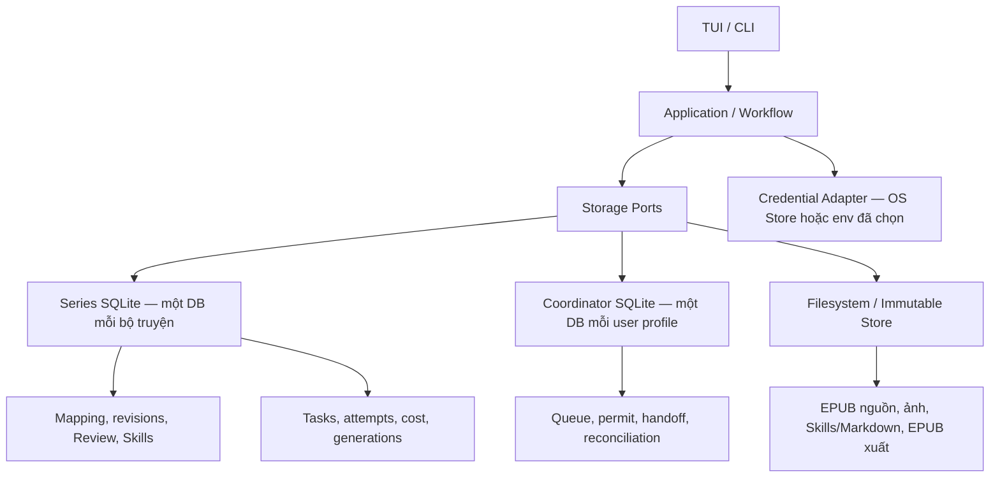
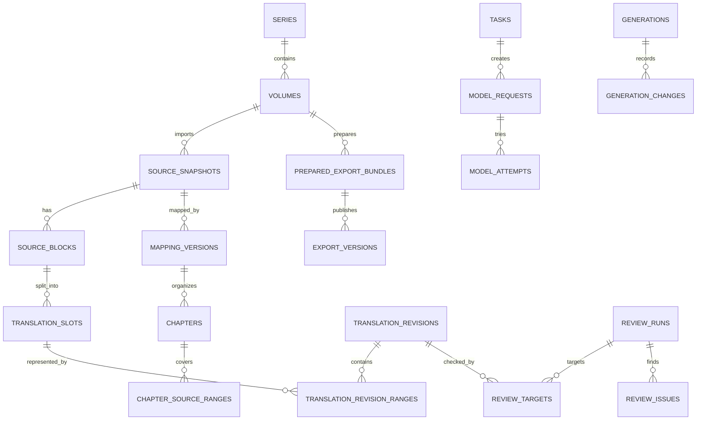
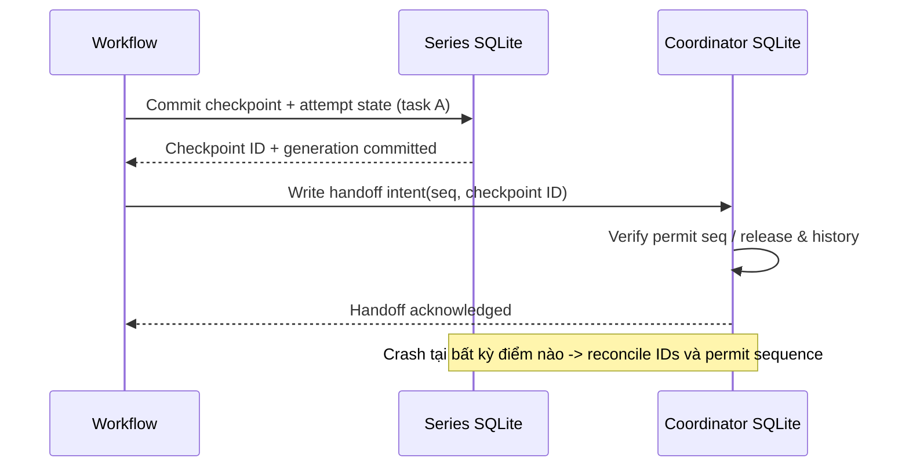
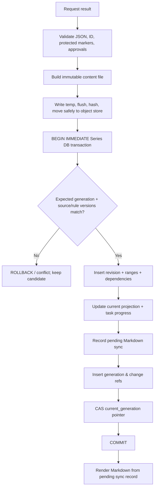
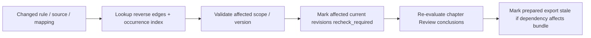

# BƯỚC 6 — DATA ARCHITECTURE & SQLITE SCHEMA DESIGN

**Dự án:** `novel-translate-cli`  
**Phiên bản:** Draft 0.2 — thiết kế dữ liệu chi tiết  
**Ngày:** 05/11/2026  
**Trạng thái:** **ĐỀ XUẤT ĐỂ REVIEW — CHƯA PHẢI MIGRATION V1 ĐƯỢC PHÊ DUYỆT**  
**Bối cảnh:** Bước 1–4: kiến trúc tổng thể/subsystem/crate/module; Bước 5: nền tảng kỹ thuật và contract.  
**Nguồn nghiệp vụ:** [DESIGN_DECISIONS_36.md](../spec/DESIGN_DECISIONS_36.md), [DATA_MODEL_STATE_SPEC.md](../spec/DATA_MODEL_STATE_SPEC.md), [MODEL_STRATEGY_SPEC.md](../spec/MODEL_STRATEGY_SPEC.md), [WORKFLOW_ORCHESTRATION_SPEC.md](../spec/WORKFLOW_ORCHESTRATION_SPEC.md), đặc tả Skills/Review/Research/EPUB/Export.

> **Điểm khác so với bản phác thảo Bước 6 trong hội thoại:** Tài liệu này không chỉ liệt kê nhóm bảng. Nó đưa ra hai bản **SQL DDL mẫu có thể chạy để kiểm tra thiết kế**, sơ đồ quan hệ, ranh giới transaction, recovery, test và danh sách điều kiện phải chốt trước khi đưa vào code.
>
> - [SQL mẫu Series](SQLITE_SCHEMA_V1_DRAFT.sql): 71 bảng, gồm lõi và bảng hỗ trợ; chỉ dùng để rà soát, **không tự chạy trên dữ liệu người dùng**.
> - [SQL mẫu Coordinator](COORDINATOR_SCHEMA_V1_DRAFT.sql): 7 bảng, database độc lập theo user profile.
> - Các SQL mẫu đã được chạy trên SQLite trong bộ nhớ để kiểm tra cú pháp, `PRAGMA integrity_check` và `PRAGMA foreign_key_check` trên schema trống. Điều đó **không** chứng minh mọi bất biến nghiệp vụ hay mọi đường recovery đã đúng.

---

## 1. Mục tiêu và quy ước

Bước 6 trả lời: **lưu cái gì, lưu ở đâu, quan hệ ra sao, ai được ghi, khi nào được công bố, làm sao khôi phục, và khi nâng cấp không mất dữ liệu**.

Phân biệt nhãn:
- **[ĐÃ CHỐT]**: yêu cầu trong 36 quyết định và đặc tả nghiệp vụ; không tùy tiện thay đổi.
- **[ĐỀ XUẤT]**: tên bảng/cột, loại ID, DDL, bố cục index, thủ tục giao dịch trong tài liệu này.
- **[CÒN MỞ]**: yêu cầu một ADR/quyết định kỹ thuật trước khi áp dụng schema thực tế.

**Không đánh đồng** schema đã parse được với schema đã đủ triển khai. DDL không thể tự chứng minh tính đúng nghĩa của Review, bao phủ source range, approval batch, tính hợp lệ dependency, thứ tự Workflow hoặc phiên bản của hai database độc lập.

### 1.1. Đầu ra

1. Logical data model và ownership.
2. Hai database riêng với bảng/cột/chỉ mục minh họa.
3. Bất biến liên bảng và việc phải xác minh ở Domain/Application.
4. Transaction protocol, crash-recovery và concurrency policy.
5. Quy tắc versioning, migration, retention và dữ liệu bất biến.
6. Danh sách vấn đề phải chốt, kế hoạch kiểm thử và nghiệm thu.

---

## 2. Kiến trúc lưu trữ

### 2.1. Bốn phạm vi lưu trữ



**[ĐÃ CHỐT]**
- Mỗi series có một SQLite; các volume của series dùng chung nhân vật, glossary, decision, lịch sử.
- Coordinator SQLite là database khác theo user profile, chứa thứ tự yêu cầu, task/workspace ID, permit holder/sequence. Không sao chép toàn bộ bản dịch vào Coordinator.
- EPUB, ảnh, Skills Markdown, draft Markdown và EPUB đầu ra là file; file bất biến có hash/reference.
- API key nằm trong OS Credential Store hoặc nguồn môi trường người dùng chọn; SQLite chỉ giữ `connection_reference` không bí mật.
- Workspace Rust mới bắt đầu `schema_version = 1`; không migrate workspace thử nghiệm Go.

### 2.2. Dữ liệu nghiệp vụ và representation

| Thành phần | Nguồn sự thật | Representation/bản xem |
|---|---|---|
| Source EPUB | File snapshot bất biến + SQLite mapping/version | Source view, chapter tree |
| Draft revision | Revision record + immutable content hash | Markdown editor projection |
| Approved Skill | Decision/version sau publish an toàn, đối chiếu Skill file | Skill preview/file editor |
| Review status | Review runs, targets, coverage, issue và current pointer | TUI badge/summary |
| Task execution | Task/checkpoint/attempt ledger trong Series | CLI status, TUI progress |
| AI permit | Coordinator SQLite + OS lock, reconciliation | Trạng thái hàng đợi |
| Prepared export | Immutable bundle manifest + referenced resources | Local Preview và EPUB Builder |

**Không** coi file Markdown do watcher nhìn thấy là revision đã được commit; file sửa ngoài phải đi qua import/merge/approval tương ứng.

### 2.3. Ownership theo subsystem

| Chủ nghiệp vụ | Dữ liệu chính | Ai thực hiện ghi vật lý |
|---|---|---|
| Workspace | series, volumes, configuration/scope | Storage adapter |
| EPUB Processing | source snapshot, package, blocks, mappings | Storage adapter |
| Context & Skills | skills, candidates, approved versions, characters, addressing | Storage + safe file publish |
| Translation | translation candidates/revisions/ranges | Storage + immutable objects |
| Review | Review runs/targets/issues/coverage/repairs/exceptions | Storage adapter |
| Research | questions/sources/evidence/cache | Storage adapter |
| Workflow | tasks, step/checkpoint, state transition, budget snapshot | Storage adapter |
| Model Integration | request/attempt/usage/cost pricing evidence | Storage adapter |
| Export | image selection, metadata, prepared bundle, export history | Storage + filesystem |
| Persistence | generation, current pointer, durable operation intents | SQLite transaction/atomic file protocols |
| Coordinator | queue/permits/handoff | Coordinator SQLite owner |

**Chỉ owner nghiệp vụ quyết định thay đổi hợp lệ.** `nt-storage` không tự xác nhận một Review là Đạt hoặc chấp nhận một glossary candidate.

---

## 3. Các định danh và kiểu dữ liệu

### 3.1. Quy tắc sơ bộ

| Loại | Đề xuất | Ghi chú |
|---|---|---|
| Domain ID (`task_id`, `revision_id`, v.v.) | `TEXT` với ID do chương trình tạo | UUIDv7/ULID chưa chốt; không dùng `rowid` làm contract công khai |
| `source_block_id` | SHA-256 dạng hex, `TEXT` 64 ký tự | Công thức từ source hash + parser version + XHTML path + stable node theo đặc tả |
| File content hash | SHA-256 hex, `TEXT` 64 ký tự | Giá trị dùng xác minh chứ không chỉ đặt tên |
| Timestamp | `INTEGER` UTC epoch-milliseconds **[ĐỀ XUẤT]** | Thống nhất cả hai database; date trong UI theo local timezone |
| Booleans | `INTEGER CHECK (... IN (0,1))` | SQLite không có BOOLEAN riêng |
| Enum trạng thái | `TEXT` + `CHECK` cho danh mục ổn định trong v1 | Breaking enum change cần migration |
| JSON payload | `TEXT` + validate schema trong Application | Chỉ dùng cho payload/version chưa đủ ổn định hoặc snapshot, không thay toàn bộ quan hệ bằng JSON |
| Currency/money | `currency TEXT`, `amount_decimal TEXT` **[ĐỀ XUẤT]** | Parse/canonicalize Decimal trong Rust; **không dùng `REAL` để cộng tiền** |
| Source offsets | `INTEGER` start/end dạng `[start,end)` | Đếm cụm ký tự hiển thị và phần tử inline được bảo vệ theo [Quyết định 04](../spec/DESIGN_DECISIONS_36.md#decision-04). Cách biểu diễn và ánh xạ tới XHTML thuộc DB-05. |
| File path | Relative path trong workspace, validated | Không tin path từ EPUB; chặn traversal và symlink escape |

Lưu ý: `CHECK(length(sha256)=64)` chỉ kiểm tra độ dài, chưa xác minh hex/hash thực sự. `CHECK` ở SQLite cũng không đủ cho mọi quan hệ liên bảng.

### 3.2. Không gộp những loại phiên bản khác nhau

| Đối tượng | Version/ID riêng |
|---|---|
| Workspace | `schema_version` |
| Original EPUB | `snapshot_id`, `epub_sha256` |
| Parsing/mapping | `parser_version`, `mapping_id`, `mapping.version_no` |
| Text content | `revision_id`, `base_revision_id` |
| Approved rule | `decision_id`, `decision_version_id` |
| Review | `review_run_id`, exact revision target set |
| Task/workflow | `task_id`, `step_id`, `checkpoint_id` |
| Model | `request_id`, `attempt_id` |
| Consistent state | `generation_id` |
| Export | `bundle_id`, `manifest_schema_version`, `export_version_no` |
| Coordinator | `permit_sequence`, protocol version |

Một lần gọi AI không phải revision; generation không phải bản dịch; export version không phải version của tập nguồn.

---

## 4. Logical Model — Series Database

### 4.1. Quan hệ chính



Sơ đồ chỉ mô tả những quan hệ cốt lõi; quan hệ source/rule dependency và file store nằm trong ma trận phía dưới.

### 4.2. Danh mục bảng theo nhóm và mục đích

**A — Workspace & Source (11 bảng):**

| Bảng | Vai trò |
|---|---|
| `schema_migrations` | Theo dõi migration đã áp dụng và checksum |
| `series` | Định danh bộ truyện và mặc định content scope |
| `volumes` | Tập, số thứ tự, content scope snapshot |
| `immutable_objects` | Reference/hash/path/size của file bất biến |
| `source_snapshots` | Bản EPUB nguồn theo tập, hash/parser version |
| `source_resources` | Manifest XHTML/CSS/image/other resource |
| `source_blocks` | Stable block ID, source locator, content hash |
| `mapping_versions` | Version ánh xạ snapshot |
| `chapters` | Chapter theo mapping version và thứ tự đọc |
| `chapter_source_ranges` | Các source range của chương |
| `content_classifications` | translate/keep_original/image/unresolved |

**B — Translation, current state & Markdown sync (6 bảng):**

| Bảng | Vai trò |
|---|---|
| `translation_slots` | Đơn vị phạm vi nguồn được cập nhật/review |
| `translation_revisions` | Revision bất biến, parent/base và content reference |
| `translation_revision_ranges` | Revision bao phủ slot nào và theo thứ tự nào |
| `current_translations` | Current revision + **quality** và **validity** độc lập |
| `translation_candidates` | AI candidate chưa được publish (candidate không phải revision) |
| `markdown_sync_operations` | Dựng và đối chiếu Markdown, base hashes, conflict/recovery |

> `translation_units`/chunk execution không đồng nghĩa `source_block` hoặc `translation_slot`. Việc chia request được lưu qua task/step và snapshot ranges. Nếu cần query độc lập theo chunk, bổ sung `translation_units` và `unit_ranges` theo ADR thay vì ép identity nguồn phụ thuộc chunk index.

**C — Review, source reading & repair (8 bảng):**

| Bảng | Vai trò |
|---|---|
| `review_runs` | Lần Review (unit/chapter), conclusion |
| `review_targets` | Revision set chính xác được Review |
| `review_coverage` | Source→Translation, Translation→Source, nối cảnh |
| `review_issues` | S0–S3, M1–M4, status và evidence status |
| `review_evidence` | Quote/căn cứ, kiểm tra nguồn và bản dịch |
| `review_source_findings` | Kết quả đọc source-only, không lẫn bản dịch |
| `repair_plans` | Phạm vi sửa, nguyên nhân, M4 verification |
| `repair_rounds` | Vòng sửa–Review, đếm riêng quality failure |

Hai bảng bổ trợ: `user_exceptions` (ngoại lệ gắn issue/revision/approval), `review_chapter_sets` (revision manifest/chapter review). **Tổng nhóm C: 10 bảng.**

**D — Context, Skills & Character (10 bảng):**

| Bảng | Vai trò |
|---|---|
| `skill_files`, `skill_versions` | File đăng ký và phiên bản hash |
| `rule_candidates` | Thuật ngữ/quy tắc chưa duyệt |
| `rule_decisions`, `rule_decision_versions` | Quyết định đã duyệt và phiên bản/phạm vi |
| `approval_batches`, `approval_batch_items` | Duyệt nhóm nguyên tử theo danh sách chọn |
| `skill_publish_operations` | Durable file publish intent/base/target hash |
| `characters`, `character_aliases` | ID nhân vật và bí danh đã xác nhận |
| `addressing_rule_versions` | Quy tắc xưng hô A→B, thời gian/cảnh/mốc tiết lộ |
| `context_events` | Sự kiện có nguồn và trạng thái kiểm chứng |
| `term_occurrences` | Chỉ mục thuật ngữ để truy ngược phạm vi ảnh hưởng |

**Tổng nhóm D: 13 bảng.**

**E — Generation & Dependency (5 bảng):**

| Bảng | Vai trò |
|---|---|
| `generations` | Generation ID, parent ID, checksum |
| `current_generation` | Con trỏ singleton trỏ generation hiện hành |
| `generation_changes` | Thay đổi được công bố trong generation |
| `dependency_edges` | Chỉ mục phụ thuộc có kiểu upstream/downstream/version |
| `dependency_invalidations` | Lịch sử phần cần kiểm tra lại và nguyên nhân |

**F — Task, Workflow & Budget (7 bảng):**

| Bảng | Vai trò |
|---|---|
| `tasks` | Execution state, run mode, snapshot cấu hình/call count |
| `task_scopes` | Chương, mapping và phạm vi theo từng task |
| `task_steps` | Bước nghiệp vụ và input/output version |
| `task_checkpoints` | Checkpoint durable để resume |
| `task_wait_conditions` | Điểm chờ user/dependency |
| `task_state_events` | Audit trail chuyển trạng thái |
| `task_budgets` | Hạn mức hoặc unlimited, currency/nguồn kế thừa |

**G — Model, Attempts & Cost (8 bảng):**

| Bảng | Vai trò |
|---|---|
| `model_connections` | Chỉ chứa secret reference, không chứa API key |
| `model_capability_versions` | Capability model có source/version |
| `model_requests` | Logic request + dependency snapshot |
| `model_attempts` | Thực tế từng lần gửi + deadline/trạng thái |
| `model_attempt_usage` | Usage từng bucket, nguồn báo cáo |
| `model_price_versions` | Giá phiên bản, currency, unit/nguồn |
| `cost_reservations` | Dự phòng ngân sách cho request chưa ngã ngũ |
| `cost_ledger` | Provider/estimated/research tool/adjustment/unknown |

**H — Research (5 bảng):**

| Bảng | Vai trò |
|---|---|
| `research_requests` | Câu hỏi, ngữ cảnh, spoiler boundary |
| `research_runs` | Một lần thực thi với giới hạn/query count |
| `research_sources` | Nguồn web hoặc nội bộ đã đọc |
| `research_evidence` | Excerpt/hash, entity, disclosure, verification |
| `research_cache_entries` | Cache theo question/dependency fingerprints |

**I — Image & Export (6 bảng):**

| Bảng | Vai trò |
|---|---|
| `image_assets` | Ảnh nguồn theo snapshot/đường dẫn |
| `image_asset_versions` | Ảnh nguồn/edit đã kiểm tra, hash bất biến |
| `volume_metadata_versions` | Metadata từng volume và version |
| `prepared_export_bundles` | Manifest bất biến, base generation |
| `prepared_export_items` | Danh sách tham chiếu version/hash ghim trong bundle |
| `export_versions` | Reservation/build/validation/publish của EPUB theo volume |

**Danh mục SQL minh họa có 71 bảng Series.** Số lượng này được dùng để nhận diện dữ liệu và tính toàn vẹn, **không phải bắt buộc tạo cả 71 bảng ngay trong sprint đầu**. Khi triển khai, chia migration theo vertical slice và chỉ công bố `schema_version = 1` sau khi baseline bắt buộc cho release đầu tiên đã được chốt.

---

## 5. Series SQLite — các ràng buộc quan trọng

### 5.1. Source và mapping

- Mỗi `source_snapshot` tham chiếu một EPUB bất biến. Thay nguồn tạo snapshot khác, **không cập nhật byte nguồn tại chỗ**.
- `source_block_id` được tính từ source EPUB hash, parser version, XHTML locator/node theo đặc tả; hai đoạn giống chữ nhưng khác vị trí vẫn có ID khác.
- `mapping_version` giữ snapshot cố định, có thể tách/gộp/dời chapter boundary mà không đổi identity block.
- Chapter ranges và classifications phải phủ đủ theo scope, không overlap sai. SQLite `CHECK(start < end)` **không** đủ để kiểm chứng toàn coverage, thứ tự và matching snapshot: Application cần validation transaction-level.
- Khi story-only, `keep_original` giữ nguyên vị trí/link; không gán `passed` hoặc `translated` cho phần giữ nguyên.

### 5.2. Revision

- Revision append-only. Nội dung dịch ở `immutable_objects` để giữ hash/recovery; SQLite chứa metadata/revision lineage, exact slot/range links.
- `translation_slots` là phạm vi source có khả năng được sửa/Review, khác với lượt request (chunk). Một revision có thể tham chiếu nhiều slot.
- `current_translations` chỉ là **projection hiện hành**; history nằm ở `translation_revisions`, Review và generation.
- Trước khi cập nhật current pointer: xác minh revision, slot, snapshot và mapping tương thích; không để revision r1 của tập khác làm current cho slot hiện tại.
- Nếu user edit/AI response chạy trên base cũ: tạo conflict record và/hoặc ba phía base/user/AI; **không ghi đè user edit**.

### 5.3. Review

- `review_targets` là **tập hợp revision chính xác** được kiểm tra. Kết luận Review cũ không tự áp cho revision mới.
- Review source-only findings lưu riêng, chỉ dùng dữ liệu nguyên tác/nguồn đã xác minh.
- `review_coverage` ghi từng hướng, không đếm phần context chồng là coverage.
- Issue có S0–S3 và M1–M4 hai trục; M4 cần verification bổ sung, không chọn theo số lượng lỗi.
- `repair_rounds` phân biệt Quality Repair và retry/structural errors. Tối đa năm vòng sửa–Review thất bại là policy nghiệp vụ, **không** cố nhét `CHECK(round_no<=5)` vì một plan có thể có bản sửa, test và trạng thái `not_counted` khác nhau.
- Exception gắn issue, revision và reason/approver; không dùng nó để bỏ qua coverage/chapter review.

### 5.4. Context & Skills

- Rule candidate và approved decision là **hai dữ liệu khác nhau**. Chỉ approved version có hiệu lực; external user edit theo 2B phải qua parse/hash/version/publish.
- Approval batch phải kiểm tra conflict trên toàn tập item được chọn và chỉ activate cùng thành công.
- `skill_publish_operations` là intent bền vững để đối chiếu SQLite ↔ Markdown khi crash.
- Addressing dùng người nói/nghe, lời tự xưng/cách gọi, mốc cảnh, story time và reader disclosure. Chưa biết phải có trạng thái chưa xác định.
- `term_occurrences` phục vụ backfill/reverse invalidation; không coi cùng mặt chữ là cùng thực thể/nghĩa.

### 5.5. Dependency & generations

- `generations(parent_generation_id, checksum, manifest)` tạo chuỗi lineage; `current_generation` là singleton.
- Generation chỉ được coi current sau **cùng transaction** tạo các revision/decision/review refs/dependencies/progress cần thiết.
- `dependency_edges` dùng upstream→downstream typed/versioned, có index hai chiều; **chưa đủ FK bảo đảm mọi loại đối tượng**. Application cần validate kind/ID/version bằng owner repository.
- Nếu không chứng minh phạm vi ảnh hưởng nhỏ hơn, phải đánh dấu tối thiểu cả translation unit đã nhận context đó.

### 5.6. Attempt, usage và budget

- `model_requests` = việc logic, `model_attempts` = lần gửi thực tế; có `UNIQUE(request_id,attempt_no)`.
- Retry gửi cùng model đã chọn, từng attempt có usage và status riêng. Late response không được publish khi không phải attempt hiện hành hợp lệ.
- Outstanding reservation vẫn giữ khi provider xử lý chưa rõ; `unknown` không phải zero.
- Budget mode `limited|unlimited`, currency, FX snapshot và price version cần record đủ để audit. SQL mẫu có bảng `model_price_versions`/ledger/reservations; **FX snapshot chưa đưa vào DDL mẫu** — xem DB-09.
- Phí công cụ Research có dòng riêng trong cost ledger.

### 5.7. Export

- Mỗi prepared bundle ghi manifest bất biến, source/mapping/scope, revision & Review set, rules/ruby, metadata, selected image hashes.
- Preview và EPUB Builder đọc **cùng bundle**. Bundle không tự thay đổi khi dữ liệu hiện hành đổi; UI báo stale.
- `export_versions(volume_id, version_no)` có UNIQUE; reserve trước build, validate rồi publish. **Không overwrite** bản EPUB đã xuất.
- Nếu r003 thất bại và user tạo export mới thì r004; nếu resume chính r003 thì tiếp tục theo export ID hợp lệ.

---

## 6. Series SQLite — SQL mẫu đã kiểm tra

Để đọc và kiểm tra SQL mẫu chi tiết (bảng, cột, FK, check, index), xem **`SQLITE_SCHEMA_V1_DRAFT.sql`**.

### 6.1. Generation/current pointer

```sql
CREATE TABLE generations (
  generation_id TEXT PRIMARY KEY,
  parent_generation_id TEXT REFERENCES generations(generation_id),
  created_at_ms INTEGER NOT NULL,
  checksum_sha256 TEXT NOT NULL CHECK(length(checksum_sha256)=64),
  change_manifest_object_id TEXT REFERENCES immutable_objects(object_id)
);

CREATE TABLE current_generation (
  singleton_id INTEGER PRIMARY KEY CHECK(singleton_id=1),
  generation_id TEXT NOT NULL REFERENCES generations(generation_id)
);
```

Chỉ có một dòng singleton (`singleton_id=1`). DDL chưa tự kiểm soát **CAS expected generation**; Application/Storage phải thực thi trong `BEGIN IMMEDIATE` (hoặc một giao thức writer tuần tự tương đương) và kiểm tra số dòng cập nhật.

### 6.2. Request và attempt

```sql
CREATE TABLE model_requests (
  request_id TEXT PRIMARY KEY,
  task_id TEXT NOT NULL REFERENCES tasks(task_id),
  role TEXT NOT NULL CHECK(role IN ('translation','review','research')),
  requested_model TEXT NOT NULL,
  request_contract_version TEXT NOT NULL,
  input_dependency_json TEXT NOT NULL,
  created_at_ms INTEGER NOT NULL
);

CREATE TABLE model_attempts (
  attempt_id TEXT PRIMARY KEY,
  request_id TEXT NOT NULL REFERENCES model_requests(request_id),
  attempt_no INTEGER NOT NULL CHECK(attempt_no >= 1),
  provider TEXT NOT NULL,
  actual_model TEXT,
  provider_request_id TEXT,
  deadline_ms INTEGER,
  status TEXT NOT NULL CHECK(status IN
    ('prepared','sent','uncertain','completed','failed','timed_out','cancelled')),
  sent_at_ms INTEGER,
  completed_at_ms INTEGER,
  finish_reason TEXT,
  result_object_id TEXT REFERENCES immutable_objects(object_id),
  UNIQUE(request_id,attempt_no)
);
```

SQL kiểm soát identity/attempt numbering. Quyền publish kết quả vẫn phải xác minh `request_id`, `attempt_id`, `base generation`, permit sequence và kết quả đã công bố.

### 6.3. Những gì chưa giải quyết bằng DDL

1. Hai FK `slot_id`/`revision_id` tồn tại nhưng chưa tự chứng minh cùng volume/snapshot/mapping.
2. Một chapter range phải nằm trong số đơn vị nguồn của block. `source_blocks.char_length` là tên cột minh họa cho số cụm ký tự hiển thị và phần tử inline được bảo vệ theo Quyết định 04.
3. Coverage của chapter/volume đủ, không thừa/thiếu, không overlap.
4. Một review run có đủ findings source-only và đúng toàn bộ revision set.
5. Batch Skills đã được publish file an toàn trước khi activate.
6. Result late/older attempt không được công bố.
7. Tổng cost ledger + outstanding reservations <= task budget (nếu limited).
8. Quy tắc nhất quán giữa two SQLite và permit OS lock.
9. Các `JSON TEXT` có schema/version phù hợp và không chứa secret.
10. Đường dẫn file thực tế không escape workspace và byte có hash đúng.

**Đề xuất cách xử lý:** Domain validation + repository transaction guard + integrity worker + contract/recovery tests. Có thể tăng dần composite FK/triggers ở bước chốt migration, không dùng trigger phức tạp để thay toàn bộ nghiệp vụ.

---

## 7. Coordinator SQLite riêng

### 7.1. Danh mục bảng (7)

| Bảng | Mục đích |
|---|---|
| `coordinator_schema_migrations` | Schema version/checksum |
| `coordinator_state` | Singleton giữ latest permit sequence |
| `queue_entries` | Thứ tự/idempotency key cho start/resume |
| `active_permit` | Singleton; tối đa **một permit** có hiệu lực theo Coordinator |
| `permit_history` | Lịch sử cấp/thu hồi |
| `handoff_operations` | Intent/ack và trạng thái bàn giao |
| `reconciliation_records` | Vấn đề được tìm thấy/sửa sau crash |

**[ĐÃ CHỐT]** Coordinator theo user profile dùng OS lock để không có hai Coordinator chủ động, chia queue cho các TUI/CLI/workspace. SQLite một mình không thay cho OS lock.

### 7.2. SQLite skeleton

```sql
CREATE TABLE active_permit (
  singleton_id INTEGER PRIMARY KEY CHECK(singleton_id=1),
  permit_sequence INTEGER NOT NULL CHECK(permit_sequence>=1),
  queue_id TEXT NOT NULL REFERENCES queue_entries(queue_id),
  workspace_ref TEXT NOT NULL,
  task_id TEXT NOT NULL,
  granted_at_ms INTEGER NOT NULL
);
```

`active_permit` là singleton giúp không có hai row active; nhưng **không tự bảo đảm** process đang giữ permit là process hợp lệ sau crash. Cần OS lock, permit sequence monotonic và reconciliation.

### 7.3. Không có distributed transaction giữa hai SQLite

Không dùng giả định rằng thao tác `commit A` trên Series và `commit B` trên Coordinator là nguyên tử chung. Đề xuất dùng **durable handoff intent**:



**[CÒN MỞ]** Thứ tự chính thức của `intent / ack / release`, cơ chế heartbeat/fencing, timeout và quyền tiếp quản khi Series DB bị lỗi. Sơ đồ là nguyên tắc, chưa phải protocol cuối. Đặc biệt không cấp B nếu chưa chứng minh A đã dừng gửi request và permit đã được bàn giao hợp lệ.

---

## 8. Transaction Design

### 8.1. Chuẩn bị và công bố revision



**Tính nguyên tử:** SQLite bảo đảm các thay đổi nằm **trong một transaction của một database**. File ghi bên ngoài SQLite không được tự động rollback theo transaction. Orphan file phải được kiểm tra/reference scan và GC an toàn về sau.

Phương án này ghi việc dựng Markdown cùng giao dịch công bố revision. Khi crash ngay sau commit, lần mở lại đọc bản ghi chờ và kiểm tra bản sửa tay trước khi dựng file theo [Quyết định 07–08](../spec/DESIGN_DECISIONS_36.md#decision-07).

### 8.2. Pseudocode CAS

```sql
-- Minh họa, không phải query hoàn chỉnh của migration.
-- executed inside the same write transaction after inserts
UPDATE current_generation
SET generation_id = :new_generation
WHERE singleton_id = 1
  AND generation_id = :expected_generation;
-- REQUIRE changes() == 1, otherwise ROLLBACK / StaleGeneration.
```

Ban đầu phải tạo một bootstrap generation/current pointer phù hợp. Các thao tác có thể tạo generation từ trạng thái chưa có current pointer cần use case bootstrap riêng, không cố chạy CAS với ID rỗng.

### 8.3. Duyệt nhóm Skills và file publish

1. Ghi `approval_batches`/selected IDs/version và `skill_publish_operations` intent/base/target hash.
2. Dựng temp Markdown và kiểm tra syntax/version đầy đủ.
3. Đảm bảo file nền chưa thay; safe replace theo yêu cầu filesystem.
4. Đọc lại file, đối chiếu target hash.
5. Trong transaction Series: activate **cả batch** hoặc không activate mục nào; tạo decision versions/generation/dependency updates.
6. Chuyển operation sang `activated` và ghi audit. Nếu crash, reconcile theo intent/hash/version và không dùng decision pending như approved.

File write/SQLite write **không** phải transaction xuyên hệ thống; cần test crash tại từng ranh giới.

### 8.4. Research/model/usage ledger

- Trước khi gửi: checkpoint intent + attempt record + reservation.
- Sau khi gửi thành công: cập nhật `sent`/deadline, response/usage/error theo attempt.
- Timeout mất kết nối: `uncertain`, không xóa reservation chỉ vì client không nhận được response.
- Kết quả muộn: cập nhật history của đúng attempt, chỉ publish nếu vẫn là attempt được quyền công bố theo base/permit policy.
- Model call cap tăng **khi thực sự gửi**, không tăng theo số `request_id` và không reset khi resume.
- Cost adjustment có ledger entry mới, không sửa mất lịch sử cũ.

### 8.5. Export publish

1. Kiểm tra volume readiness (Review + exact revision set + scope + dependency + metadata).
2. Chọn file ảnh source/edit và xác minh hash.
3. Tạo prepared bundle/manifest bất biến với generation hiện hành.
4. Reserve `(volume_id, version_no)` bằng transaction/unique constraint.
5. Build EPUB temp, validate EPUB3.3/EPUBCheck, ghi hash.
6. Publish file không overwrite, cập nhật `export_versions` theo export ID/path/hash/report.
7. Nếu crash, reconcile theo reservation/manifest/temp/final path/hash; không báo thành công thiếu bằng chứng.

---

## 9. Trạng thái và invalidation

### 9.1. Ba trục độc lập

| Trục | Lưu ở đâu | Ví dụ |
|---|---|---|
| **Content Quality** | `current_translations.quality_status`, Review history | `passed`, `pending_review`, `needs_verification` |
| **Data Validity** | `current_translations.validity_status`, dependency invalidations | `current`, `recheck_required` |
| **Task Execution** | `tasks.execution_status`, task events | `running`, `paused`, `waiting_user` |

Không nén ba trục vào một enum hay một cột duy nhất.

### 9.2. Dependency change propagation



Không xóa r1/r2/Review history, không tự dịch lại mọi thứ; người dùng/Workflow sau đó mới lên lịch phần cần Review hoặc sửa.

### 9.3. Research evidence không tự thành approved decision

Đã đọc web ≠ đã xác minh nội dung ≠ đã duyệt cách dịch. Dữ liệu có thể là `unverified` hoặc `unknown_spoiler`; chỉ dữ kiện đúng mốc tiết lộ và được xác minh mới có thể thành context phù hợp.

---

## 10. Quy tắc mở rộng và tiến hóa schema

### 10.1. Chọn đường nâng cấp

**[ĐÃ CHỐT]** Workspace Rust mới bắt đầu schema 1. Nâng cấp tương lai: khóa ghi, backup SQLite và những file sẽ thay, migrate theo thứ tự version, integrity check, rollback/phục hồi khi lỗi. Không convert workspace test Go cũ.

**[ĐỀ XUẤT]**
- `PRAGMA user_version` + `schema_migrations(version, checksum, applied_at)`.
- Mỗi migration có preconditions và postconditions, chạy trong transaction khi có thể.
- Không thay `source_snapshot`/revision/approved decision history tại chỗ để “tiện sửa schema”.
- New optional field: migration/backfill rõ; breaking meaning/enum: plan chuyển version, rollback/read-only khi không hỗ trợ.
- Mỗi migration có fixture từ version cũ thuộc phạm vi hỗ trợ, công cụ khôi phục và test idempotency.

### 10.2. Quy tắc vận hành SQLite

- `PRAGMA foreign_keys=ON` trên **mọi connection**; DDL có FK nhưng setting runtime cũng quan trọng.
- Đánh giá `WAL`, `busy_timeout`, `synchronous` và backup/close checkpoint trước khi chốt theo yêu cầu durability/latency. **Chưa khóa `WAL`/`synchronous=FULL` trong bản này.**
- Một writer hợp lệ cho workspace, kiểm tra expected generation trước commit; locking và optimistic version check phải cùng tồn tại.
- Không dùng network filesystem/WAL thiếu kiểm chứng (file lock và crash semantics khác nhau).
- Thực thi `PRAGMA foreign_key_check`, `PRAGMA integrity_check` khi migration/recovery phù hợp.

### 10.3. Retention và file GC

- Chỉ xóa file bất biến khi không còn reference từ generation, revision, source snapshot, prepared bundle, export history, pending recovery intent hoặc retention hold.
- Không xóa file orphan ngay trong lúc một transaction khác có thể còn đang chuẩn bị tham chiếu.
- Raw model responses và web material có thể chứa nội dung riêng tư/bản quyền: tách retention policy, redaction và quyền lưu theo provider.
- Xóa export file người dùng đã publish không được thực hiện âm thầm như GC cache.

---

## 11. Kế hoạch kiểm thử

### 11.1. SQL smoke tests đã thực hiện với bản DDL mẫu

| Mục | Kết quả |
|---|---|
| Series DDL parse/apply vào in-memory SQLite | **Đạt** |
| Series số bảng (kể cả nhóm mở rộng) | **71** |
| Coordinator DDL parse/apply vào in-memory SQLite | **Đạt** |
| Coordinator số bảng | **7** |
| `PRAGMA integrity_check` của cả hai DB trống | **ok** |
| `PRAGMA foreign_key_check` DB trống | **Không có lỗi** |
| `PRAGMA user_version` | **1** |
| Seed tối thiểu Series + FK/CHECK + stale-generation CAS | **Đạt với fixture tối thiểu** |
| Coordinator singleton permit constraint | **Đạt với fixture tối thiểu** |

**Giới hạn kiểm chứng:** Các test trên xác nhận schema tạo được và một số ràng buộc tối thiểu (một fixture Series, FK/`CHECK`, CAS sai base; một fixture Coordinator singleton). **Chưa** có bộ seed đầy đủ, concurrent writer, malicious inputs, migration rollback, crash injection hay kiểm tra đầy đủ domain invariants.

### 11.2. Acceptance tests phải viết trước khi phê duyệt migration

| Mã | Tình huống | Kết quả cần đạt |
|---|---|---|
| DB-T01 | Import EPUB, remap chapter | Snapshot/block identity giữ, mapping version mới |
| DB-T02 | Chia lại translation chunks | Không thay source block ID hay mất revision hợp lệ |
| DB-T03 | User sửa r1 thành r2 | r1 history còn; Review r1 không tự áp r2 |
| DB-T04 | Review muộn của r1 | Không ghi đè quality/current revision r2 |
| DB-T05 | Đổi approved rule cặp/mốc | Chỉ invalidation phạm vi phụ thuộc và occurrence phù hợp |
| DB-T06 | Approval batch 10 mục, 1 conflict | Không activate một phần trái danh sách xác nhận |
| DB-T07 | Skill file đổi ngay khi tool publish | Giữ base/target/user file, không auto chấp nhận conflict |
| DB-T08 | Crash sau generation commit trước Markdown projection | Rebuild Markdown, bảo vệ sửa tay |
| DB-T09 | Crash trước commit generation sau khi viết immutable file | Không publish revision nửa chừng; orphan xử lý an toàn |
| DB-T10 | Timeout sau `send` | Attempt uncertain và reservation vẫn tồn tại |
| DB-T11 | Retry rồi late response | Chỉ attempt đủ quyền được publish; lưu usage từng attempt |
| DB-T12 | Limited budget và unknown cost | Không vượt cap bằng cách coi unknown=0 |
| DB-T13 | Coordinator crash giữa checkpoint/handoff | Không cấp permit B khi A chưa được reconcile |
| DB-T14 | Resume task paused | Giữ task scope, counters, cost và next step |
| DB-T15 | Edit image only | Stale export bundle; không tự gọi model dịch lại |
| DB-T16 | Export r003 lỗi và tạo export mới | Mới là r004; không overwrite r003/r002 |
| DB-T17 | Story-only volume | Keep-original ranges có mặt đúng vị trí; không là passed translation |
| DB-T18 | Upgrade Rust schema 1→2 (fixture mô phỏng) | Backup/migration/rollback/integrity rõ |
| DB-T19 | Hai writer cố cập nhật cùng generation | Một commit thành công, một StaleGeneration hoặc serialization |
| DB-T20 | FK + cross-snapshot source mapping | FK pass chưa đủ, Domain validation chặn sai snapshot |

Tất cả test mô phỏng/mocking, offline deterministic. Không cần API thật trong CI.

---

## 12. Những quyết định còn mở

| ID | Vấn đề | Cần chốt trước khi nào |
|---|---|---|
| DB-01 | ID format (UUIDv7/ULID/khác), ID string canonical | Trước migration release v1 |
| DB-02 | UTC timestamp epoch ms, precision, timezone conversion | Trước migration |
| DB-03 | Hash hex TEXT/BLOB, hashing/verify API | Trước migration |
| DB-04 | Nội dung revision: file bất biến, text trong SQLite hay hybrid | Trước storage adapter |
| DB-05 | Cách lưu offset và ánh xạ đơn vị nguồn đã chốt sang Unicode/XHTML/ruby | **Trước viết source mapping** |
| DB-06 | Translation slot boundaries và exact coverage validation | **Trước Translation/Review** |
| DB-07 | Composite FK/triggers để bảo đảm cùng snapshot/volume | Trước migration |
| DB-08 | Generation CAS, bootstrap generation, replay/idempotency | **Trước write path** |
| DB-09 | Decimal precision, currency, exchange-rate snapshots (DDL thiếu FX) | **Trước budget/accounting** |
| DB-10 | Coordinator handoff/reconciliation protocol, fencing | **Trước chạy AI đa process** |
| DB-11 | Source/Research/Model raw material retention & secure redaction | Trước release |
| DB-12 | Migration & backup process, rollback khi file cũng được sửa | Trước migration updater |
| DB-13 | SQLite pragmas (WAL, synchronous, busy timeout), DB worker model | Trước storage implementation |
| DB-14 | Index tuning theo workload thực tế | Trước performance acceptance |
| DB-15 | Export version reservation/publish crash protocol | Trước Export |
| DB-16 | Skill sync atomicity with external Markdown and approval batch | Trước Context/Skills publish |
| DB-17 | Các type quan hệ generic `entity_kind/id` và kiểm tra integrity | Trước dependency engine |
| DB-18 | Tối ưu số bảng/nhóm migration theo vertical slices (không overengineering) | Trước scaffold/implementation |

**Không chốt các ID DB-xx chỉ từ việc DDL hợp lệ.** Đặc biệt DB-05, DB-08, DB-09, DB-10, DB-16 có thể ảnh hưởng toàn bộ hệ thống nếu đưa ra quyết định sai.

---

## 13. Tổ chức file và triển khai theo vertical slice

**[ĐỀ XUẤT]** Các module triển khai dùng phần schema và migration đã được rà soát cho slice tương ứng:

```text
crates/nt-storage/
  src/sqlite/
    series/
      repositories/
      transaction.rs
      generation.rs
    coordinator/
      queue_repository.rs
      permit_repository.rs
    migration/
      runner.rs
      integrity.rs
    recovery/
      operations.rs
  migrations/
    series/
      0001_initial.sql         # Sau khi duyệt
    coordinator/
      0001_initial.sql         # Sau khi duyệt

tests/
  db_contract/
  storage_recovery/
  migration_fixtures/
```

**Các file `*_DRAFT.sql` đang đi kèm tài liệu là bản thiết kế tham khảo**, chưa đặt vào thư mục migration chạy tự động.

Các nhóm dưới đây là phạm vi dữ liệu của từng slice. Thứ tự triển khai dự kiến theo [Bước 9](IMPLEMENTATION_ROADMAP_STEP9.md).

| Phase | Nhóm dữ liệu được dùng |
|---|---|
| [02](IMPLEMENTATION_ROADMAP_STEP9.md#phase-02) | Workspace, series/volume, kho file bất biến, schema bootstrap và commit nhất quán cho snapshot/mapping |
| [03](IMPLEMENTATION_ROADMAP_STEP9.md#phase-03) | Mở rộng Generation Commit cho revision, current state, dependency, Markdown và duyệt Skills có recovery |
| [04](IMPLEMENTATION_ROADMAP_STEP9.md#phase-04) | Lưu Review target, coverage, kết quả và checkpoint có phiên bản tối thiểu để tiếp tục luồng Dịch–Review giả lập |
| [05](IMPLEMENTATION_ROADMAP_STEP9.md#phase-05) | Mở rộng checkpoint cho request/attempt, usage/budget, send-gap recovery và Coordinator IPC/reconciliation |
| [06](IMPLEMENTATION_ROADMAP_STEP9.md#phase-06) | Mở rộng Review issues/repair, lan truyền dependency và lưu Research evidence/cache |
| [07](IMPLEMENTATION_ROADMAP_STEP9.md#phase-07) | Ảnh, prepared bundle và lịch sử xuất EPUB |

Mỗi phase dùng các bảng và thao tác cần cho luồng nghiệm thu của nó. Sau khi schema v1 được áp dụng, thay đổi schema đi qua migration có phiên bản theo mục 10.

---

## 14. Bảng truy xuất yêu cầu và kiểm soát thay đổi

| Yêu cầu | Bảng/contract chịu trách nhiệm |
|---|---|
| Quyết định 06 — Series SQLite + filesystem | `series`, `volumes`, `immutable_objects`, `source_snapshots` |
| 07 — Generation atomic commit | `generations`, `generation_changes`, `current_generation` |
| 08 — Markdown revision sync | `translation_revisions`, `markdown_sync_operations`, file hashes |
| 09 — Dependency/invalidation | `dependency_edges`, `dependency_invalidations`, `term_occurrences` |
| 10 — Ba trục trạng thái | `current_translations`, `tasks`, `task_state_events` |
| 11–16 — Skills, glossary, xưng hô, approval | `rule_*`, `approval_*`, `skill_*`, `characters`, `addressing_rule_versions` |
| 17–19 — Model/usage/cost/timeout | `model_requests`, `model_attempts`, `model_attempt_usage`, `cost_*` |
| 20 — Translation response | `translation_candidates`, `translation_revisions`, input versions |
| 21–25 — Review & repair | `review_*`, `repair_*`, `user_exceptions` |
| 26–27 — Research/evidence/spoiler | `research_*`, `context_events` |
| 28–29 — One AI task/Checkpoint/Coordinator | `tasks`, `task_checkpoints`; Coordinator `queue_entries`, `active_permit`, `handoff_operations` |
| 30–33 — Image/Preview/EPUB 3.3/versioning | `image_*`, `prepared_export_*`, `export_versions` |
| Extensibility/evolvability | Schema versioning, typed ports, immutable history, migration/contract tests |

### Quy tắc cập nhật tài liệu

- Mỗi thay đổi schema có **ID quyết định**, ảnh hưởng tới owner/API/migration, acceptance tests.
- Không thay cấu trúc đã chốt trong [DESIGN_DECISIONS_36.md](../spec/DESIGN_DECISIONS_36.md) mà không có quyết định sản phẩm mới.
- Tên bảng/cột/ID/DDL mẫu ở đây có thể sửa sau khi review, miễn vẫn giữ invariant và hồ sơ lịch sử.
- Mọi thay đổi tác động source identity/revision/Review/dependency/cost/Coordinator phải có fault/recovery tests tương ứng.

---

## 15. Tiêu chí nghiệm thu Bước 6

- [x] Phân biệt rõ Series SQLite, Coordinator SQLite, filesystem và credential store.
- [x] Phân nhóm logical data model và owner cho các subsystem.
- [x] Có SQL DDL minh họa với PK/FK/CHECK/UNIQUE/index.
- [x] Kiểm tra DDL mẫu chạy được với SQLite in-memory và `integrity_check` cơ bản.
- [x] Mô tả revision/Review set/dependency/generation/attempt/cost/approval/export relationships.
- [x] Mô tả transaction, sync, recovery, versioning và migration.
- [x] Phân biệt các ràng buộc DB có thể kiểm chứng và các quy tắc Application phải kiểm chứng.
- [x] Có kế hoạch testing, vertical slice và danh sách quyết định còn mở.
- [ ] **Chốt DB-xx quan trọng và các loại ID/offset/money.**
- [ ] **Kiểm tra cross-entity/coverage, mẫu dữ liệu và crash-injection tests.**
- [ ] **Phê duyệt schema v1 và chuyển bản DRAFT thành migration thực tế.**

### Trạng thái cuối

**Bước 6 hoàn tất ở mức *design draft chi tiết*, chưa đủ điều kiện áp dụng schema v1 vào workspace người dùng.** Các bảng và SQL mẫu có thể là nền tảng review và test, không phải mệnh lệnh tự động tạo database production.

[Bước 7 — Workflow State Machine & Recovery Design](WORKFLOW_STATE_MACHINE_STEP7.md) mô tả state/transition, checkpoint, request/attempt và permit handoff dựa trên thiết kế này. Giao thức liên tiến trình còn mở ở cả hai bước và được xếp vào ADR trước [Phase 05](IMPLEMENTATION_ROADMAP_STEP9.md#phase-05).
