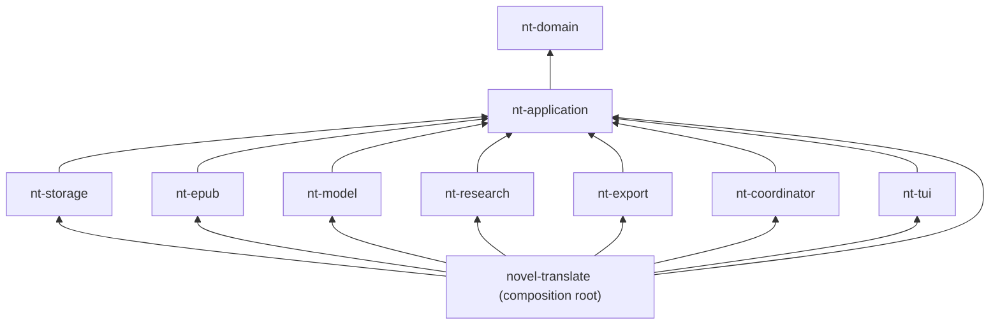
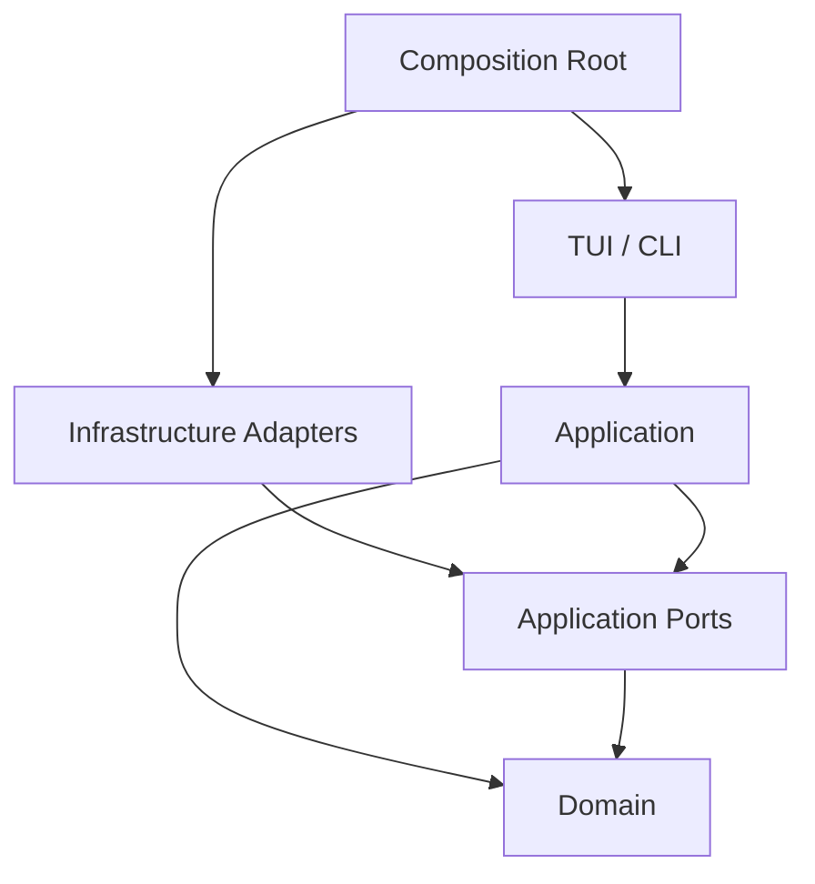
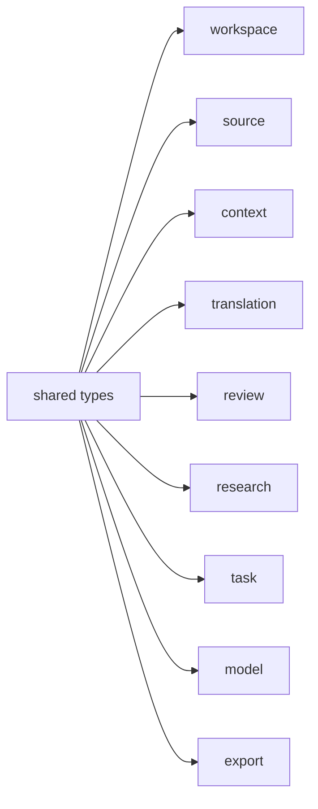
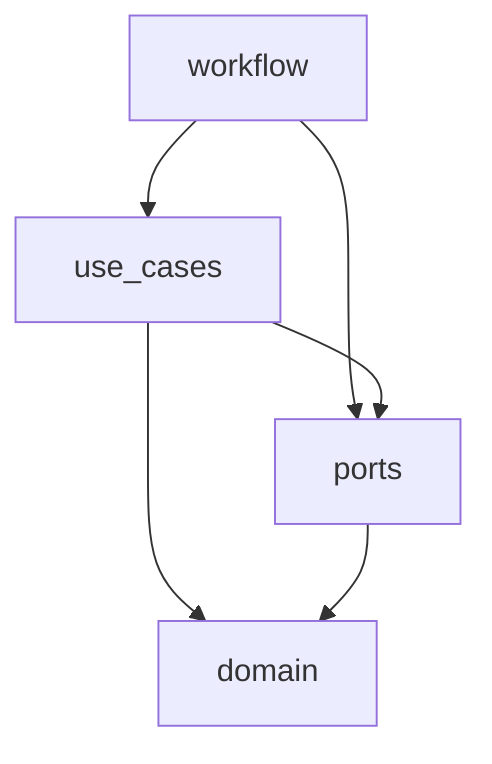

# BƯỚC 4 — RUST MODULE DESIGN
## Extensibility · Maintainability · Evolvability

> **Dự án:** `novel-translate-cli`  
> **Tài liệu:** `MODULE_DESIGN_STEP4.md`  
> **Phiên bản:** 0.2 — sửa đổi theo định hướng mở rộng lâu dài  
> **Ngày:** 05/11/2026  
> **Trạng thái:** Bản thiết kế đề xuất để rà soát; chưa triển khai code  
> **Căn cứ:** `ARCHITECTURE_OVERVIEW.md`, `SUBSYSTEM_ARCHITECTURE.md`, `RUST_PROJECT_ARCHITECTURE.md`, [DESIGN_DECISIONS_36.md](../spec/DESIGN_DECISIONS_36.md) và các đặc tả nghiệp vụ.

---

## Mục lục

1. [Mục đích, phạm vi và thay đổi so với bản 0.1](#1-mục-đích-phạm-vi-và-thay-đổi-so-với-bản-01)
2. [Mục tiêu kiến trúc và nguyên tắc thiết kế](#2-mục-tiêu-kiến-trúc-và-nguyên-tắc-thiết-kế)
3. [Kiến trúc module tổng thể](#3-kiến-trúc-module-tổng-thể)
4. [Module Design cho từng crate](#4-module-design-cho-từng-crate)
5. [Public API, visibility và ownership](#5-public-api-visibility-và-ownership)
6. [Interface/Port Catalog và hợp đồng dữ liệu](#6-interfaceport-catalog-và-hợp-đồng-dữ-liệu)
7. [Quy tắc phụ thuộc và giao tiếp](#7-quy-tắc-phụ-thuộc-và-giao-tiếp)
8. [Điểm mở rộng và chiến lược tiến hóa](#8-điểm-mở-rộng-và-chiến-lược-tiến-hóa)
9. [Các kịch bản thay đổi và phạm vi ảnh hưởng](#9-các-kịch-bản-thay-đổi-và-phạm-vi-ảnh-hưởng)
10. [Versioning, dữ liệu và migration](#10-versioning-dữ-liệu-và-migration)
11. [State, concurrency, lỗi và phục hồi](#11-state-concurrency-lỗi-và-phục-hồi)
12. [Testability và bảo vệ kiến trúc bằng CI](#12-testability-và-bảo-vệ-kiến-trúc-bằng-ci)
13. [Những gì không xây dựng trước](#13-những-gì-không-xây-dựng-trước)
14. [Các vấn đề vẫn còn mở](#14-các-vấn-đề-vẫn-còn-mở)
15. [Tiêu chí nghiệm thu và bước tiếp theo](#15-tiêu-chí-nghiệm-thu-và-bước-tiếp-theo)
16. [Ma trận truy xuất yêu cầu](#16-ma-trận-truy-xuất-yêu-cầu)

---

# 1. Mục đích, phạm vi và thay đổi so với bản 0.1

## 1.1. Mục đích

Bước 1 xác định kiến trúc tổng thể; Bước 2 xác định mười subsystem; Bước 3 đề xuất Cargo Workspace gồm **9 library crates và 1 binary crate**. Bước 4 xác định module-level responsibilities, interface, public API, dependency và test boundary trong từng crate.

**Mục tiêu bổ sung của phiên bản 0.2:** Thiết kế ứng dụng không chỉ đáp ứng đặc tả hiện tại mà còn có khả năng **mở rộng chức năng, thay thế adapter và phát triển dần** mà không buộc viết lại các thành phần không liên quan.

Khả năng mở rộng không có nghĩa mọi tính năng tương lai đều được bổ sung chỉ bằng một plugin hoặc không bao giờ phải thay Core. Một thay đổi phá vỡ giả định nghiệp vụ (ví dụ thêm ngôn ngữ nguồn hoặc định dạng nhập có cấu trúc hoàn toàn khác) vẫn có thể yêu cầu sửa Domain/Application và migration dữ liệu. Mục tiêu là **khoanh vùng ảnh hưởng, bảo toàn tương thích và kiểm chứng được thay đổi**.

## 1.2. Những nội dung đã điều chỉnh từ bản 0.1

| ID | Điều chỉnh | Lý do |
|---|---|---|
| V2-01 | Bổ sung **Extensibility, Maintainability, Evolvability** là mục tiêu thiết kế | Hỗ trợ phát triển dài hạn |
| V2-02 | Mỗi crate có **Stable Core / Extension Boundary / Change Impact** | Không chỉ liệt kê tên module |
| V2-03 | Phân biệt điểm mở rộng **cần ngay** và **dự phòng cho tương lai** | Tránh overengineering |
| V2-04 | Thêm contract versioning, persistence compatibility và migration | Dữ liệu nhiều tập sống lâu hơn một phiên bản code |
| V2-05 | Thêm kịch bản thay đổi: provider, ngôn ngữ, input/output, workflow, review, GUI | Kiểm tra thiết kế bằng nhu cầu thực tế |
| V2-06 | Tách **business policy** khỏi **adapter implementation** | Có thể thay thư viện/provider |
| V2-07 | Bổ sung contract tests, architecture tests và change-impact tests | Chứng minh mở rộng không phá chức năng cũ |
| V2-08 | Chuẩn hóa 8 màn TUI theo đặc tả đã chốt | Không tự thêm màn chính khi chia module |
| V2-09 | Không tạo plugin framework tổng quát hoặc dynamic loading từ đầu | Chưa có nhu cầu thực tế |
| V2-10 | Giữ các quyết định kỹ thuật chưa giải quyết ở trạng thái **còn mở** | Không suy đoán framework/driver/IPC |

## 1.3. Trạng thái thông tin

- **[ĐÃ CHỐT]**: yêu cầu nằm trong 36 quyết định hoặc đặc tả.
- **[CƠ SỞ BƯỚC 3]**: 9 library + 1 binary crate và hướng phụ thuộc đã được chọn làm cơ sở thiết kế trong cuộc trao đổi; có thể rà soát lại khi phát hiện ràng buộc không phù hợp.
- **[ĐỀ XUẤT BƯỚC 4]**: module, trait, API, điểm mở rộng và ranh giới thay đổi trong tài liệu này.
- **[CÒN MỞ]**: cần quyết định thiết kế/triển khai; không mặc nhiên được chốt.

## 1.4. Giới hạn

Tài liệu mô tả trách nhiệm và hợp đồng **logic**. Những tên file, tên trait và cây thư mục là đề xuất; **không** phải code đã có hoặc API Rust cuối cùng. Chưa lựa chọn phiên bản thư viện, viết SQL schema, tạo file Rust hay triển khai plugin runtime.

---

# 2. Mục tiêu kiến trúc và nguyên tắc thiết kế

## 2.1. Các thuộc tính chất lượng

| Thuộc tính | Định nghĩa áp dụng cho dự án | Kiểm chứng |
|---|---|---|
| **Extensibility** | Thêm một provider/search adapter mới không cần sửa logic dịch/Review | Contract test adapter; kiểm tra diff |
| **Maintainability** | Mỗi lỗi/quy tắc có owner và module rõ ràng | Ownership map; module tests |
| **Evolvability** | Schema, contract, cấu hình tiến hóa có version/migration | Upgrade/rollback fixtures |
| **Modularity** | Không có phụ thuộc vòng; ranh giới đủ hẹp | Dependency graph trong CI |
| **Testability** | Domain/Workflow kiểm thử với mock, offline | Unit/contract/integration tests |
| **Reliability** | Revision/attempt/decision không mất sau crash | Fault injection và resume tests |
| **Security** | Secret và nội dung EPUB không đáng tin cậy được cô lập | Redaction, preview security tests |

**Định hướng ưu tiên:** Extensibility + Maintainability + Evolvability, trên nền Modularity, Testability và Reliability.

**Scalability không đồng nghĩa Extensibility:** giai đoạn hiện tại **[ĐÃ CHỐT]** chỉ một tác vụ AI hoạt động tại một thời điểm. Không tự thiết kế scheduler song song trái yêu cầu.

## 2.2. Bảy nguyên tắc bắt buộc khi rà soát module

1. **Single Responsibility:** module có một lý do thay đổi chính.
2. **High Cohesion:** logic của cùng quy tắc/nghiệp vụ ở gần nhau.
3. **Explicit Ownership:** phân biệt owner/reader/writer của dữ liệu.
4. **Private by Default:** hạn chế public API và quyền thay đổi trạng thái.
5. **Dependency Inversion:** Application/Domain không phụ thuộc implementation.
6. **Versioned Boundaries:** contract/dữ liệu có chính sách version và migration khi cần.
7. **No Premature Abstraction:** không tạo interface/plugin framework khi chưa có ít nhất một ranh giới thay đổi thực tế.

**Nguyên tắc bổ sung:** một phần được xem là “dễ thay” nếu việc thay đổi không đòi hỏi sửa các module không liên quan, và khả năng đó được chứng minh bằng test — không chỉ bằng số lượng trait.

## 2.3. Cấu trúc ổn định và phần dễ thay đổi

| Phần nên giữ ổn định | Phần dự kiến dễ thay đổi |
|---|---|
| SourceSnapshot, SourceRange, Mapping identity | EPUB parser implementation |
| TranslationRevision và lineage | Provider/model adapter |
| ReviewRun, Issue, Evidence, coverage | Review prompt/policy implementations trong giới hạn đã chốt |
| Approved Rule/Scope/Version | Skill parser và formatting |
| Task, Checkpoint, Attempt, Generation | Transport, streaming và HTTP client |
| Dependency graph và invalidation semantics | Cache/index implementation |
| PreparedExportBundle và manifest | EPUB builder/preview rendering |

Nếu thay đổi nghiệp vụ làm thay đổi phần ổn định, cần một quyết định thiết kế và migration/compatibility plan thay vì lén thay type.

---

# 3. Kiến trúc module tổng thể

## 3.1. Từ subsystem sang crate

| Crate | Các năng lực chính | Loại |
|---|---|---|
| `nt-domain` | Thực thể và quy tắc của 10 subsystem | Domain |
| `nt-application` | Use cases, workflow, ports, DTO và policies | Application |
| `nt-storage` | Series/Coordinator SQLite, immutable files, đồng bộ | Infrastructure |
| `nt-epub` | EPUB input, parse/mapping adapter | Infrastructure |
| `nt-model` | Provider, capability, transport, usage/pricing | Infrastructure |
| `nt-research` | Search/page adapter, evidence extraction | Infrastructure |
| `nt-export` | Image resolver, bundle, Preview, EPUB3 builder | Infrastructure |
| `nt-coordinator` | Queue/permit, IPC integration, handoff | Infrastructure/Application-facing adapter |
| `nt-tui` | 8 màn, state, actions, rendering | Presentation |
| `novel-translate` | CLI, bootstrap, composition root | Binary |

Một subsystem nghiệp vụ có thể trải qua Domain, Application và Infrastructure. Mười subsystem **không** tương ứng mười crate.

## 3.2. Đồ thị phụ thuộc



Mũi tên `A → B` nghĩa A phụ thuộc B. Adapter có thể phụ thuộc thêm `nt-domain` cho type nghiệp vụ. **Không** cho `nt-application` phụ thuộc ngược vào crate adapter.

**Ghi chú quan trọng:** `nt-coordinator` không được gọi thẳng `nt-storage` chỉ để lấy Coordinator SQLite; hai thành phần liên kết qua port và Composition Root. Nếu Bước 4 phát hiện cặp adapter cần phụ thuộc nhau, cần rà lại ownership và contract trước khi thêm dependency.

## 3.3. Ba loại giao tiếp

1. **Command/Use Case:** người dùng hoặc Workflow yêu cầu thực hiện thao tác nghiệp vụ.
2. **Query/Read Model:** đọc dữ liệu đã công bố mà không thay đổi nghiệp vụ.
3. **Event/Progress:** thông báo kết quả đã commit hoặc tiến độ không quyết định dữ liệu hiện hành.

Không tự động biến event thành nguồn sự thật duy nhất. State hiện hành/Generation và lịch sử được đọc qua repository contract.

---

# 4. Module Design cho từng crate

## 4.1. `nt-domain` — mô hình và bất biến nghiệp vụ

### Cây module đề xuất

```text
nt-domain/src/
├── lib.rs
├── shared/
│   ├── ids.rs
│   ├── version.rs
│   ├── hash.rs
│   ├── range.rs
│   └── money.rs
├── workspace/
│   ├── series.rs
│   ├── volume.rs
│   └── configuration.rs
├── source/
│   ├── snapshot.rs
│   ├── block.rs
│   ├── mapping.rs
│   └── content_scope.rs
├── context/
│   ├── skill.rs
│   ├── glossary.rs
│   ├── character.rs
│   ├── addressing.rs
│   └── decision.rs
├── translation/
│   ├── unit.rs
│   ├── revision.rs
│   └── candidate.rs
├── review/
│   ├── run.rs
│   ├── issue.rs
│   ├── evidence.rs
│   ├── severity.rs
│   ├── repair.rs
│   └── coverage.rs
├── research/
│   ├── query.rs
│   └── evidence.rs
├── task/
│   ├── task.rs
│   ├── state.rs
│   ├── step.rs
│   └── checkpoint.rs
├── model/
│   ├── profile.rs
│   ├── request.rs
│   ├── attempt.rs
│   ├── usage.rs
│   └── cost.rs
└── export/
    ├── bundle.rs
    ├── manifest.rs
    └── version.rs
```

Mỗi thư mục có `mod.rs` hoặc cú pháp module Rust phù hợp; chọn quy ước nhất quán khi scaffold.

### Trách nhiệm và ranh giới

| Module | Sở hữu | Không sở hữu |
|---|---|---|
| `shared` | ID newtypes, version/hash/range/money value objects dùng thực sự ở nhiều domain | Mọi helper không rõ chỗ đặt |
| `workspace` | Series/Volume identity, cấu hình có hiệu lực | Đọc file/SQLite |
| `source` | Snapshot, Block, Mapping, Scope classification invariants | EPUB parser |
| `context` | Decision, Glossary, Alias, Addressing, effective scope | Markdown parser hoặc AI approval UI |
| `translation` | Unit, Revision, Candidate và lineage | Provider transport |
| `review` | Issue, Evidence, S0–S3, M1–M4, Coverage | Prompt execution |
| `research` | ResearchQuestion/Evidence, verification/spoiler semantics | Web search HTTP |
| `task` | Task, WorkflowState/Step, Checkpoint identity | Async runtime/scheduler |
| `model` | Requested model, Attempt/Usage, Cost/Budget value semantics | SDK/pricing fetch |
| `export` | Bundle/Manifest/ExportVersion semantics | ZIP builder, HTTP Preview |

### Stable Core

- Dùng **ID newtypes** (`SeriesId`, `SourceBlockId`, `RevisionId`, `TaskId`, `AttemptId`, `GenerationId`...) để ngăn truyền nhầm ID cùng kiểu chuỗi.
- Không để `Domain` phụ thuộc Tokio, Ratatui, Clap, SQLx, provider SDK hoặc HTTP client.
- Cần tách rõ **revision bản dịch**, **Review run**, **task execution state**, **generation** và **export version**.
- Các quy tắc đã chốt về mapping ID, dependency, 3 trục trạng thái, xưng hô theo cặp/hồi tưởng, severity S/M được biểu diễn thành invariants có test.

### Điểm mở rộng

- **Hiện tại:** thêm rule subtype hoặc value object mới mà không sửa adapter không liên quan nếu contract cho phép.
- **Tương lai:** hỗ trợ đa ngôn ngữ/đa định dạng có thể buộc mở rộng `source`, `translation`, `context`, `export`; **không khẳng định plug-and-play**.
- **Không làm sớm:** abstract `AnyDocument`/`AnyLanguage` toàn cục khi chưa có yêu cầu/fixture xác minh.

## 4.2. `nt-application` — use cases, ports và workflow

### Cây module đề xuất

```text
nt-application/src/
├── lib.rs
├── ports/
│   ├── repositories/
│   │   ├── workspace.rs
│   │   ├── source.rs
│   │   ├── context.rs
│   │   ├── translation.rs
│   │   ├── review.rs
│   │   ├── task.rs
│   │   └── research.rs
│   ├── gateways/
│   │   ├── model.rs
│   │   ├── search.rs
│   │   ├── epub_import.rs
│   │   ├── export.rs
│   │   └── coordinator.rs
│   └── infrastructure/
│       ├── generation_commit.rs
│       ├── immutable_store.rs
│       ├── clock.rs
│       └── id_generator.rs
├── use_cases/
│   ├── workspace/
│   ├── import/
│   ├── context/
│   ├── translation/
│   ├── review/
│   ├── research/
│   ├── task/
│   └── export/
├── workflow/
│   ├── engine.rs
│   ├── transitions.rs
│   ├── policies.rs
│   ├── checkpoint.rs
│   ├── recovery.rs
│   └── invalidation.rs
├── dto/
│   ├── commands/
│   ├── queries/
│   └── responses/
├── events/
└── errors/
```

### Trách nhiệm

| Nhóm | Vai trò |
|---|---|
| `ports::repositories` | Nhu cầu đọc/ghi theo owner nghiệp vụ, không để lộ SQLite |
| `ports::gateways` | Nhu cầu gọi model, search, import/export và coordinator |
| `ports::infrastructure` | Atomic generation commit, immutable files, thời gian và ID |
| `use_cases` | Thực thi một yêu cầu nghiệp vụ có input/output rõ |
| `workflow` | Chọn bước tiếp theo, checkpoint, user wait, điều kiện chuyển chương |
| `dto` | Hợp đồng Presentation/Application; tách khỏi SDK/DB DTO |
| `events` | Thông báo sau commit và tiến độ |
| `errors` | Error taxonomy cấp Application |

### Những quy tắc không được thay

- Workflow điều phối **Translation → Review theo từng lượt → Review toàn chương**, không dịch hết lượt rồi mới Review.
- Review đúng revision.
- Candidate thuật ngữ/xưng hô không được tự duyệt.
- Research chỉ chạy khi có yêu cầu.
- TUI/CLI cùng use case, không đường tắt ghi DB.
- Export không gọi AI để tự hoàn tất bản dịch.
- Budget/permission/dependency preflight xảy ra trước request mới.

### Điểm mở rộng

- **Hiện tại:** thêm provider mà không sửa use cases, nhờ `ModelGateway`.
- **Tương lai có điều kiện:** chiến lược chia unit, context composition, Review policy có thể đóng gói thành các policy/module thay thế **nếu vẫn bảo toàn** invariant đã chốt. Không mở cơ chế thay đổi thứ tự workflow một cách tùy ý.
- **Không làm sớm:** engine workflow tổng quát kiểu BPMN/DSL hoặc dynamic plugin runtime.

### Boundary quan trọng

`workflow` **phụ thuộc vào** use cases/ports và domain state; use cases **không phụ thuộc ngược** vào workflow engine. Adapter không được tự gọi use case khác để lén thay đổi thứ tự.

## 4.3. `nt-storage` — persistence và synchronization

```text
nt-storage/src/
├── lib.rs
├── sqlite/
│   ├── connection.rs
│   ├── series/
│   │   ├── repositories/
│   │   ├── transaction.rs
│   │   └── generation.rs
│   └── coordinator/
│       ├── queue_repository.rs
│       └── permit_repository.rs
├── filesystem/
│   ├── immutable_store.rs
│   ├── workspace_files.rs
│   └── atomic_write.rs
├── synchronization/
│   ├── translation_markdown.rs
│   ├── skill_markdown.rs
│   └── conflict.rs
├── migration/
│   ├── runner.rs
│   └── integrity.rs
└── recovery/
    ├── generation.rs
    └── orphan_files.rs
```

| Module | Trách nhiệm | Ranh giới ổn định |
|---|---|---|
| `sqlite::series` | One SQLite/series, repositories và generation | Port/repository types, không lộ SQLite Row |
| `sqlite::coordinator` | Một Coordinator SQLite/user profile | Queue/permit IDs/sequence |
| `filesystem` | Atomic write, immutable hashed files | File reference/hash |
| `synchronization::translation_markdown` | Revision nền, markers, external edits, three-way conflict | Revision/mapping semantics |
| `synchronization::skill_markdown` | 2B sync, publish intent/base hash/target hash | Approved rule version |
| `migration` | Schema migration, backup và rollback | Workspace schema version |
| `recovery` | Incomplete operations, orphan checks, consistency reconciliation | Generation/current-state |

**Mở rộng:** có thể thay SQLite driver hoặc cơ chế watcher mà không đổi Domain/Use Cases nếu port/transaction contract còn nguyên. Không xây lớp database-agnostic ORM tổng quát chỉ để dự phòng.

**Không được phá:** một SQLite mỗi series; Coordinator SQLite riêng; file bất biến ghi/hash trước DB reference; SQLite generation commit nguyên tử đối với revision/review/dependency/progress liên quan; không ghi đè sửa tay; lưu history.

## 4.4. `nt-epub` — import và source mapping

```text
nt-epub/src/
├── lib.rs
├── archive/
│   ├── reader.rs
│   ├── limits.rs
│   └── path_validation.rs
├── package/
│   ├── container.rs
│   ├── opf.rs
│   ├── manifest.rs
│   └── spine.rs
├── navigation/
│   ├── epub3.rs
│   └── ncx.rs
├── xhtml/
│   ├── parser.rs
│   ├── extractor.rs
│   ├── inline.rs
│   ├── ruby.rs
│   └── notes.rs
├── mapping/
│   ├── stable_id.rs
│   ├── block.rs
│   ├── range.rs
│   ├── chapter.rs
│   └── reconciliation.rs
├── classification/
│   └── classifier.rs
└── adapter.rs
```

- `archive`: validate ZIP, đường dẫn, giới hạn tài nguyên và an toàn đầu vào.
- `package`: đọc OPF, manifest/spine.
- `navigation`: Nav/NCX và ranh giới mục lục.
- `xhtml`: trích xuất nội dung/ruby/marker/notes.
- `mapping`: BlockID, SourceRange và ánh xạ nguồn.
- `classification`: all-text/story/keep-original/unresolved.
- `adapter`: chuyển dữ liệu parser sang domain contract.

**Điểm mở rộng hiện tại:** EPUB 2/3 variant/reader implementation qua `EpubImporter` contract. **Tương lai:** nếu thêm TXT/DOCX/PDF, cần xem xét lại source abstraction và mapping; không coi đó chỉ là thêm một parser vì có thể thiếu semantics XHTML/spine/notes.

**Không được phá:** block ID có hash nguồn/parser/path/node; range nửa mở; không dùng chunk index làm ID; Import cục bộ không gọi AI; phạm vi nội dung giữ nguyên phần ngoài scope.

## 4.5. `nt-model` — model/provider adapters

```text
nt-model/src/
├── lib.rs
├── connection/
│   ├── resolver.rs
│   └── profile.rs
├── providers/
│   ├── openai/
│   ├── anthropic/
│   └── custom/
├── catalog/
│   ├── model.rs
│   └── catalog_source.rs
├── capability/
│   ├── context_limit.rs
│   └── output_limit.rs
├── request/
│   ├── builder.rs
│   └── dispatcher.rs
├── streaming/
│   └── collector.rs
├── response/
│   ├── normalizer.rs
│   └── finish_reason.rs
├── usage/
│   └── collector.rs
├── pricing/
│   ├── catalog.rs
│   └── estimator.rs
└── credential/
    └── resolver.rs
```

`providers/openai`, `anthropic`, `custom` là **ví dụ vị trí adapter**, không phải cam kết mọi provider đã có hoặc phải triển khai ngay.

**Điểm mở rộng cần ngay:** `ModelGateway` với contract thống nhất, hỗ trợ ba role Translation/Review/Research; thêm adapter mới mà không sửa business policy.

**Bất biến:**
- Không tự chuyển model khi lỗi.
- Attempt ID/request ID và actual model ID được lưu/truy vết.
- Giới hạn input/output/context phải có căn cứ.
- Retry và structural repair có bộ đếm riêng.
- Token/usage/price/unknown cost tách biệt.
- API key từ credential store hoặc env do user chọn; không lưu plaintext trong workspace/log.
- Model catalog/capability có version/source.

**Không làm sớm:** registry động tải mã provider không tin cậy, multi-provider optimizer hoặc auto fallback không được yêu cầu.

## 4.6. `nt-research` — research adapters

```text
nt-research/src/
├── lib.rs
├── query/
│   └── planner.rs
├── search/
│   ├── brave.rs
│   └── search_result.rs
├── page_reader/
│   ├── reader.rs
│   └── content.rs
├── extraction/
│   └── excerpt.rs
├── evidence/
│   ├── normalizer.rs
│   └── validator.rs
├── spoiler/
│   └── boundary.rs
├── cache/
│   └── research_cache.rs
└── adapter.rs
```

- Brave Search API là adapter đầu tiên theo yêu cầu hiện có.
- Search/page-read là hạ tầng; evidence và spoiler validity có quy tắc trong Domain/Application.
- Không để `nt-research` gọi thẳng `nt-model` hoặc tự đổi workflow; Application điều phối role Research.
- Nguồn, quote, hash, URL, thời gian và spoiler boundary phải truy vết được.

**Điểm mở rộng:** thêm search adapter theo `SearchGateway`, không sửa Review/Translation. Nếu thay chiến lược kiểm chứng, phải giữ nguyên yêu cầu bằng chứng và approval.

## 4.7. `nt-export` — images, preview, EPUB

```text
nt-export/src/
├── lib.rs
├── images/
│   ├── resolver.rs
│   ├── validator.rs
│   └── asset.rs
├── bundle/
│   ├── builder.rs
│   ├── manifest.rs
│   └── validator.rs
├── preview/
│   ├── server.rs
│   ├── session.rs
│   ├── token.rs
│   └── security.rs
├── epub/
│   ├── package.rs
│   ├── navigation.rs
│   ├── metadata.rs
│   ├── content.rs
│   └── resources.rs
├── validation/
│   ├── epub_check.rs
│   └── coverage.rs
└── publisher/
    ├── version.rs
    └── publish.rs
```

**Ổn định:** `PreparedExportBundle`, immutable manifest/hash, revision/scope/source mapping và selected image assets. `preview` và `epub` chỉ đọc một bundle được chuẩn bị.

**Điểm mở rộng:** nếu sau này xuất PDF/DOCX, đánh giá khả năng dùng chung mô hình **prepared content** nhưng không khẳng định mọi renderer dùng nguyên định dạng bundle hiện tại; có thể cần manifest version/representation mới.

**Không được phá:** source/edit image exact matching; edit hỏng chặn xuất; Preview loopback/one-time token/tài nguyên allowlist; EPUB3.3; export volume hoàn chỉnh; version mới không overwrite; không gọi model khi xuất.

## 4.8. `nt-coordinator` — machine-wide AI coordination

```text
nt-coordinator/src/
├── lib.rs
├── queue/
│   ├── manager.rs
│   └── ordering.rs
├── permit/
│   ├── manager.rs
│   └── sequence.rs
├── lock/
│   ├── process_lock.rs
│   └── ownership.rs
├── handoff/
│   ├── request.rs
│   └── acknowledgement.rs
├── recovery/
│   └── reconciliation.rs
├── ipc/
│   ├── protocol.rs
│   └── server.rs
└── service.rs
```

**Ổn định:** task/workspace ID, permit sequence, queue semantics và checkpoint/recovery contract.

**Thay được:** IPC transport và lifecycle host/daemon sau khi quyết định kỹ thuật; không để workflow phụ thuộc Named Pipe/Unix Socket cụ thể.

**Không được phá:** một task AI hoạt động theo user profile; OS process lock; không phát request B khi A vẫn giữ permit; retry wait không tự bàn giao; recovery đối chiếu coordinator SQLite/series SQLite/attempt ledger.

**Còn mở:** IPC transport, coordinator lifecycle, durable handoff/ack và reconciliation protocol.

## 4.9. `nt-tui` — presentation

### Tám màn chính theo đặc tả

```text
nt-tui/src/
├── lib.rs
├── app/
│   ├── application.rs
│   └── lifecycle.rs
├── event/
│   ├── handler.rs
│   └── action.rs
├── navigation/
│   ├── router.rs
│   └── screen.rs
├── state/
│   ├── app_state.rs
│   └── screen_state.rs
├── screens/
│   ├── dashboard/           # Tổng quan
│   ├── volumes/             # Tập và chương
│   ├── tasks/               # Tác vụ
│   ├── editor/              # Editor Nhật–Việt
│   ├── reviewer/            # Reviewer
│   ├── skills/              # Skills và ngữ cảnh
│   ├── images_export/       # Ảnh và xuất
│   └── settings_reports/    # Cấu hình, báo cáo, trợ giúp
├── components/
├── rendering/
└── terminal/
```

**Giải thích điều chỉnh:** Các nhóm `workspace`, `research`, `translation` có thể là panel, dialog hoặc subview bên trong tám màn; không tự tăng số màn chính trái `TUI_CLI_SPEC`.

**Ranh giới:** Screen đọc `ViewModel`/read model và phát `Action`; event handler gửi Application command. Screen không gọi SQLite/provider. Không để render/scroll/focus tạo AI request ngoài ý định user.

**Điểm mở rộng:** GUI hoặc Web UI tương lai là adapter presentation mới cùng Application ports. Không cần nhồi GUI/Web logic vào `nt-tui`.

**Không được phá:** keyboard-first, 80×24, bố cục 120 cột, giữ selection/filter/scroll/draft, `Ctrl+S` tạo revision sửa tay, CLI/TUI cùng nghiệp vụ.

## 4.10. Binary `novel-translate` — composition root và CLI

```text
apps/novel-translate/src/
├── main.rs
├── bootstrap.rs
├── config.rs
├── cli/
│   ├── args.rs
│   ├── command.rs
│   └── parser.rs
├── commands/
│   ├── workspace.rs
│   ├── import.rs
│   ├── translate.rs
│   ├── review.rs
│   ├── terms.rs
│   ├── tasks.rs
│   ├── connection.rs
│   └── export.rs
└── shutdown.rs
```

- Binary package/crate có thể dùng tên nội bộ `novel-translate`, **tên executable phải là `novel-translate-cli`** theo đặc tả CLI.
- Không tham chiếu business implementation từ CLI command; chỉ gọi use case.
- Bootstrap chọn và kết nối adapter theo cấu hình; không tự fallback provider/model.
- CLI không tương tác có JSON schema/version, exit code và checkpoint theo đặc tả.

**Điểm mở rộng:** adapter presentation mới có thể dùng chung Application; không sao chép nghiệp vụ trong binary.

---

# 5. Public API, visibility và ownership

## 5.1. Visibility trong Rust

| Mức | Được dùng khi |
|---|---|
| private | Helper/implementation nội bộ một module |
| `pub(super)` | Chỉ module cha cần dùng |
| `pub(crate)` | Module khác trong cùng crate cần dùng |
| `pub` | Contract cần qua ranh giới crate |

**Quy tắc:** private by default. `lib.rs` chỉ re-export contract đã chủ ý công khai. Không dùng `pub mod` cho tất cả module chỉ để dễ import.

## 5.2. API surface theo crate

| Crate | Có thể công khai | Giữ private hoặc `pub(crate)` |
|---|---|---|
| `nt-domain` | Entities/value objects, domain errors/invariants | Constructors bypass validation, internal helpers |
| `nt-application` | Commands/queries/results, use-case facade, ports | Workflow internal state machine details |
| `nt-storage` | Adapter constructors/configuration cần cho Composition Root | Raw SQL, row mapping, connection internals |
| `nt-epub` | Import adapter, structured import result | ZIP/XML parser implementation |
| `nt-model` | Provider adapter constructors, normalized configuration | SDK response/raw HTTP types |
| `nt-research` | Search adapter constructors, normalized evidence interface | Web page parsing internals |
| `nt-export` | Export/preview adapters and accepted config | Sanitizer internals, ZIP assembly helpers |
| `nt-coordinator` | CoordinatorGateway adapter, status/read interface | Raw permit DB writer methods |
| `nt-tui` | TUI entrypoint and presentation configuration | Screens, rendering and focus internals |
| Binary | CLI entrypoint/executable | Bootstrap wiring |

## 5.3. Ownership và sửa dữ liệu

- Translation tạo revision; Review đánh giá đúng revision; Workflow chọn bước; Persistence commit vật lý.
- Context & Skills sở hữu approved decision, không cho Translation/Review tự publish.
- EPUB Processing sở hữu SourceSnapshot/Mapping.
- Export sở hữu PreparedBundle/ExportVersion; không tự sửa TranslationRevision.
- Coordinator sở hữu queue/permit; không sở hữu nội dung volume.
- Mọi thao tác có side effect cần base generation/version, workspace writer permission và idempotency/cancellation policy nếu áp dụng.

---

# 6. Interface/Port Catalog và hợp đồng dữ liệu

## 6.1. Các nhóm port

| Nhóm | Interface logic đề xuất | Consumer | Adapter/Implementation |
|---|---|---|---|
| Repository | `WorkspaceRepository` | Workspace use cases | `nt-storage` |
| Repository | `SourceRepository` | Import, Translation, Review, Export | `nt-storage` |
| Repository | `ContextRepository` | Context, Translation, Review | `nt-storage` |
| Repository | `TranslationRepository` | Translation, Review, Export | `nt-storage` |
| Repository | `ReviewRepository` | Review, Workflow, Export | `nt-storage` |
| Repository | `TaskRepository` | Workflow/CLI status | `nt-storage` |
| Repository | `ResearchRepository` | Research and evidence use cases | `nt-storage` |
| Infrastructure | `GenerationCommitPort` | Application commit orchestration | `nt-storage` |
| Infrastructure | `ImmutableFileStore` | Import/Translation/Export | `nt-storage` |
| Gateway | `EpubImporter` | Import use case | `nt-epub` |
| Gateway | `ModelGateway` | Translation/Review/Research | `nt-model` |
| Gateway | `SearchGateway` | Research use case | `nt-research` |
| Gateway | `CoordinatorGateway` | Workflow | `nt-coordinator` |
| Gateway | `ExportGateway` | Export use cases | `nt-export` |
| Utility | `Clock`, `IdGenerator` | Time-dependent/id-dependent tests | Production adapters/test doubles |

Đây là **catalog logic**. Không nhất thiết mỗi tên tương ứng đúng một Rust `trait`; có thể gom/tách sau khi biết consumer và transaction boundary.

## 6.2. Năm hợp đồng cần ổn định nhất

### A. `ModelGateway`

**Input:** role, requested model identity/capability reference, message/content parts, output contract, attempt metadata, timeout/cancellation context.  
**Output:** normalized stream/result, actual model ID, finish reason, provider usage, classified errors.

Không để business code nhìn thấy SDK response. Không cho adapter quyết định fallback.

### B. `EpubImporter`

**Input:** EPUB file reference, parser version, import options và safety limits.  
**Output:** source snapshot candidate, resource references, structured mapping, diagnostics/unresolved classification.

Không trả về một cấu trúc chỉ có plain text nếu cần bảo toàn notes/ruby/links.

### C. `GenerationCommitPort`

**Input:** base generation, validated domain changes, dependency edges, current-state pointer changes, immutable file refs.  
**Output:** committed generation, entity/revision IDs hoặc typed conflict.

Không để từng use case tự tạo nửa transaction rồi cập nhật pointer riêng.

### D. `CoordinatorGateway`

**Input:** task/workspace IDs, queue request, permit sequence, pause/resume/handoff intent.  
**Output:** queued/granted/released/reconciliation-needed và reason.

Transport-specific socket/pipe data không lộ vào Workflow.

### E. `ExportGateway`

**Input:** approved revisions, mapping/scope, approved rule/ruby decisions, image asset hashes, metadata và base generation.  
**Output:** immutable PreparedExportBundle/manifest, Preview session hoặc ExportVersion/report theo operation.

Không cho phép Preview và EPUB Builder tự lấy các bộ dữ liệu khác nhau.

## 6.3. Quy tắc thiết kế port

1. Trait hình thành từ **nhu cầu của consumer**, không từ các phương thức SDK/database đang có.
2. Input/output dùng type có nghĩa; không trả raw `SqliteRow`/HTTP response.
3. Mỗi thao tác nêu điều kiện, idempotency key và conflict result nếu có.
4. Version/identity của snapshot, rule, revision, generation được truyền rõ.
5. Không tạo `Repository<T>` chung cho tất cả entity chỉ vì trông gọn.
6. Port đồng bộ/async, `Send`/`Sync`, trait object và cancellation được chốt cùng runtime/test strategy; chưa cố định chữ ký tại đây.
7. Event phát sau commit; đọc trạng thái hiện hành vẫn qua query/repository.

---

# 7. Quy tắc phụ thuộc và giao tiếp

## 7.1. Quy tắc giữa crate



**Cấm:**
- `nt-domain` → `nt-application`/adapter/UI.
- `nt-application` → `nt-storage`, `nt-model`, `nt-epub`, `nt-research`, `nt-export`, `nt-coordinator`, `nt-tui`.
- `nt-tui` → SQLite/provider SDK.
- Direct dependency giữa adapter crates chỉ để gọi implementation nội bộ.
- Truy cập dữ liệu không qua owner/contract.
- Circular dependency.

## 7.2. Quy tắc giữa module trong `nt-domain`



*Sơ đồ trên cho thấy `shared` là nguồn kiểu dùng chung, không phải chiều import trong Rust. Các feature module có thể import `shared`, nhưng `shared` tuyệt đối không import ngược feature.*

Ưu tiên quan hệ theo ID/reference qua feature boundary thay vì để hai aggregate giữ struct của nhau vòng tròn. Không tạo `translation → review → translation`.

## 7.3. Quy tắc trong `nt-application`



Workflow gọi use case/port; use case không gọi ngược workflow engine. Side-effect có permission/dependency/budget check.

## 7.4. Error boundary

| Lớp lỗi | Ví dụ | Trách nhiệm |
|---|---|---|
| Domain | Invalid transition, rule conflict, insufficient coverage | Giữ quy tắc nghiệp vụ |
| Application | WaitForApproval, BudgetBlocked, StaleGeneration, Queued | Quyết định next action |
| Infrastructure | IO, SQLite, provider HTTP, parser, IPC | Phân loại và chuyển thành typed error |
| Presentation | CLI exit code, TUI message/diagnostics | Hiển thị, không đoán nguyên nhân |

Không biến mọi lỗi thành `String`; không để raw secret/response trong error UI/log.

---

# 8. Điểm mở rộng và chiến lược tiến hóa

## 8.1. Phân cấp điểm mở rộng

| Cấp | Có làm ngay? | Ví dụ | Tiêu chí |
|---|---|---|---|
| **E1 — bắt buộc hiện tại** | Có | Provider adapter, Search adapter, TUI/CLI cùng use case | Nằm trong đặc tả hiện tại |
| **E2 — tách hợp lý để dễ thay** | Có ở mức module/port tối thiểu | EPUB parser, Export Builder, token estimator, Preview server | Có ranh giới hạ tầng thực tế |
| **E3 — thay đổi nghiệp vụ sau này** | Chưa tạo framework, ghi thiết kế tác động | Ngôn ngữ mới, format mới, GUI, review strategy mới | Chỉ triển khai khi có use case và fixture |
| **E4 — hạ tầng plugin runtime** | Không | Dynamic plugin loading, arbitrary workflow DSL | Chưa có yêu cầu, tăng rủi ro đáng kể |

## 8.2. Extension point tối thiểu theo khả năng thay đổi

| Extension point | Ranh giới | Khi thêm implementation mới |
|---|---|---|
| AI Provider | `ModelGateway` + provider-specific adapter | Thêm adapter, capability, contract tests; không sửa Translation/Review nghiệp vụ |
| Search Provider | `SearchGateway` | Thêm search/page adapter, evidence normalization tests |
| EPUB Parser Implementation | `EpubImporter` | Bổ sung fixture, giữ snapshot/mapping contract |
| Tokenizer/Pricing Source | Model capabilities/pricing modules | Phiên bản hóa nguồn ước tính; không sửa Domain money semantics |
| Preview/EPUB Renderer | Prepared bundle and render adapters | Giữ immutable manifest và validation |
| Presentation | Application use cases + DTO | Thêm GUI/Web UI sau này mà không sao chép workflow |
| Workflow policy | Explicit policy points | Chỉ thay khi vẫn giữ các invariant đã chốt |
| Review rubrics | Typed Review policy/version | Không tự thay S0–S3, M1–M4 hay source-first requirement |

## 8.3. Tránh mở rộng giả

Không tạo trait cho mọi struct, không chia crate cho mỗi file, không dựng generic event bus toàn ứng dụng khi state/transaction chưa cần. Chỉ mở abstraction khi có một trong các căn cứ:
- Đã có nhiều implementation hợp lệ.
- Consumer cần test double để kiểm thử độc lập.
- Ranh giới hạ tầng cần cô lập.
- Khác biệt vận hành thực sự có khả năng đổi mà không phá contract.
- Có yêu cầu nghiệp vụ tương lai đã được xác nhận.

---

# 9. Các kịch bản thay đổi và phạm vi ảnh hưởng

| Kịch bản giả định | Nên thay đổi | Không nên phải sửa | Điều kiện/giới hạn |
|---|---|---|---|
| Thêm Gemini/OpenRouter/Ollama | `nt-model::providers`, capability, contract tests, UI config | Translation/Review Domain và Workflow chính | Không tự fallback; adapter hỗ trợ contract |
| Thêm nguồn search | `nt-research::search`, config, evidence test | Translation/Review workflow | Evidence/approval/spoiler vẫn giữ |
| Thay HTTP client | Transport module trong `nt-model`/`nt-research` | Domain, Use Cases, TUI | Response/errors phải normalize |
| Thay SQLite driver | `nt-storage::sqlite`, integration tests | Domain, Presentation | Transaction semantics giữ nguyên |
| Thêm GUI | Presentation crate mới + composition root | Domain/Workflow/Repositories | Cùng use case, quyền ghi và auth boundary |
| Thêm ngôn ngữ nguồn/đích | Có thể đổi Domain context, glossary, source unit, prompts, Review, UI | Không có bảo đảm giữ nguyên Core | Cần ADR, fixtures và migration nếu cần |
| Nhập TXT/DOCX/PDF | New importer + source abstraction/mapping changes nếu khác cấu trúc | Provider adapter không liên quan | Không coi PDF scan chỉ là parser mới; OCR là workflow mới |
| Xuất PDF/DOCX | Output adapter và mô hình prepared content nếu phù hợp | Translation/Review nếu bản dịch giữ nguyên | EPUB-specific bundle cần version/adapter |
| Thêm Review strategy | Review policy/module + rubric version + tests | Source identity, Revision lineage | Giữ source-first, evidence, S/M, approval trừ khi đổi yêu cầu |
| Thêm workflow step tùy chọn | Application workflow policy/state + checkpoint/migration | Provider transport không liên quan | Không bỏ Review theo lượt/cuối chương, 13A |
| Đổi format Skill | Skill parser/version + migration/sync tests | Translation nếu contract approved rule giữ nguyên | Không mất lịch sử, không tự duyệt AI candidate |
| Sau này nhiều task AI song song | Coordinator, task policy, data locks, cost control | Không có bảo đảm thay hẹp | **Trái chính sách hiện tại**; chỉ qua quyết định sản phẩm mới |

### Kịch bản chi tiết A — thêm provider

1. Thêm adapter dưới `nt-model::providers`.
2. Ánh xạ capability, output limits, tokenizer/usage, errors và actual model identity.
3. Chạy `ModelGateway` contract tests.
4. Bổ sung cấu hình kết nối ở Presentation nhưng không đổi `TranslateUseCase`.
5. Không thay workflow retry, budget hoặc model fallback policy.

**Đạt khi:** cùng request nghiệp vụ chạy qua mock provider mới, revision/Review logic không đổi.

### Kịch bản chi tiết B — thêm GUI

1. Tạo Presentation adapter mới và ViewModel mapping.
2. Dùng Application command/query API hiện hành.
3. Coordinator vẫn giữ quyền chạy duy nhất theo user profile.
4. GUI không trực tiếp ghi SQLite hoặc gọi provider.
5. Kiểm thử cùng hành động từ TUI/CLI/GUI cho kết quả nghiệp vụ tương đương.

**Đạt khi:** không sao chép logic Translation/Review sang GUI.

### Kịch bản chi tiết C — thêm định dạng đầu vào

1. Xác định khả năng bảo toàn cấu trúc tương đương EPUB: reading order, notes, ruby/inline, image links, source locators.
2. Nếu format không đáp ứng, thiết kế source representation version mới trước khi thêm importer.
3. Viết fixtures mapping, loss policy và migration.
4. Đối chiếu Translation/Review coverage và Export readiness.

**Đạt khi:** nội dung không bị bỏ sót hoặc tự đánh dấu đã xử lý vì importer khác cấu trúc.

---

# 10. Versioning, dữ liệu và migration

## 10.1. Versioning boundary

| Boundary | Versioning strategy |
|---|---|
| Workspace schema | `schema_version`, migration từng bước, backup/rollback |
| Source snapshot | Source hash, parser version, mapping version |
| Translation response | `schema_version` của JSON contract |
| Skills/rules | Rule ID, version, scope và approved history |
| Revision/Review | Revision ID + exact source/dependency set |
| Provider capability/pricing | Model identity, capability source/version, price version |
| Workflow/checkpoint | Task schema/step identity và generation |
| CLI machine output | JSON `schema_version`; giữ tương thích hoặc nâng major khi breaking |
| Coordinator IPC | Protocol version negotiation/error khi không tương thích **[ĐỀ XUẤT]** |
| Prepared bundle | Immutable manifest ID/hash + manifest version |

## 10.2. Quy tắc thay đổi có kiểm soát

- Thêm trường tùy chọn: cân nhắc compatibility với reader cũ.
- Đổi nghĩa field, ID, trạng thái hoặc enum: breaking change, phải có migration/decision.
- Không thay nội dung đã ký/hash hoặc sửa lịch sử revision.
- Không đọc workspace tương lai bằng cách “đoán schema”.
- Nếu migration lỗi, rollback tới trạng thái trước; không ghi đè file nguồn.
- Test fixtures cả version hiện hành và version cũ thuộc phạm vi hỗ trợ.
- Chỉ có **workspace Rust schema 1** ban đầu; không chuyển workspace Go test cũ **[ĐÃ CHỐT]**.

## 10.3. Public API stability

Ưu tiên ổn định **behavioral contract**, không đóng băng mọi chi tiết type/trait nội bộ. Private API có thể thay đổi dễ dàng. Khi một public port đổi:
1. Định danh consumer/adapter bị ảnh hưởng.
2. Viết migration adapter/DTO nếu cần.
3. Cập nhật contract tests.
4. Kiểm tra persistence và resume từ checkpoint.
5. Ghi ADR cho thay đổi kiến trúc.

---

# 11. State, concurrency, lỗi và phục hồi

## 11.1. Ba trục trạng thái

Tách:
1. Content Quality.
2. Data Validity.
3. Task Execution.

Không gộp thành một enum trạng thái chung. Sửa glossary có thể chuyển validity sang **Cần kiểm tra lại** dù quality revision cũ là **Đạt**.

## 11.2. Generation và transaction

- File bất biến được ghi và kiểm tra hash trước khi DB tham chiếu.
- Revision, Review refs, dependency, progress và current-state pointer liên quan được commit nguyên tử trong Series SQLite.
- Markdown projection/sync có thể hoàn tất sau commit và phục hồi nếu lỗi.
- Hai SQLite (series/coordinator) không có distributed transaction; cần reconcile ID, permit sequence, attempt ledger.
- Conflict không tự ghi đè sửa tay.

## 11.3. Retry/cancellation

- Network retry tối đa 2 lần; structural repair tối đa 2; quality repair tối đa 5 vòng thất bại, đếm riêng.
- Timeout mặc định 10 phút; retry wait mặc định 10 giây/30 giây.
- Không gửi lại nếu response đã lưu và còn hợp lệ để kiểm tra.
- Pause không khẳng định provider đã hủy request.
- Response đến muộn giữ theo attempt cũ; không ghi đè revision mới.

## 11.4. State và ABI/IPC

Workflow phụ thuộc `CoordinatorGateway` contract, không phụ thuộc cơ chế IPC. Coordinator SQLite giữ queue/permit; Series SQLite giữ task progress/attempt. Error/ack/state phải versioned nếu IPC trở thành protocol lâu dài.

---

# 12. Testability và bảo vệ kiến trúc bằng CI

## 12.1. Các lớp kiểm thử

| Lớp | Trọng tâm |
|---|---|
| Domain Unit | IDs/ranges, decision scope, S/M, state invariants |
| Application Unit | Use case, workflow policy, no unapproved candidate |
| Port Contract | ModelGateway, SearchGateway, Repository, CoordinatorGateway |
| Adapter Integration | SQLite, file sync, EPUB parsing, provider mock, Preview |
| End-to-End | Import → Translation → Review → Export |
| Fault Injection | Crash giữa các bước commit/ack/publish |
| Migration Compatibility | Workspace schema, CLI JSON, manifest/IPC versions |
| Change-impact Regression | Thêm provider/GUI/format bằng fixture, test hệ cũ không đổi |

CI offline, deterministic, không gọi model trả phí; model thật được đánh giá thủ công với budget được duyệt.

## 12.2. Kiểm tra kiến trúc bằng máy

**[ĐỀ XUẤT]** Trong CI xác minh:
- Không có cycle giữa các crate.
- `nt-domain` không kéo adapter/UI/SDK.
- `nt-application` không phụ thuộc crate hạ tầng.
- `nt-tui` không import database/provider SDK.
- Không có direct adapter-to-adapter dependency trừ khi có ADR được duyệt.
- Công khai API có kiểm soát; không dùng wildcard re-export thiếu lý do.
- Model adapter mới phải chạy chung contract tests.
- Migrations có version/integrity tests.
- TUI route chính vẫn đúng 8 màn cho đến khi sửa đặc tả.
- CLI executable/JSON/exit contract đúng đặc tả.

Không nhất thiết cần tool kiểm tra kiến trúc đặc biệt ngay từ ngày đầu; có thể dùng metadata và script CI phù hợp sau khi chọn toolchain.

## 12.3. Checklist khi bổ sung chức năng mới

1. Có yêu cầu/decision/fixture mới chưa?
2. Owner nghiệp vụ là subsystem nào?
3. Có dùng được contract hiện tại không?
4. Nếu phải đổi stable contract, có migration/backward compatibility không?
5. Các module nào bị ảnh hưởng theo dependency graph?
6. Có bỏ qua approval, Review, budget, concurrency hoặc security không?
7. Đã có unit/contract/integration/regression tests chưa?
8. Có cần ADR không?

---

# 13. Những gì không xây dựng trước

Tránh những thiết kế dễ gây phức tạp không cần thiết:

- Dynamic plugin loader và plugin marketplace.
- Framework workflow/DSL tổng quát.
- Microservices hoặc phân tán máy.
- Generic `Repository<T>` áp cho mọi entity.
- Universal `Document` model cho mọi định dạng khi hiện tại chỉ hỗ trợ EPUB.
- Abstraction đa ngôn ngữ hoàn chỉnh khi đang là Nhật→Việt.
- Cơ chế chạy nhiều task AI song song trái quyết định 13A.
- Event Sourcing thuần túy thay current-state + history đã chốt.
- Tách mỗi module thành một crate.
- Tạo trait cho mọi struct hoặc object chỉ để “trông SOLID”.
- Tự động model fallback, tự duyệt rule hoặc tự xuất nội dung chưa Review.

**Lý do:** một kiến trúc dễ phát triển là kiến trúc có điểm thay đổi đúng chỗ, không phải kiến trúc có nhiều lớp nhất.

---

# 14. Các vấn đề vẫn còn mở

Các vấn đề sau chưa được quyết định bởi việc phê duyệt định hướng mở rộng:

| ID | Vấn đề | Ảnh hưởng |
|---|---|---|
| O4-01 | Rust toolchain/MSRV | Build và compatibility |
| O4-02 | Async runtime (ví dụ Tokio) | Executor, cancellation, port async |
| O4-03 | Native async trait / `async-trait` | Trait object, ergonomics |
| O4-04 | TUI framework (ví dụ Ratatui) | Event loop, rendering |
| O4-05 | CLI framework (ví dụ Clap) | Commands, parsing, help |
| O4-06 | SQLite driver (SQLx/rusqlite...) | Storage implementation |
| O4-07 | Serialization boundary | DTO vs Domain types |
| O4-08 | Error libraries, taxonomy | Error propagation và CLI status |
| O4-09 | Coordinator IPC transport/lifecycle | Process ownership và compatibility |
| O4-10 | HTTP client/streaming | Provider adapters |
| O4-11 | Logging/tracing redaction | Security/observability |
| O4-12 | Feature flags/dependency policy | Build variants |
| O4-13 | Concurrency cho local-only operations | Workspace writer lock và UI responsiveness |
| O4-14 | Retention/GC của immutable files, raw responses | Dung lượng và audit |
| O4-15 | Contract schema chi tiết/UnitOfWork | Transaction correctness |
| O4-16 | Migration/backup lifecycle và crash protocol | Long-term evolvability |
| O4-17 | Khi nào thêm crate/contracts mới | Tránh overengineering |
| O4-18 | Chốt provider/adapter triển khai đầu tiên | Scope triển khai, không phải business requirement |

Không tự chốt O4-xx chỉ vì chọn mục tiêu Extensibility.

---

# 15. Tiêu chí nghiệm thu và bước tiếp theo

## 15.1. Tiêu chí nghiệm thu Bước 4

- [ ] 10 crate có trách nhiệm và cây module sơ bộ rõ.
- [ ] Module owner/reader/writer được phân định.
- [ ] Đồ thị dependency không có vòng và không kéo provider/DB lên Domain.
- [ ] Đã lập Port Catalog theo consumer với input/output và error boundary.
- [ ] Public API/private API được quy định.
- [ ] Mọi thay đổi trạng thái quan trọng có version/generation/transaction boundary.
- [ ] Có phân loại điểm mở rộng E1/E2/E3/E4.
- [ ] Có change-impact scenarios và regression tests.
- [ ] Không tạo framework/trait/crate dự phòng quá mức.
- [ ] 8 màn TUI và CLI contract giữ đúng đặc tả.
- [ ] Reviewer, Skills approval, budget, retry, Research và 13A giữ nguyên.
- [ ] Các vấn đề còn mở có owner/quyết định cần thiết; không bị coi là đã chốt.

## 15.2. Bàn giao cho bước kế tiếp

Các bản thiết kế tiếp theo dùng ranh giới module của Bước 4.

1. [Bước 5](TECHNICAL_FOUNDATION_STEP5.md) đề xuất công nghệ, hợp đồng port, DTO và lỗi.
2. [Bước 6](DATA_ARCHITECTURE_STEP6.md) đề xuất schema, migration và transaction.
3. [Bước 7](WORKFLOW_STATE_MACHINE_STEP7.md) mô tả workflow, checkpoint và recovery.
4. [Bước 8](UI_UX_DESIGN_STEP8.md) thiết kế các luồng TUI/CLI.
5. [Bước 9](IMPLEMENTATION_ROADMAP_STEP9.md) xếp các quyết định còn mở vào roadmap, ADR và các task. [Phase 02](IMPLEMENTATION_ROADMAP_STEP9.md#phase-02) kiểm chứng luồng tạo workspace, import, lưu và đọc lại EPUB.

---

# 16. Ma trận truy xuất yêu cầu

| Thiết kế Bước 4 | Đặc tả/căn cứ |
|---|---|
| Source mapping, stable block IDs, source scope | [EPUB_INPUT_SPEC.md](../spec/EPUB_INPUT_SPEC.md), quyết định 01–05 |
| Domain state, revision, generation, migration | [DATA_MODEL_STATE_SPEC.md](../spec/DATA_MODEL_STATE_SPEC.md), 06–10 |
| Skill sync/approved decision/continuity | [SKILLS_GLOSSARY_SPEC.md](../spec/SKILLS_GLOSSARY_SPEC.md), [ADDRESSING_CONTINUITY_SPEC.md](../spec/ADDRESSING_CONTINUITY_SPEC.md), 11–16 |
| Model, budget, retry, usage | [MODEL_STRATEGY_SPEC.md](../spec/MODEL_STRATEGY_SPEC.md), 17–19 |
| Translation response/validation | [TRANSLATION_STAGE_SPEC.md](../spec/TRANSLATION_STAGE_SPEC.md), 20 |
| Review/evidence/S0–S3/M1–M4 | [REVIEW_STAGE_SPEC.md](../spec/REVIEW_STAGE_SPEC.md), [REVIEW_RUBRIC_SPEC.md](../spec/REVIEW_RUBRIC_SPEC.md), 21–25 |
| Research/web/spoiler boundary | [RESEARCH_STAGE_SPEC.md](../spec/RESEARCH_STAGE_SPEC.md), 26–27 |
| 13A Coordinator/checkpoints | [WORKFLOW_ORCHESTRATION_SPEC.md](../spec/WORKFLOW_ORCHESTRATION_SPEC.md), 28–29 |
| Images, Preview, EPUB 3.3 export | [IMAGE_EDIT_SPEC.md](../spec/IMAGE_EDIT_SPEC.md), [SECURITY_SPEC.md](../spec/SECURITY_SPEC.md), [EPUB_OUTPUT_SPEC.md](../spec/EPUB_OUTPUT_SPEC.md), 30–33 |
| TUI/CLI (8 màn, tên thực thi, JSON/exit) | [TUI_CLI_SPEC.md](../spec/TUI_CLI_SPEC.md), 34–35 |
| Testing/acceptance | [Quyết định 36](../spec/DESIGN_DECISIONS_36.md#decision-36) và [bộ lệnh kiểm tra Rust](../../AGENTS.md#required-checks) |
| 9 library + 1 binary, package structure | `RUST_PROJECT_ARCHITECTURE.md` — cơ sở Bước 3 |
| Extensibility/Maintainability/Evolvability | **Đề xuất Bước 4 theo yêu cầu mở rộng dài hạn của người dùng** |

---

## Kết luận

`novel-translate-cli` được định hướng thành **nền tảng dịch thuật cục bộ có thể tiến hóa**, không chỉ là một CLI dịch EPUB theo yêu cầu hiện tại.

Bước 4 giữ Domain/Workflow/Revision/Dependency làm **Stable Core**, cô lập provider, research, storage, importer, preview và exporter sau các hợp đồng tối thiểu. Mỗi hướng mở rộng có **owner, change-impact và test strategy**. Những nhu cầu chưa được xác nhận (ngôn ngữ mới, định dạng mới, GUI, workflow mới) là kịch bản thiết kế, **không phải chức năng sẽ tự triển khai ngay**.

**Đây là Bước 4 phiên bản 0.2 — bản đề xuất sẵn sàng review.**
