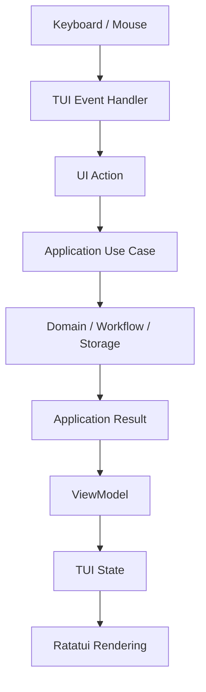

# BƯỚC 8 — TUI/CLI UI & UX DESIGN

**Dự án:** `novel-translate-cli`  
**Phiên bản:** Draft 0.1  
**Ngày:** 05/11/2026  
**Trạng thái:** Thiết kế đề xuất — chờ rà soát và phê duyệt  
**Căn cứ nghiệp vụ:** [TUI_CLI_SPEC.md](../spec/TUI_CLI_SPEC.md), [DESIGN_DECISIONS_36.md](../spec/DESIGN_DECISIONS_36.md) (quyết định 34–35), thiết kế kiến trúc Bước 1–7 và [trạng thái tác vụ ở Bước 7](WORKFLOW_STATE_MACHINE_STEP7.md).

> **Lưu ý phạm vi:** Đây là bản thiết kế UI/UX ở cấp cấu trúc màn hình, cách tương tác và wireframe minh họa. Các số liệu hiển thị trong wireframe là ví dụ, không phải dữ liệu thực. Kích thước chi tiết từng control, màu sắc, dialog và wireframe hoàn chỉnh cho cả hai breakpoint **chưa được phê duyệt**.
>
> **[ĐÃ CHỐT]** TUI có tám màn chính, dùng được hoàn toàn bằng bàn phím; CLI/TUI dùng chung Application Core; các phím dùng chung, quy tắc resize và lệnh CLI căn cứ [TUI_CLI_SPEC.md](../spec/TUI_CLI_SPEC.md). **[ĐỀ XUẤT]** Bố cục ba vùng, wireframe, cách nhóm panel/subview và phân rã thành component.

---

## 1. Mục tiêu thiết kế giao diện

TUI là giao diện chính để người dùng làm việc với các bộ light novel, còn CLI dành cho thao tác trực tiếp và tích hợp script.

| Mục tiêu | Yêu cầu |
|---|---|
| Dễ sử dụng | Người mới tìm được chức năng mà không phải nhớ toàn bộ lệnh |
| Dễ theo dõi | Luôn biết bộ, tập, chương, revision và tác vụ đang thao tác |
| Dễ kiểm soát | Tạm dừng, tiếp tục, sửa tay và xử lý điểm chờ minh bạch |
| Không mất dữ liệu | Chuyển màn, cuộn, đổi focus hoặc resize không làm mất trạng thái và bản soạn |
| Dễ mở rộng | Thêm panel, dialog, subview mà không cần viết lại navigation và Application Core |

**Mục tiêu của Bước 8:** Thiết kế trải nghiệm người dùng và cấu trúc kỹ thuật của TUI/CLI; không chỉ vẽ terminal đẹp mắt.

---

## 2. Tám màn hình chính đã chốt

**[ĐÃ CHỐT]** Giữ đúng tám màn theo đặc tả [TUI_CLI_SPEC.md](../spec/TUI_CLI_SPEC.md).

| STT | Tên màn | Nhiệm vụ |
|---:|---|---|
| 01 | **Dashboard — Tổng quan** | Bộ/tập, tiến độ, việc đang chờ, lối mở đúng vị trí |
| 02 | **Volumes & Chapters — Tập và chương** | Cây sách, phân loại, điều chỉnh ranh giới, chọn chương hoặc tự động đến hết |
| 03 | **Tasks — Tác vụ** | Hàng đợi, model/bước thực tế, ngân sách, chi phí, thời gian, tạm dừng/tiếp tục |
| 04 | **Japanese–Vietnamese Editor — Editor Nhật–Việt** | Nguyên tác, bản Việt, revision nền, sửa/lưu, lịch sử |
| 05 | **Reviewer** | Issue, bằng chứng, severity S0–S3, repair M1–M4 và mở editor đúng đoạn |
| 06 | **Skills & Context — Skills và ngữ cảnh** | Thuật ngữ, nhân vật, xưng hô, đề xuất chờ duyệt, duyệt nhiều mục |
| 07 | **Images & Export — Ảnh và xuất** | Ảnh chọn/thay, lỗi, bundle, preview và lịch sử EPUB xuất |
| 08 | **Settings, Reports & Help — Cấu hình, báo cáo và trợ giúp** | Kết nối, model, ngân sách, báo cáo, hướng dẫn theo ngữ cảnh |

**[ĐỀ XUẤT]** Research, chi tiết task, lịch sử revision, cấu hình provider… có thể là tab, panel, dialog hoặc subview bên trong tám màn. Không tự tạo màn chính thứ chín.

---

## 3. Bố cục tổng thể

**[ĐỀ XUẤT]** Giao diện có ba vùng ổn định:

1. **Header / Global Status** — Workspace, tập hiện tại, vai trò/model/bước của tác vụ AI thực sự đang hoạt động.
2. **Main Content** — Nội dung và panel của màn đang chọn.
3. **Footer / Contextual Shortcuts** — Phím tắt và thông báo theo focus.

### Wireframe khái niệm

```text
┌────────────────────────────────────────────────────────────┐
│ NOVEL TRANSLATE CLI                  Re:Zero · Volume 01   │
├────────────────────────────────────────────────────────────┤
│ AI: Review · Model: ... · Task A: Running · Chapter 03    │
├──────────────┬─────────────────────────────────────────────┤
│              │                                             │
│  Dashboard   │                                             │
│  Volumes     │                                             │
│  Tasks       │              MAIN CONTENT                   │
│  Editor      │                                             │
│  Reviewer    │                                             │
│  Skills      │                                             │
│  Export      │                                             │
│  Settings    │                                             │
│              │                                             │
├──────────────┴─────────────────────────────────────────────┤
│ Tab Focus  Enter Open  / Search  F1 Help  Esc Back        │
└────────────────────────────────────────────────────────────┘
```

Sơ đồ chỉ minh họa bố cục, không phải số ô terminal cuối cùng.

### 3.1. Responsive theo kích thước terminal

| Kích thước | Hành vi bắt buộc |
|---|---|
| **80×24 đến dưới 120 cột** | Hiển thị danh sách và chi tiết theo chiều dọc hoặc mở riêng, vẫn xem được mọi thông tin cần duyệt |
| **Từ 120 cột, cao ít nhất 24 dòng** | Màn phù hợp có thể dùng hai vùng cạnh nhau, không bắt tất cả màn chia đôi |
| **Nhỏ hơn 80 cột hoặc 24 dòng** | Thông báo kích thước chưa đủ; giữ lựa chọn, bản soạn và tác vụ; không hiển thị nút bị che |

Kích thước tính bằng **ô hiển thị terminal**, không phải pixel. Nội dung Nhật/Việt có dấu phải wrap/scroll phù hợp, không làm sai Unicode hoặc thay đổi nội dung nguồn để vừa khung. Khi resize phải giữ focus, filter, selection, scroll và draft.

### 3.2. Global status bar

- Luôn nhận diện đúng **tác vụ AI đang giữ quyền chạy**, kể cả khi người dùng xem hồ sơ tác vụ khác.
- Hiển thị vai trò, tên/ID model, bước hiện tại và trạng thái chờ phù hợp.
- Không để việc điều hướng, resize hoặc mở trợ giúp phát request AI.
- Ở màn hẹp có thể wrap/tóm lược nhãn nhưng không che mất danh tính model và bước đang hoạt động.

---

## 4. Thiết kế tám màn chính

### 4.1. Dashboard — Tổng quan

**Mục tiêu:** Người dùng biết ngay công việc đang chạy, phần đã hoàn tất và hành động tiếp theo.

```text
┌───────────────────────────────────────────────────────────┐
│ Dashboard                                  Re:Zero        │
├───────────────────────────────────────────────────────────┤
│                                                           │
│  SERIES OVERVIEW                                          │
│                                                           │
│  Current Volume : Volume 01                               │
│  Chapters       : 02 / 12 hoàn tất                        │
│  Current Task   : Review Chapter 03                       │
│  Waiting        : 04 glossary candidates                  │
│                                                           │
│  QUICK ACTIONS                                            │
│  [Open Volume]  [Continue Task]  [Review Issues]           │
│                                                           │
│  RECENT ACTIVITY                                          │
│  - Chapter 02: Passed                                     │
│  - Chapter 03: Review in progress                         │
│  - Skills: 4 candidates waiting                           │
│                                                           │
├───────────────────────────────────────────────────────────┤
│ Enter Select  Tab Focus  F1 Help                          │
└───────────────────────────────────────────────────────────┘
```

**Thông tin:** series/volume hiện hành; tiến độ theo nội dung; tác vụ thực tế; điểm chờ; hoạt động gần đây.  
**Hành động:** Mở tập, **＋ Nhập tập truyện**, tiếp tục tác vụ hợp lệ, mở issue/Skills đang chờ.  
**Ràng buộc:** Mở Dashboard không tự khởi động AI.

### 4.2. Volumes & Chapters — Tập và chương

**Mục tiêu:** Xem cây EPUB, sửa mapping/phân loại và quyết định phạm vi chạy.

```text
┌─────────────────────────┬────────────────────────────────┐
│ VOLUMES                 │ CHAPTER DETAILS                │
├─────────────────────────┼────────────────────────────────┤
│                         │                                │
│ ▼ Re:Zero               │ Chapter 03                     │
│   ▼ Volume 01           │                                │
│     ✓ Chapter 01        │ Source Blocks : 120            │
│     ✓ Chapter 02        │ Translation   : In Progress    │
│     ● Chapter 03        │ Review        : Pending        │
│     ○ Chapter 04        │                                │
│     ○ Chapter 05        │ Content Scope                  │
│                         │ ◉ Story                         │
│                         │ ○ All Text                      │
│                         │                                │
│                         │ [Translate Selected]           │
│                         │ [Translate to End]             │
├─────────────────────────┴────────────────────────────────┤
│ Enter Open  Space Select  / Search  f Filter              │
└──────────────────────────────────────────────────────────┘
```

**Cập nhật được duyệt 14/11/2026:** Trong workspace đã tạo/mở, Tổng quan và Tập và chương đều có nút **＋ Nhập tập truyện** khi trống lẫn có tập; cùng hành động, không thêm route. Tab/Enter hoặc chuột khi terminal hỗ trợ mở chooser gốc Windows; duyệt thư mục, chọn một `.epub`, Mở/OK để import cục bộ vào workspace gốc. Ứng dụng tự đăng ký Volume ID; không yêu cầu gõ path hay ID. Thành công hiện cây và focus tập mới; Esc/hủy hoặc lỗi trở lại workspace với dữ liệu/focus đúng, lỗi chooser có thử lại/hủy và không công bố nguồn dở dang. Resize hoặc đổi workspace khi chờ không áp kết quả nhầm workspace. Kiểm Unicode/khoảng trắng và file sai. Adapter thuộc P02-D06/T12; không cam kết Linux native.

**Phải phân biệt:** `Translate Selected` và `Translate to End`; chế độ `Story` và `All Text`; phần dịch và phần giữ nguyên. Phần giữ nguyên không tự được đánh dấu đã dịch/đạt Review. Chọn chương không tự gửi AI.

### 4.3. Tasks — Tác vụ

**Mục tiêu:** Điều khiển và quan sát một tác vụ AI đang hoạt động, những tác vụ khác đang chờ và ngân sách.

```text
┌──────────────────────────┬───────────────────────────────┐
│ TASK QUEUE               │ ACTIVE TASK                   │
├──────────────────────────┼───────────────────────────────┤
│                          │                               │
│ ● Task A — Running       │ Task: Translation Volume 01  │
│ ○ Task B — Queued        │                               │
│ ◐ Task C — Waiting User  │ Stage: Review                 │
│ ⏸ Task D — Paused        │ Chapter: 03                   │
│                          │ Model: ...                    │
│                          │                               │
│                          │ Progress                      │
│                          │ ███████░░░░░  58%            │
│                          │                               │
│                          │ Cost: ...                     │
│                          │ Time: ...                     │
│                          │ [Pause] [View Details]        │
├──────────────────────────┴───────────────────────────────┤
│ p Pause  r Resume  Enter Details  F1 Help                │
└──────────────────────────────────────────────────────────┘
```

**Lưu ý:** Thanh tiến độ mang tính minh họa; tiến độ thực tế dựa trên phạm vi nội dung và các bước hoàn tất hợp lệ, **không** dùng số model request làm tỉ lệ chất lượng. Task B đang chờ không được hiển thị nhầm như đang dùng model của A.

**Thông tin bắt buộc:** Role/model/step hiện tại; chương/phạm vi; budget/cost; thời gian, timeout/retry nếu có; lý do chờ; queue/permit.  
**Hành động:** Pause/resume theo guards, mở chi tiết task. Pause không đồng nghĩa provider đã hủy hoặc ngừng tính phí.

### 4.4. Japanese–Vietnamese Editor — Editor Nhật–Việt

**Mục tiêu:** Đọc và đối chiếu source, chỉnh bản Việt, theo dõi revision và bảo vệ sửa tay.

```text
┌────────────────────────────┬─────────────────────────────┐
│ JAPANESE SOURCE            │ VIETNAMESE TRANSLATION      │
├────────────────────────────┼─────────────────────────────┤
│                            │                             │
│ [Source Block B001]        │ [Revision r3]               │
│                            │                             │
│ 「……」                     │ “……”                         │
│                            │                             │
│ 原文の内容……               │ Nội dung bản dịch…          │
│                            │                             │
│                            │                             │
├────────────────────────────┴─────────────────────────────┤
│ Revision: r3 · Quality: Pending Review                    │
│ Ctrl+S Save Revision   Esc Back   F1 Help                 │
└──────────────────────────────────────────────────────────┘
```

- `Ctrl+S` tạo revision sửa tay mới, không overwrite history.
- Khi base revision thay đổi phải phát hiện conflict; không âm thầm ghi đè AI/User changes.
- Giữ vị trí issue/source range nếu mở từ Reviewer; khi quay lại không mất focus, filter, scroll hoặc bản soạn.
- Marker, source mapping và cấu trúc được bảo vệ.
- Ở 80×24, chuyển sang view dọc/tab thay vì ép hai cột quá hẹp.

### 4.5. Reviewer

**Mục tiêu:** Kiểm tra các lỗi với đầy đủ bằng chứng và đi đúng revision/phạm vi.

| Thành phần | Nội dung |
|---|---|
| Source Range | Vị trí nguyên tác |
| Translation Revision | Bản dịch chính xác được Review |
| Severity S0–S3 | Mức ảnh hưởng |
| Evidence | Trích dẫn nguồn/bản Việt và trạng thái kiểm chứng |
| Explanation | Lý do phát hiện vấn đề |
| Repair Scope M1–M4 | Phạm vi sửa đề xuất, căn cứ |
| Status | Chờ, cần xác minh, đã giải quyết hoặc ngoại lệ |

**Hành động:** Mở issue; xem nguyên tác/bản Việt/bằng chứng; mở đúng source range trong Editor; Review lại revision mới; xem lịch sử. Bố cục hẹp không được làm mất phần bằng chứng hay phạm vi sửa. Không tự biến issue thiếu căn cứ thành Review đạt.

### 4.6. Skills & Context — Skills và ngữ cảnh

**Mục tiêu:** Quản lý glossary, nhân vật, xưng hô, ngữ cảnh và duyệt các quyết định theo đúng phạm vi/phiên bản.

```text
┌─────────────────────────┬────────────────────────────────┐
│ PENDING DECISIONS       │ SELECTED CANDIDATE             │
├─────────────────────────┼────────────────────────────────┤
│                         │                                │
│ [x] Candidate 001       │ Original: ...                  │
│ [x] Candidate 002       │ Proposed Translation: ...     │
│ [ ] Candidate 003       │                                │
│ [ ] Candidate 004       │ Source Evidence: ...           │
│                         │                                │
│                         │ Scope: Chapter 03              │
│                         │                                │
│                         │ [Change Option]                │
│                         │ [Change Scope]                 │
│                         │                                │
├─────────────────────────┴────────────────────────────────┤
│ Selected: 2                                             │
│ [Confirm 2 Selected Decisions]                           │
└──────────────────────────────────────────────────────────┘
```

`Space` chỉ đánh dấu mục; chọn phương án và phạm vi chưa phải approval. Chỉ nút xác nhận mới gửi batch approval với đúng ID/version và các lựa chọn đang chọn. Nếu xung đột, giữ danh sách chọn và thông báo phần cần xử lý. Candidate AI không tự thành rule chính thức.

### 4.7. Images & Export — Ảnh và xuất

**Mục tiêu:** Xem ảnh nguồn/thay thế, lỗi kiểm tra, prepared bundle, Preview cục bộ và lịch sử file EPUB xuất.

| Thành phần | Nội dung |
|---|---|
| Image List | Ảnh gốc, ảnh thay, đường dẫn, hash và trạng thái |
| Export Readiness | Điều kiện đạt và các điểm chặn |
| Prepared Bundle | Generation/manifest và stale status |
| Preview | Mở trình duyệt cục bộ theo phiên có quyền |
| Export History | Các phiên bản EPUB đã xuất, hash/báo cáo |

Preview dùng trình duyệt cục bộ **chỉ cho bản chuẩn bị hợp lệ**, không mở toàn workspace và không biến hệ thống thành Web UI. Bản EPUB xuất dùng cùng prepared data, không tự gọi AI hoặc ghi đè bản cũ.

### 4.8. Settings, Reports & Help — Cấu hình, báo cáo và trợ giúp

**Nội dung:** Provider/kết nối; model theo Translation, Review và Research; capability/token limits; ngân sách; timeout/retry; workspace; báo cáo usage/cost/issues; hướng dẫn theo ngữ cảnh.

**Bảo mật:** API key không xuất hiện trong log, báo cáo hoặc task history. Trạng thái kết nối có thể hiển thị, nhưng không lộ secret.

---

## 5. Navigation & Interaction

### 5.1. Phím đã chốt

| Phím | Hành vi |
|---|---|
| `↑ ↓ ← →` | Di chuyển theo vùng đang focus; trong ô nhập là di chuyển con trỏ |
| `Tab` | Chuyển focus, vùng focus phải hiển thị rõ |
| `Enter` | Mở/kích hoạt; trong ô nhập nhiều dòng không tự duyệt toàn bộ form |
| `Space` | Chọn/bỏ chọn trong danh sách nhiều mục; trong ô nhập là ký tự dấu cách |
| `Esc` | Đóng lớp/quay lại một cấp, không tự xóa bản soạn hoặc hủy task |
| `F1` | Trợ giúp theo màn/ngữ cảnh |
| `/` | Tìm kiếm ngoài ô nhập |
| `f` | Lọc ngoài ô nhập |
| `e` | Mở Editor khi hợp lệ |
| `p` | Tạm dừng tác vụ khi hợp lệ |
| `r` | Tiếp tục tác vụ khi hợp lệ |
| `Ctrl+S` | Lưu revision sửa tay trong Editor |

Thanh footer chỉ hiện hành động thực sự có hiệu lực. Khi ô nhập có focus, phím gõ không được kích hoạt command phía sau.

### 5.2. Navigation State — đề xuất kỹ thuật

Mỗi màn giữ theo workspace/volume/document ID:
- Selected item và focus.
- Search query, filter, sort.
- Scroll position và detail panel.
- Draft đang nhập và base revision.
- Route/subview trước đó (để `Esc` trở về đúng vị trí).

Chuyển màn, resize, mở trợ giúp không tự thay đổi task/Review state hoặc tạo model request.

---

## 6. Kiến trúc TUI trong Rust



Đây là hướng triển khai **đề xuất**: framework Ratatui/Crossterm ở Bước 5 vẫn chưa được phê duyệt cuối cùng.

- `nt-tui` chỉ nhận sự kiện, tạo `Action`, quản lý UI State, hiển thị ViewModel và gọi Application contract.
- Không để màn trực tiếp truy vấn SQLite, đọc API key hoặc gọi AI SDK.
- CLI/TUI dùng chung quyền chạy, budget, approval và workflow.
- GUI sau này có thể là adapter Presentation khác, không sao chép core nghiệp vụ.

---

## 7. Phạm vi CLI được giữ nguyên

**[ĐÃ CHỐT]** Executable là `novel-translate-cli`; không tham số mở TUI. Các nhóm lệnh chính theo [TUI_CLI_SPEC.md](../spec/TUI_CLI_SPEC.md):

```text
novel-translate-cli workspace create <path>
novel-translate-cli workspace open <path>
novel-translate-cli import <epub> --volume <id>
novel-translate-cli scope set --volume <id> --content all-text|story
novel-translate-cli translate --volume <id> (--chapter <id> [--chapter <id> ...] | --to-end)
novel-translate-cli review --volume <id> --chapter <id>
novel-translate-cli issues --task <id>
novel-translate-cli terms list
novel-translate-cli terms confirm --file <json>
novel-translate-cli status [--task <id>]
novel-translate-cli pause <task-id>
novel-translate-cli resume <task-id>
novel-translate-cli check --volume <id>
novel-translate-cli preview --volume <id>
novel-translate-cli export --volume <id>
novel-translate-cli connection set <name> --key-env <env-name>
novel-translate-cli connection list
novel-translate-cli connection remove <name>
```

Các cờ toàn cục thích hợp: `--workspace`, `--json`, `--non-interactive`. Dịch có thể dùng `--cost-limit`, `--currency` hoặc `--unlimited-cost` theo đặc tả.

**CLI JSON:** `schema_version, command, state, task_id, scope, result, issues, next_action`. Machine-readable output ra stdout; chẩn đoán đã redaction ra stderr.

**Exit code đã chốt cho lệnh công việc:** `0` hoàn tất; `2` sai cấu hình/tham số; `3` lỗi vận hành; `4` chờ duyệt/xung đột; `5` chạm ngân sách/trần gọi; `6` đã xếp hàng/đang có tác vụ đó; `7` tạm dừng/chưa hoàn tất lý do khác. `status` trả 0 khi đọc thành công, trạng thái tác vụ nằm trong kết quả.

TUI và CLI không có đường tắt để bỏ qua approval, Review, ngân sách hoặc quyền Coordinator.

---

## 8. Tiêu chí nghiệm thu giao diện

| Tình huống | Kết quả cần đạt |
|---|---|
| Terminal 80×24 | Thao tác được toàn bộ chức năng đã chốt bằng bàn phím |
| Terminal ≥120 cột | Màn phù hợp có bố cục hai vùng |
| Resize khi đang nhập | Không mất draft, selection, filter hoặc scroll |
| Đọc tiếng Nhật/Việt | Không cắt hỏng Unicode/marker |
| Chuyển màn khi AI chạy | Không tạo model request mới |
| Mở Task B trong khi A chạy | Vẫn hiển thị đúng A/model đang giữ quyền |
| Lưu Editor | Tạo revision mới, bảo vệ revision nền |
| Duyệt nhiều thuật ngữ | Chỉ xác nhận mục đã đánh dấu/phiên bản tương ứng |
| Xem Review issue | Mở được revision, source range và bằng chứng |
| Tạm dừng | Không tuyên bố provider hủy nếu chưa có căn cứ |
| Preview | Chỉ phục vụ tài nguyên của prepared bundle hợp lệ |
| CLI và TUI | Chung điều kiện nghiệp vụ, ngân sách, quyền điều phối |
| Terminal nhỏ hơn 80×24 | Cảnh báo, không mất trạng thái hoặc tự hủy/chạy task |
| Mất hỗ trợ chuột | Vẫn thực hiện được toàn bộ quy trình |

**Kiểm thử:** Offline deterministic, mock provider, test bàn phím/terminal resize, không gọi API AI trả phí trong CI.

---

## 9. Đầu ra của Bước 8 và những phần còn cần hoàn thiện

Các tài liệu có thể tách sau khi bản thiết kế được duyệt:

| Tài liệu | Nội dung |
|---|---|
| `UI_UX_DESIGN.md` | Tổng quan và nguyên tắc giao diện |
| `TUI_SCREEN_SPEC.md` | Chi tiết tám màn |
| `TUI_NAVIGATION_SPEC.md` | Focus/keyboard/dialog/routing |
| `TUI_COMPONENT_CATALOG.md` | Danh mục component dùng chung |
| `TUI_STATE_MANAGEMENT.md` | UI State, ViewModel, Application Actions |
| `TUI_ACCEPTANCE_TESTS.md` | Test giao diện |

### [CÒN MỞ] trước khi phê duyệt UI cuối cùng

1. Wireframe chính xác cho **từng màn ở 80×24 và ≥120 cột**; bản này mới có wireframe minh họa tổng thể và một số màn ở chế độ rộng.
2. Kích thước/control, wrapping, scroll, virtualized list và thành phần UI dùng chung.
3. Color palette, contrast, focus/hover/selection states.
4. Dialog/confirmation, xử lý thay đổi chưa lưu, lỗi/xung đột.
5. Chi tiết trình tự UI Action → Application Query/Command → ViewModel cập nhật.
6. Preview session UX và thông báo stale/validation.
7. Tình huống IPC disconnected, task recovery và trạng thái không thể xác định.
8. Các acceptance scenarios cụ thể cho từng màn, không chỉ tiêu chí chung.

[Các gói giao diện ở Bước 9](IMPLEMENTATION_ROADMAP_STEP9.md#ui-work-packages) đặt CLI entrypoint và TUI shell ở Phase 01, rồi gắn từng thao tác với luồng nghiệp vụ của Phase 02–07. Phase 08 hoàn thiện tám màn và kiểm thử hợp đồng TUI/CLI. Khi viết task cho mỗi gói, dùng thiết kế màn tương ứng ở mục 4 và tiêu chí nghiệm thu ở mục 8 của tài liệu này.

---

## Kết luận

Bước 8 đặt nền tảng giao diện **TUI/CLI dùng chung Application Core**, đầy đủ bằng bàn phím, responsive theo terminal, có khả năng mở rộng về sau và bảo vệ dữ liệu/tác vụ trong mọi thao tác điều hướng. Tám màn đã chốt được giữ nguyên; wireframe và kiến trúc UI cụ thể là đề xuất cần rà soát.

**Trạng thái:** Draft 0.1 — chờ rà soát thiết kế UI/UX chi tiết.
