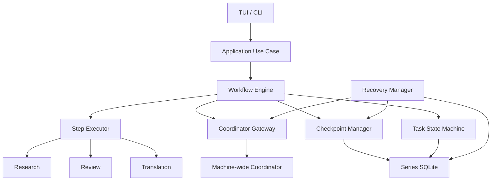
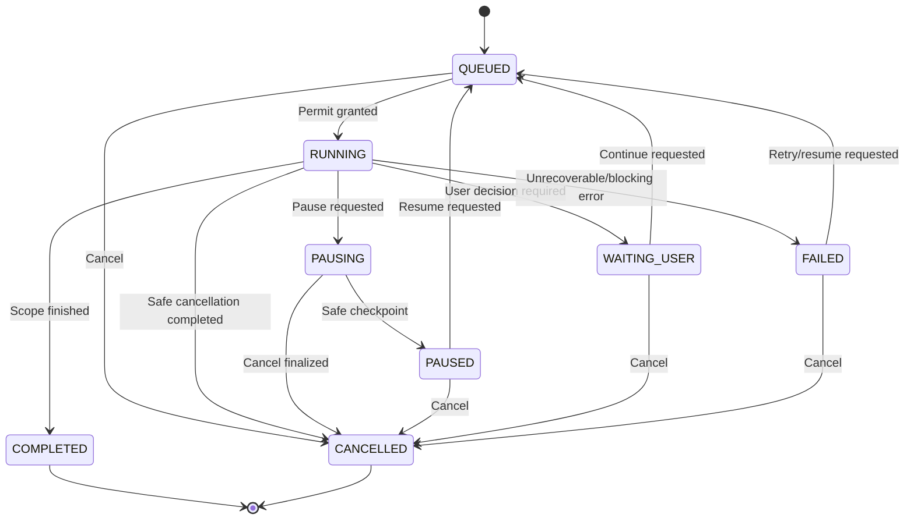
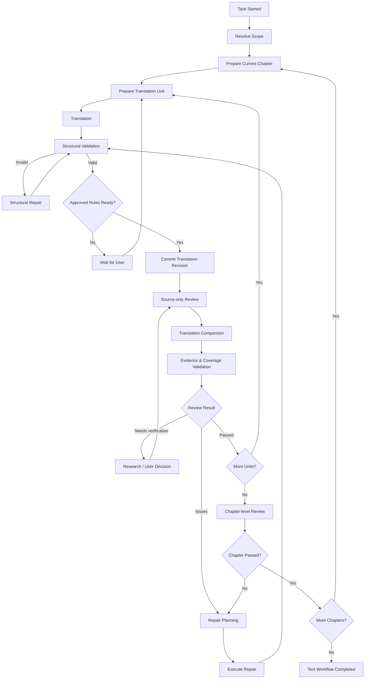
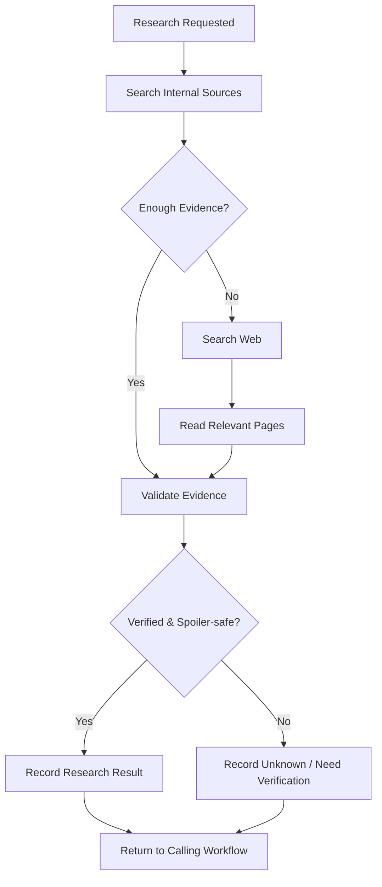
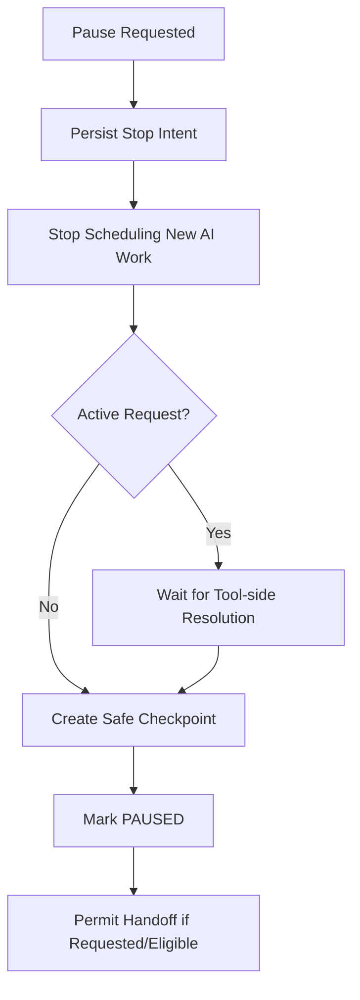
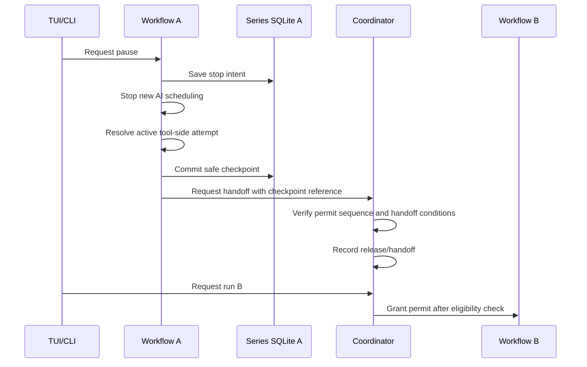

# BƯỚC 7 — WORKFLOW STATE MACHINE & RECOVERY DESIGN

**Dự án:** `novel-translate-cli`  
**Phiên bản:** Draft 0.1  
**Trạng thái:** Đề xuất thiết kế — chờ phê duyệt  
**Kiến trúc:** Modular Monolith · Rust · SQLite · Ports & Adapters  
**Nguồn căn cứ:** [WORKFLOW_ORCHESTRATION_SPEC.md](../spec/WORKFLOW_ORCHESTRATION_SPEC.md), [DATA_MODEL_STATE_SPEC.md](../spec/DATA_MODEL_STATE_SPEC.md), [DESIGN_DECISIONS_36.md](../spec/DESIGN_DECISIONS_36.md), [Bước 6 — Data Architecture](DATA_ARCHITECTURE_STEP6.md).

> Tài liệu này là bản Markdown của thiết kế Bước 7 đã trình bày trong hội thoại. Các tên enum, step, trait và quy trình kỹ thuật là đề xuất, không đồng nghĩa đã được phê duyệt triển khai.

---

## 1. Mục tiêu

Bước 7 thiết kế cách hệ thống **thực thi, theo dõi, tạm dừng, tiếp tục và phục hồi các tác vụ**.

Bước 6 đã xác định dữ liệu cần lưu trữ. Bước 7 sử dụng những cấu trúc đó để trả lời:

1. Một tác vụ có những trạng thái nào?
2. Khi nào được phép chuyển từ trạng thái này sang trạng thái khác?
3. Workflow Dịch–Review được điều phối như thế nào?
4. Làm sao bảo đảm không bỏ qua Review?
5. Khi nào Research được phép thực hiện?
6. Một yêu cầu tạm dừng ảnh hưởng thế nào đến request đang chạy?
7. Khi ứng dụng gặp sự cố, cần tiếp tục từ đâu?
8. Làm sao tránh gọi AI trùng hoặc công bố response quá hạn?
9. Coordinator bàn giao quyền chạy giữa hai tác vụ ra sao?
10. Làm sao mở rộng workflow trong tương lai mà không phá vỡ các quy tắc hiện tại?

**Mục tiêu cốt lõi:** Một tác vụ phải có thể tiếp tục từ trạng thái hợp lệ đã lưu gần nhất, thay vì bắt đầu lại toàn bộ quá trình.

---

## 2. Kiến trúc Workflow tổng thể

Đề xuất chia hệ thống điều phối thành năm thành phần:

| Thành phần | Trách nhiệm |
|---|---|
| `WorkflowEngine` | Xác định bước nghiệp vụ tiếp theo |
| `TaskStateMachine` | Kiểm soát chuyển trạng thái tác vụ |
| `CheckpointManager` | Lưu và khôi phục tiến độ |
| `CoordinatorGateway` | Xin, giữ và bàn giao quyền thực hiện AI |
| `RecoveryManager` | Đối chiếu dữ liệu sau sự cố |



`WorkflowEngine` điều phối, nhưng không tự triển khai logic dịch, Review hoặc Research. Các subsystem chuyên trách thực hiện nghiệp vụ và trả kết quả cho Workflow.

---

## 3. Phân biệt các loại trạng thái

Không tạo một enum khổng lồ trộn `TRANSLATING`, `REVIEW_PASSED`, `RETRYING`, `PAUSED`, `EXPORT_READY` vì những trạng thái ấy thuộc các khía cạnh khác nhau.

### 3.1. Task Execution State

| Trạng thái | Ý nghĩa |
|---|---|
| `QUEUED` | Đang chờ quyền chạy |
| `RUNNING` | Đang thực hiện tác vụ |
| `PAUSING` | Đã nhận yêu cầu tạm dừng |
| `PAUSED` | Đã lưu tiến độ và tạm dừng |
| `WAITING_USER` | Cần người dùng quyết định |
| `FAILED` | Không thể tiếp tục do lỗi hoặc giới hạn |
| `COMPLETED` | Hoàn tất phạm vi tác vụ |
| `CANCELLED` | Đã hủy phần công việc còn lại |

`PAUSING` không đồng nghĩa `PAUSED`. Một tác vụ đang gọi AI có thể cần chờ request kết thúc hoặc được xử lý tại phía ứng dụng trước khi tạm dừng an toàn.

### 3.2. Content Quality State

| Trạng thái | Ý nghĩa |
|---|---|
| `NOT_TRANSLATED` | Chưa có bản dịch |
| `PENDING_REVIEW` | Có revision chờ kiểm tra |
| `NEEDS_REPAIR` | Có lỗi cần sửa |
| `NEEDS_VERIFICATION` | Chưa đủ căn cứ |
| `PASSED` | Đã đạt điều kiện Review |
| `ACCEPTED_EXCEPTION` | Người dùng chủ động giữ ngoại lệ |

Chất lượng gắn với nội dung và revision, không phải tình trạng thực thi task.

### 3.3. Data Validity State

| Trạng thái | Ý nghĩa |
|---|---|
| `CURRENT` | Các dependency còn phù hợp |
| `RECHECK_REQUIRED` | Có căn cứ thay đổi, cần đánh giá lại |

Ví dụ:

```text
Translation Revision r2
    Quality: PASSED
    Validity: RECHECK_REQUIRED

Task
    Execution: PAUSED
```

Revision r2 từng đạt Review, nhưng glossary đã đổi nên phải kiểm tra lại, và tác vụ hiện đang tạm dừng. Ba sự thật này có thể đồng thời tồn tại.

---

## 4. Thiết kế Task State Machine

### 4.1. Sơ đồ trạng thái



Đây là mô hình đề xuất. `WAITING_USER → RUNNING` có thể đi qua `QUEUED` để bắt buộc kiểm tra quyền chạy.

### 4.2. Transition Guards

| Chuyển trạng thái | Điều kiện |
|---|---|
| `QUEUED → RUNNING` | Có permit; đủ quyền, ngân sách và dependency |
| `RUNNING → PAUSING` | Có yêu cầu tạm dừng |
| `PAUSING → PAUSED` | Không còn bước gửi AI đang được tool chủ động xử lý; checkpoint đã lưu |
| `PAUSED → QUEUED` | Người dùng yêu cầu tiếp tục |
| `RUNNING → WAITING_USER` | Có quyết định người dùng bắt buộc |
| `WAITING_USER → QUEUED` | Điều kiện chờ đã giải quyết và tác vụ được phép tiếp tục |
| `RUNNING → COMPLETED` | Toàn bộ phạm vi yêu cầu đã đạt điều kiện |
| `RUNNING → FAILED` | Lỗi/giới hạn ngăn tự động tiếp tục |
| `RUNNING → CANCELLED` | Hoàn tất xử lý ý định hủy và lưu trạng thái |

Không được thay trạng thái chỉ bằng cập nhật trực tiếp `execution_status`:

```text
Transition Request
    → Validate Current State
    → Validate Guards
    → Prepare State Changes
    → Commit State + Event + Checkpoint
    → Publish Updated State
```

Chuyển sai điều kiện phải bị từ chối kèm lý do.

---

## 5. Workflow Dịch–Review

### 5.1. Pipeline tổng thể



Sơ đồ thể hiện luồng thành công và các nhánh chính. Lỗi, retry, ngân sách, cancellation theo Task State Machine.

### 5.2. Workflow Steps đề xuất

| Mã | Step |
|---|---|
| WF-01 | `RESOLVE_SCOPE` |
| WF-02 | `PREPARE_CHAPTER` |
| WF-03 | `PREPARE_UNIT` |
| WF-04 | `TRANSLATE` |
| WF-05 | `VALIDATE_TRANSLATION` |
| WF-06 | `RESOLVE_CANDIDATES` |
| WF-07 | `COMMIT_REVISION` |
| WF-08 | `REVIEW_SOURCE` |
| WF-09 | `REVIEW_COMPARISON` |
| WF-10 | `VALIDATE_REVIEW` |
| WF-11 | `PLAN_REPAIR` |
| WF-12 | `EXECUTE_REPAIR` |
| WF-13 | `EVALUATE_UNIT` |
| WF-14 | `REVIEW_CHAPTER` |
| WF-15 | `EVALUATE_CHAPTER` |
| WF-16 | `ADVANCE_CHAPTER` |
| WF-17 | `COMPLETE_SCOPE` |

Các mã là đề xuất, không phải enum Rust đã chốt.

**Thứ tự bắt buộc:** Sau `COMMIT_REVISION` phải Review đúng revision; không chuyển thẳng sang lượt tiếp theo. Sau khi mọi lượt đạt cục bộ phải Review toàn chương; không tự báo chương đạt.

---

## 6. Thiết kế Workflow Review

### 6.1. Hai giai đoạn bắt buộc

**Giai đoạn 1 — Source-only Review:** AI chỉ nhận nguyên tác, ngữ cảnh nguồn đã xác minh và phạm vi/contract đọc nguồn. Không nhận bản dịch tiếng Việt đang được kiểm tra.

**Giai đoạn 2 — Translation Comparison:** AI nhận nguyên tác, revision đang xét, bằng chứng phù hợp và các quy tắc/phạm vi đã áp dụng để đối chiếu ý nghĩa và độ phủ.

### 6.2. Review Result

| Kết quả | Hành động |
|---|---|
| Passed | Đánh dấu đạt cho revision/phạm vi chính xác |
| Needs Repair | Tạo Repair Plan |
| Needs Verification | Bổ sung bằng chứng hoặc chờ người dùng |
| Structural Error | Sửa response trong giới hạn |
| Operational Error | Retry hoặc lưu lỗi theo chính sách |

Review chương phải tham chiếu tập hợp revision được kiểm tra:

```text
Chapter Review CR001
    ├── Unit 01 → Revision r3
    ├── Unit 02 → Revision r2
    ├── Unit 03 → Revision r1
    └── Coverage + Continuity Evidence
```

Nếu Unit 02 được sửa thành r3, kết luận CR001 không tự áp dụng cho tập hợp mới.

---

## 7. Repair Workflow

### 7.1. Phạm vi sửa đã chốt

| Mức | Phạm vi |
|---|---|
| M1 | Vá câu/cụm được định danh |
| M2 | Dịch lại đoạn |
| M3 | Dịch lại cảnh/nhóm đoạn liên quan |
| M4 | Dịch lại chương khi có đủ căn cứ đặc biệt |

Workflow không chọn M4 chỉ vì có nhiều lỗi; cần chứng minh sai lệch xuyên chương và kiểm chứng bổ sung theo đặc tả.

### 7.2. Repair State

```text
Issue Confirmed
    → Repair Plan Created
    → Repair Scope Validated
    → Repair Executed
    → New Revision Committed
    → Review New Revision
         ├── Passed
         └── Failed → Count Failed Round
```

Tối đa **5 vòng sửa chất lượng thất bại**. Tách Quality repair round, Network retry, Structural repair, Request attempt. Một vòng sửa có thể chứa nhiều request. Network retry không được tăng quality repair round; đóng ứng dụng/đổi model/chuyển task không xóa bộ đếm.

---

## 8. Research Subworkflow

Research không chạy bắt buộc sau mọi lượt dịch; chỉ chạy khi Translation, Review hoặc người dùng yêu cầu.



Research lưu Task, step đang chờ, question, dependency snapshot, ngân sách, giới hạn và bước tiếp tục. Thuật ngữ mới chỉ thành candidate, không tự thành approved rule. Research của task B không được chạy khi A đang giữ quyền chạy AI.

---

## 9. Checkpoint Design

### 9.1. Các mốc bắt buộc

1. Sau chuẩn bị công việc.
2. Trước gửi AI request.
3. Sau nhận đủ response.
4. Sau validation và commit.
5. Khi chuyển sang Review.
6. Khi chờ người dùng.
7. Khi retry.
8. Khi tạm dừng/hủy.
9. Khi hoàn tất.

### 9.2. Nội dung checkpoint

| Nhóm | Dữ liệu |
|---|---|
| Identity | `checkpoint_id`, `task_id` |
| Workflow | Version, current step, next step |
| Scope | Volume, chapter, source range, unit cursor |
| Source | Snapshot ID, mapping version |
| Dependencies | Rule/context version set |
| Translation | Current revision IDs |
| Review | Review run, issue/repair IDs |
| Model | Request ID, attempt ID, role/model |
| Retry | Counter, next retry timestamp |
| Budget | Snapshot, usage, reservations |
| Coordinator | Permit sequence, handoff reference |
| State | Execution state, wait reason |
| Persistence | Base/committed generation |
| Time | Created timestamp |

Không cần sao chép mọi dữ liệu vào mỗi checkpoint; có thể tham chiếu bản ghi bất biến bằng ID/version.

### 9.3. Yêu cầu phục hồi

Checkpoint phải trả lời: bước hoàn thành/chưa hoàn thành; response đã lưu nhưng chưa kiểm tra; revision đã commit; quyết định chờ; trạng thái gửi attempt; và liệu có thể tiếp tục mà không gọi lại AI hay không.

---

## 10. Model Request Lifecycle

Logical request có thể có nhiều attempt theo retry policy.

### 10.1. Attempt States

| State | Ý nghĩa |
|---|---|
| `PREPARED` | Có intent, chưa xác nhận gửi |
| `SENT` | Có bằng chứng tool đã thực hiện gửi |
| `UNCERTAIN` | Không rõ provider đã xử lý hay chưa |
| `COMPLETED` | Nhận đủ kết quả |
| `FAILED` | Lỗi xác định |
| `TIMED_OUT` | Quá thời hạn phía tool |
| `CANCELLED` | Tool kết thúc/hủy xử lý attempt |

`CANCELLED`/`TIMED_OUT` không chứng minh provider ngừng xử lý hoặc không tính phí.

### 10.2. Quy trình gửi

```text
Validate Preconditions
    → Reserve Budget
    → Persist Request Intent
    → Persist Attempt Record
    → Dispatch Provider Request
    → Record Response / Error / Uncertain
    → Validate Current Versions
    → Commit Eligible Result
```

Trước gửi: kiểm tra permit, stop intent, source/mapping/rules, approval, token/cost budget, call cap và kết quả có thể tái dùng.

### 10.3. Khoảng không chắc chắn

SQLite và dịch vụ AI không có transaction chung. Nếu tool crash sau ghi intent và bắt đầu gửi mạng, không thể xác định chỉ từ `SENT` rằng provider đã nhận hay chưa. Khi phục hồi, giữ attempt cần đối chiếu, không tự retry và không xóa dự phòng; khả năng đối chiếu phụ thuộc provider.

---

## 11. Retry Policy

| Cơ chế | Chính sách |
|---|---|
| Request timeout | Mặc định 10 phút |
| Network/service retry | Tối đa 2 lần sau lần gửi đầu, cùng model và chỉ khi xác định lỗi tạm thời |
| Retry delay | Mặc định 10 và 30 giây, tôn trọng thời gian chờ dài hơn do provider yêu cầu |
| Structural repair | Tối đa 2 lượt |
| Quality repair | Tối đa 5 vòng thất bại |
| Model fallback | Không tự động |

### 11.1. Retry không xóa checkpoint

```text
Attempt 1 → Temporary Error
Checkpoint:
    request_id = R001
    attempts_used = 1
    retry_after = T + 10s
    task_state = RUNNING
    current_step = RETRY_WAIT
```

`RETRY_WAIT` là bước con trong `RUNNING`. Khi khởi động lại, giữ bộ đếm và tính thời gian chờ còn lại. Trước khi gửi retry, dùng kết quả đầy đủ của attempt trước nếu kết quả đã về và còn đủ điều kiện công bố theo [Quyết định 19](../spec/DESIGN_DECISIONS_36.md#decision-19).

### 11.2. Không chạy task khác trong thời gian chờ retry

Task A vẫn giữ permit qua retry wait. B không được chạy AI tự động. Muốn chuyển phải tạm dừng và bàn giao an toàn.

---

## 12. Pause, Resume & Cancel

### 12.1. Pause



Pause không đồng nghĩa lập tức hủy request phía provider.

### 12.2. Resume

1. Đọc task/checkpoint.
2. Xác minh workspace và schema.
3. Kiểm tra source/mapping/rules.
4. Khôi phục usage, budget, counters.
5. Đối chiếu request/attempt chưa rõ.
6. Xin permit Coordinator.
7. Xác định bước còn thiếu.
8. Chỉ gửi AI nếu đủ điều kiện.

| Dữ liệu có sẵn | Resume |
|---|---|
| Response đã lưu, chưa validation | Tiếp tục validation |
| Revision đã commit, chưa Review | Review đúng revision |
| Review cục bộ đạt | Chuẩn bị lượt tiếp |
| Tất cả lượt đạt, chưa Review chương | Review chương |
| Thiếu quyết định thuật ngữ | Chờ approval |
| Retry chưa đến hạn | Chờ phần thời gian còn lại |
| Attempt chưa rõ | Đối chiếu, không tự retry |

### 12.3. Cancel

Dừng phần công việc còn lại nhưng giữ revision, attempt, usage, chi phí, quyết định và lịch sử. Không cam kết hủy được request phía provider.

---

## 13. Machine-wide Coordinator

**[ĐÃ CHỐT]** Mỗi hồ sơ người dùng trên máy có một bộ điều phối chung cho TUI, CLI và các workspace. Mỗi thời điểm chỉ một tác vụ giữ quyền AI. [Quyết định 28](../spec/DESIGN_DECISIONS_36.md#decision-28)

### 13.1. Hai lớp điều phối

- **Task Scheduler**: bước bên trong một task.
- **Machine-wide Coordinator**: task nào được quyền gửi AI.

```text
Machine-wide Coordinator
    ├── Task A ← Active Permit
    │     ├── Translate
    │     ├── Review
    │     ├── Research
    │     └── Repair
    ├── Task B ← Queued
    └── Task C ← Queued
```

Chuyển từ Translation sang Review không trả permit của A.

### 13.2. Handoff từ A sang B



Đây là luồng logic; giao thức IPC/transaction còn mở. Hai SQLite không có distributed transaction nguyên tử, phải dùng IDs, durable intent/ack, permit sequence và reconciliation. Không cấp B khi A chưa dừng gửi AI ở phía tool và chưa bàn giao hợp lệ.

### 13.3. B phải thực sự độc lập

B không được phụ thuộc dữ liệu chưa xác nhận của A hoặc xung đột phạm vi ghi. Hai bộ riêng có thể độc lập, nhưng hai task cùng bộ/cùng quy tắc đang tranh chấp thì không mặc nhiên độc lập.

---

## 14. Recovery Manager

### 14.1. Recovery Stages

```text
Application Restart
    → Acquire Required Locks
    → Validate Database Integrity
    → Read Current Generation
    → Read Pending Operations
    → Reconcile Coordinator
    → Reconcile Attempts & Reservations
    → Reconcile Files & Markdown
    → Revalidate Dependencies
    → Determine Safe Next Step
    → Ready for User / Authorized Resume
```

Phục hồi trạng thái không đồng nghĩa tự gửi AI. Phải giữ khác biệt giữa task được yêu cầu chạy, chủ động paused và waiting user.

### 14.2. Recovery Matrix

| Tình huống | Xử lý |
|---|---|
| Crash trước commit revision | Không công bố |
| Crash sau commit trước dựng Markdown | Dựng lại, bảo vệ sửa tay |
| Crash sau gửi AI chưa rõ response | Attempt `UNCERTAIN`, đối chiếu |
| Crash sau lưu response trước validation | Tiếp tục validation |
| Crash sau Review cục bộ | Tiếp tục đúng lượt/chương |
| Crash trong Skill approval | Đối chiếu publish intent/base/target hash |
| Crash khi handoff | Reconcile Series/Coordinator trước cấp permit |
| Crash khi dựng EPUB | Kiểm tra temp/manifest/validation |
| Crash sau publish EPUB trước ghi history | Đối chiếu path/hash/version, không overwrite |

### 14.3. Idempotent recovery

Recovery chạy lặp trên cùng trạng thái không được tạo thêm revision, approval, export version hoặc request trái ý định. Side effect cần operation ID, version check và idempotency policy. Không suy rằng provider bảo đảm exactly-once.

---

## 15. Late Response Handling

Kịch bản: A001 timeout; retry A002 hoàn thành, r2 được công bố; response A001 đến muộn.

```text
Late Response
    → Identify Request + Attempt
    → Store Attempt History / Usage
    → Check Publication Eligibility
         ├── Current attempt?
         ├── Matching base generation?
         ├── Matching dependencies?
         ├── Valid permit/fencing context?
         └── No result already published for logical work?
    → Not eligible: Keep historical result only
```

**Lưu response** khác với **công bố thành current revision**. Response cũ vẫn có thể lưu cho audit/usage nhưng không tự ghi đè revision mới.

---

## 16. Workflow Events

| Event | Ý nghĩa |
|---|---|
| `TaskCreated` | Task được tạo |
| `TaskQueued` | Task vào hàng đợi |
| `PermitGranted` | Cấp quyền |
| `StepPrepared` | Chuẩn bị bước |
| `AttemptIntentRecorded` | Lưu ý định gửi |
| `AttemptCompleted` | Attempt hoàn tất |
| `RevisionCommitted` | Công bố revision |
| `ReviewCompleted` | Review hoàn tất |
| `UserDecisionRequired` | Chờ người dùng |
| `DependencyInvalidated` | Căn cứ đổi |
| `TaskPauseRequested` | Yêu cầu pause |
| `TaskPaused` | Task dừng an toàn |
| `TaskResumed` | Tiếp tục |
| `TaskCompleted` | Hoàn tất phạm vi |

Event phục vụ audit và giao diện; không cần Event Sourcing framework tổng quát. Current State và Generation tiếp tục là nguồn sự thật.

---

## 17. Khả năng mở rộng Workflow

### Stable Workflow Core

Giữ Task lifecycle; Checkpoint; Generation/revision publication; Dependency validation; Budget/attempt accounting; Coordinator permit; Recovery protocol.

### Replaceable Strategies

Có thể thay có kiểm soát: Translation chunk planner, context selection, Review strategy trong giới hạn nghiệp vụ, Research search, provider adapters, output validators.

### Workflow Extensions trong tương lai

Ví dụ: bước kiểm tra văn phong, kiểm tra thuật ngữ tự động, phương pháp Review mới, xử lý định dạng đầu ra, GUI.

Thay đổi phải:
1. Xác định nghiệp vụ mới.
2. Đánh giá state machine.
3. Version workflow nếu cần.
4. Tương thích checkpoint cũ.
5. Migration/recovery mapping.
6. Regression tests.

Không tùy tiện chèn bước phá thứ tự Dịch–Review; không cần workflow DSL/plugin engine tổng quát ở v1.

---

## 18. Kế hoạch kiểm thử

| ID | Tình huống | Mong đợi |
|---|---|---|
| WF-T01 | Translation commit revision | Review đúng revision |
| WF-T02 | Review cục bộ chưa đạt | Không dịch lượt tiếp |
| WF-T03 | Mọi lượt đạt chưa Review chương | Không chuyển chương |
| WF-T04 | Review chương đạt | Chuyển đúng chương |
| WF-T05 | Thuật ngữ chưa duyệt | Chờ người dùng |
| WF-T06 | Research thiếu bằng chứng | Không đoán kết luận |
| WF-T07 | Network retry | Không tăng quality repair round |
| WF-T08 | Hết 5 vòng sửa thất bại | Chuyển người dùng |
| WF-T09 | Pause lúc AI chạy | Không cấp B quá sớm |
| WF-T10 | Resume từ revision đã commit | Không dịch lại |
| WF-T11 | Crash sau lưu response | Tiếp tục validation |
| WF-T12 | Crash trước xác nhận gửi | Không tự retry attempt chưa rõ |
| WF-T13 | Late response | Không ghi đè revision hiện hành |
| WF-T14 | Glossary đổi sau Review | Revalidate dependency |
| WF-T15 | Coordinator crash trong handoff | Không cấp hai permit |
| WF-T16 | Hai CLI yêu cầu cùng task | Không thực thi trùng |
| WF-T17 | Resume trong retry wait | Giữ counter và thời gian còn lại |
| WF-T18 | Cancel task | Giữ revision, usage, history |
| WF-T19 | Tự động đến hết EPUB | Không yêu cầu chọn từng chương |
| WF-T20 | Hoàn tất nhóm chương | Không coi toàn EPUB đã xong |

Test dùng mock provider, controllable clock, offline deterministic; không gọi API trả phí trong CI.

---

## 19. Những quyết định còn mở

| ID | Vấn đề | Cần giải quyết |
|---|---|---|
| W7-01 | Workflow Step Representation | Enum, typed state hay versioned |
| W7-02 | Workflow Versioning | Checkpoint version cũ |
| W7-03 | Checkpoint Granularity | Độ chi tiết/tần suất |
| W7-04 | Attempt Dispatch Protocol | Intent ↔ gửi mạng |
| W7-05 | Late Response Fencing | Điều kiện công bố |
| W7-06 | Coordinator Handoff | Intent/ack/release |
| W7-07 | Coordinator Crash Recovery | Quyền tiếp quản/reconciliation |
| W7-08 | Retry Classification | Lỗi tạm thời/uncertain/fatal |
| W7-09 | Cancellation Semantics | Tool/transport/provider |
| W7-10 | Repair State Representation | Plan/round/attempt |
| W7-11 | Dependency Revalidation | Thời điểm/phạm vi |
| W7-12 | Event Schema | Version/payload/retention |
| W7-13 | Recovery Failure Policy | Chặn/cho xử lý thủ công |
| W7-14 | Testing Strategy | Fault injection/crash/deterministic time |

Không tự chốt những vấn đề này chỉ vì đã vẽ state machine.

---

## 20. Tiêu chí nghiệm thu Bước 7

- [ ] Task State Machine đủ transitions/guards.
- [ ] Ba trục trạng thái độc lập.
- [ ] Dịch–Review đúng thứ tự nghiệp vụ.
- [ ] Source-only và translation comparison được phân biệt.
- [ ] Repair M1–M4 và giới hạn vòng sửa đúng đặc tả.
- [ ] Research chỉ chạy khi được yêu cầu.
- [ ] Checkpoint đủ phục hồi.
- [ ] Request/Attempt có vòng đời riêng.
- [ ] Budget/retry/call cap không reset khi resume.
- [ ] Pause/Resume/Cancel có semantics rõ.
- [ ] Coordinator không cấp hai permit hợp lệ.
- [ ] Handoff/recovery protocol được chốt.
- [ ] Late response không ghi đè revision mới.
- [ ] Generation/checkpoint commit nhất quán.
- [ ] Acceptance tests tại crash boundaries.
- [ ] Workflow tiến hóa bằng version/migration có kiểm soát.

---

## 21. Đầu ra thiết kế dự kiến

| Tài liệu | Nội dung |
|---|---|
| `WORKFLOW_STATE_MACHINE.md` | State machine, transitions, guards |
| `WORKFLOW_EXECUTION.md` | Dịch–Review–Repair–Research |
| `CHECKPOINT_RECOVERY.md` | Checkpoint/crash recovery |
| `COORDINATOR_PROTOCOL.md` | Permit/handoff/reconciliation |
| `MODEL_ATTEMPT_LIFECYCLE.md` | Request/retry/timeout/late response |
| `WORKFLOW_TEST_PLAN.md` | Acceptance/fault injection |

Ở giai đoạn này có thể giữ trong một tài liệu Bước 7, sau đó tách khi cần.

---

## Kết luận

Bước 7 xác định hợp đồng vận hành của quá trình dịch: điều kiện bắt đầu, chuyển bước, dữ liệu cần lưu, khả năng dùng lại sau gián đoạn, lý do chờ người dùng, quyền chạy AI và điều kiện công bố kết quả.

Đóng ứng dụng, chuyển tác vụ, sửa glossary hoặc lỗi mạng không được khiến hệ thống xóa lịch sử hay tự chạy lại những phần hợp lệ đã hoàn thành.

[Bước 8](UI_UX_DESIGN_STEP8.md) dùng các trạng thái này để hiển thị tác vụ. [Bước 9](IMPLEMENTATION_ROADMAP_STEP9.md) phân kỳ luồng giả lập ở Phase 04, điều phối và phục hồi ở Phase 05, rồi hoàn thiện workflow ở Phase 06.

**Trạng thái: Draft 0.1 — chờ rà soát/phê duyệt.**
